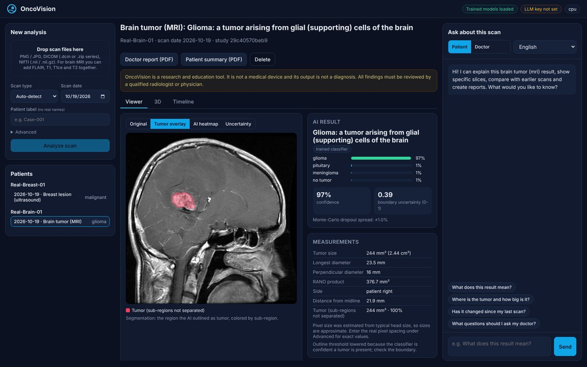
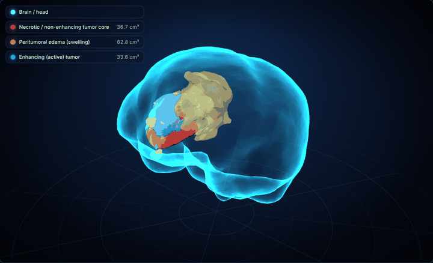
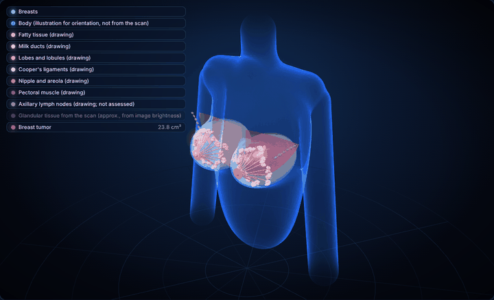
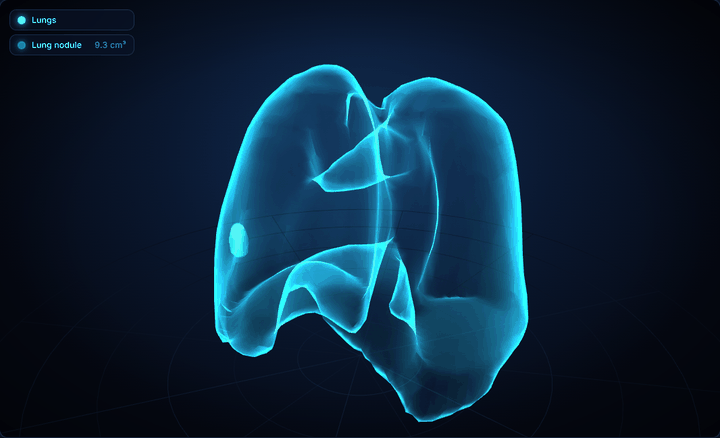
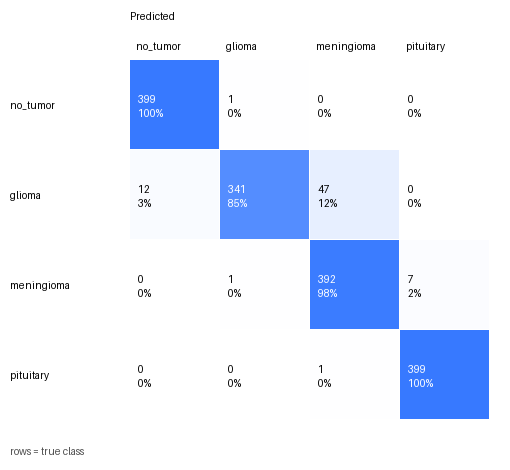
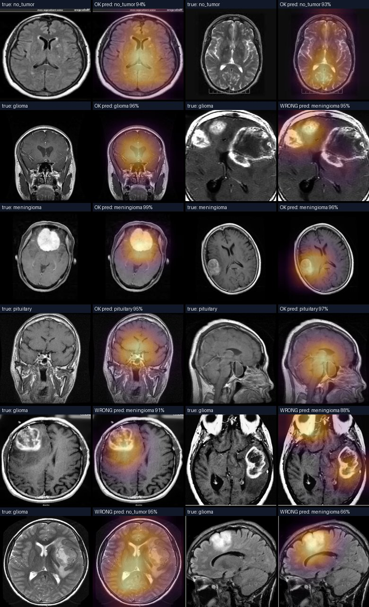
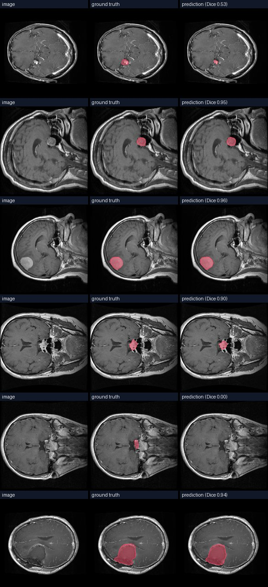
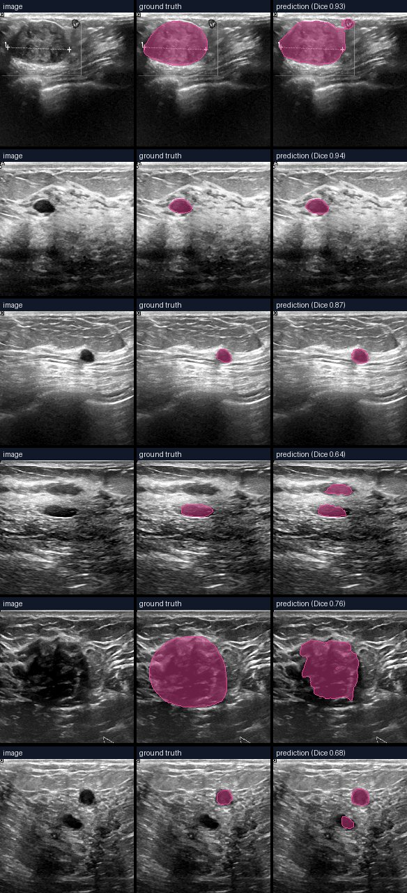
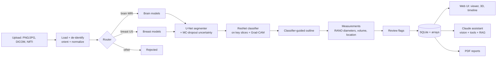

# OncoVision

**AI-assisted tumor detection, segmentation and explanation for medical scans, with an LLM assistant you can ask questions.**



OncoVision takes a brain MRI or breast ultrasound scan and:

1. **Detects the scan type** automatically and rejects images it doesn't support.
2. **Classifies** it: glioma / meningioma / pituitary tumor / no tumor for brain MRI, and normal / benign / malignant for breast ultrasound, with a confidence score.
3. **Outlines the tumor**, and for **3D MRI** (all four sequences: FLAIR, T1, T1ce, T2) it uses a **true 3D U-Net** that separates the necrotic core, edema and active (enhancing) tumor in 3D.
4. **Measures** it: area or volume, RANO-style longest and perpendicular diameters, side, approximate brain region, depth from the skin for ultrasound.
5. **Explains itself**: Grad-CAM heatmaps show what the classifier looked at, and Monte-Carlo dropout uncertainty maps show where the model is unsure. Uncertain or contradictory results are **flagged for expert review**.
6. **Interactive viewer**: zoom, pan, scroll through slices, brightness/contrast, overlay opacity, a ruler in mm, fullscreen, and a **3D view** of the tumor parts you can rotate.
7. **Tracks change over time** across a patient's scans, with simplified RANO / RECIST response categories.
8. **Answers questions** through a Claude-powered assistant that sees the scan, can open other slices, compare scans, and look up facts in a curated medical knowledge base with cited sources. It has a **doctor mode** and a **patient mode**, and answers in **12 languages** (including Hindi, Tamil, Telugu, Kannada, Malayalam, Marathi and Bengali).
9. **Writes PDF reports**: a radiology-style report for doctors or a plain-language summary for patients.
10. **Protects privacy**: DICOM headers (names, IDs, dates, institutions, private tags) are stripped on upload. Only pixel data and a patient *label* you choose are stored.

> ⚠️ **OncoVision is a research and education project, not a medical device.** Its output is not a diagnosis and must be reviewed by a qualified clinician.

---

## Quick start

Requires **Python 3.10+**. No GPU is needed: trained models are included and run on a normal laptop CPU in about a second per image.

**Windows:** double-click `run.bat`. **macOS / Linux:** run `./run.sh`.

The first run creates a virtual environment, installs everything, and starts the app at **http://localhost:8000**. To enable the chat assistant and AI-written reports, put an Anthropic API key in the `.env` file and restart. Everything else works without one.

No scans at hand? The start page has **one-click sample cards** (brain MRI, breast ultrasound and MRI, lung CT; real patients the models never trained on).

<details>
<summary>Manual setup / Docker</summary>

```bash
git clone https://github.com/Vaishnavi220506/Medical.git oncovision
cd oncovision
python -m venv .venv
# Windows: .venv\Scripts\activate      macOS/Linux: source .venv/bin/activate
pip install torch torchvision --index-url https://download.pytorch.org/whl/cpu   # or the CUDA build with an NVIDIA GPU
pip install -r requirements.txt
cp .env.example .env               # choose an LLM provider in .env (optional)
uvicorn oncovision.api.main:app
```

Or `docker compose up --build`.

### LLM providers

The assistant supports both Claude and local Ollama. Each contributor can choose independently in `.env`:

```env
# Cloud Claude (requires ANTHROPIC_API_KEY)
ONCOVISION_LLM_PROVIDER=anthropic

# Or free/local Ollama (requires Ollama plus the model installed locally)
ONCOVISION_LLM_PROVIDER=ollama
ONCOVISION_OLLAMA_MODEL=llama3.2:3b
ONCOVISION_OLLAMA_VISION=false
```

For Ollama, install the model once with `ollama pull llama3.2:3b` and keep the Ollama app running. The model must support tool calling (llama3.2, qwen2.5 and mistral do). Text-only models work from the written scan findings; set `ONCOVISION_OLLAMA_VISION=true` only for a vision model that also supports tools (for example `qwen2.5vl`), and it will also see the scan images. Both the chat and the PDF report text use the chosen provider; if the LLM is unavailable, the report falls back to a fixed template. Small local models are much weaker than Claude at medical explanations, so check their answers. The rest of the app works regardless of provider.
</details>

**Try it:** upload any brain MRI or breast ultrasound image (JPG, PNG, DICOM or NIfTI). For real **3D brain MRI**, use the scans in [`samples/brain_mri_3d/`](samples/README.md): drag the four files of one patient in together, then open the **3D** tab. A single 2D image also gets an *estimated* 3D preview in the 3D tab: its depth is guessed from the outline, so it is marked as a preview and shows no volumes. For a 3D and over-time demo, run `python scripts/make_demo_data.py`, upload the four `demo_data/brain_t0_*.nii.gz` files together with patient label `Demo-001`, then the `brain_t1_*` files with the same label and a later date. Those are synthetic phantoms, which the brain models were not trained on, so treat their results as a software demo only.

---

## Results

All numbers are on **held-out real scans the models never trained on**, split by patient where patient IDs exist. They come from `scripts/validate_app.py` and `python -m oncovision.training.evaluate`; raw numbers are in [docs/results/app_validation.json](docs/results/app_validation.json).

### Whole app, end to end (automatic scan-type detection → outline → classification → review flags)

| | Brain MRI | Breast ultrasound | Lung CT | Unsupported (chest / bone X-rays) |
|---|---|---|---|---|
| Scans tested | 400 | 117 | 20 whole 3D CTs (27 nodules) | 120 |
| Scan type recognised | **100%** | **100%** | **100%** | **100% rejected** |
| Correct diagnosis | **95.0%** | **85.5%** | largest nodule found in **8 of 10** patients with nodules (experimental) | – |
| Tumor outlined | 63.3% | 92.8% | 56% of all nodules | – |
| Normal scans wrongly outlined | **1%** | 15% | about 1 false spot per CT; 6 of 10 nodule-free CTs called clear | – |
| Flagged for expert review | 40% | 22% | 100% (always, experimental) | – |
| Time per image (4-core CPU) | 1.1 s | 1.5 s | 1–3 min per CT (seconds on a GPU) | – |

With the retrained models, compared with the previous ones on the same images: brain tumors outlined 63.3% (was 55.7%), breast normal images wrongly outlined 15% (was 20%), breast diagnosis 85.5% (was 84.6%), and fewer results flagged for review (brain 40% vs 45%, breast 22% vs 30%). Results vary by a few images between runs because of Monte-Carlo dropout.

### 3D brain tumor model (BraTS 2023, whole 3D volumes)

A 3D U-Net trained on 1,183 BraTS 2023 glioma scans with all four MRI sequences (on a free Kaggle GPU, [`notebooks/train_3d_brats.ipynb`](notebooks/train_3d_brats.ipynb)). Tested through the app itself on **24 scans from 20 patients the model never saw**:

| Tumor part | Dice (mean) |
|---|---|
| Whole tumor (incl. edema) | **0.88** (median 0.95) |
| Tumor core | **0.89** |
| Enhancing (active) tumor | **0.86** |
| Tumor volume error | **6% median** |

For comparison, strong published BraTS methods reach roughly 0.90-0.93 / 0.85-0.90 / 0.80-0.88 on the official BraTS test sets, which differ from ours. It runs in about 30 s per scan on a laptop CPU. It also works with fewer sequences (held-out Dice: T1ce only 0.91, FLAIR only 0.90, T2 only 0.84), so any 3D volume whose MRI sequence is named (by file name or in the upload form) uses it. For these scans the 3D model, not the 2D classifier, decides whether a tumor is present: the 2D classifier was trained on slices with the skull visible and is unreliable on skull-stripped research volumes. The 3D model was trained on gliomas only, so it reports "brain tumor detected" with its sub-regions and does not claim a tumor type.

### Interactive 3D

**[▶ Open the live 3D demo](https://vaishnavi220506.github.io/Medical/docs/demo/)**: held-out patients for brain MRI, breast MRI and lung CT. Rotate, zoom and hover over the organ or the tumor for plain-language explanations: what each tumor part is, which area you are on, what it does and how far the tumor is.

| Brain MRI (BraTS 2023) | Breast MRI (MAMA-MIA, Duke) | Lung CT (LIDC-IDRI) |
|---|---|---|
|  |  |  |
| Necrotic core, edema and active tumor, outlined from four MRI sequences | The patient's tumor (glowing; right breast) placed in drawn breast anatomy: fat, milk ducts, lobules, Cooper's ligaments, nipple, pectoral muscle and axillary lymph nodes, each with a hover explanation. The spot in the left breast (9.6 cm³) is a false alarm by the model | The nodule the model found (orange, 2.7 cm, right lung), with no false alarms |

### Individual models

| Model | Data (held-out set) | Result |
|---|---|---|
| Brain tumor type, ResNet-18 | 1,600 test MRIs (Masoud Nickparvar dataset) | **95.7% accuracy**, macro-F1 0.956. No tumor 99.8% recall, pituitary 99.8%, meningioma 98%, glioma 85% (mostly confused with meningioma) |
| Brain tumor outline, U-Net | 542 slices from held-out Figshare patients; 240 slices (all views, T1ce / FLAIR / T2) from held-out BraTS patients | **Dice 0.68** (Figshare), **0.67** (BraTS; previous Figshare-only model 0.17); in the app, false outlines on 1% of normal MRIs |
| Breast lesion type, ResNet-18 | 508 held-out images from 3 datasets (BUSI, BUS-BRA, BUS-UCLM; patient-disjoint) | **84.5% accuracy**, macro-F1 0.84. Per dataset: BUSI 88%, BUS-BRA 87% (malignant recall 91%; BUSI-only model: 54% / 23%), BUS-UCLM 77% (malignant recall 52%; BUSI-only model: 5%) |
| Breast lesion outline, U-Net | same held-out images, in the full app | **Dice 0.68** BUSI, **0.86** BUS-BRA, 0.38 BUS-UCLM; normal images wrongly outlined 10–15% (BUSI), 11% (BUS-UCLM) |
| Breast tumor on MRI, 3D U-Net | 100 held-out MAMA-MIA patients (DCE-MRI) | **Dice 0.62**; in the full app on 30 of them: main tumor found in **29/30 (97%)**, Dice 0.54, about 1.6 false spots per scan |
| Breast tumor on MRI, 2D U-Net (single slices) | slices of the same held-out patients | **Dice 0.53** |
| Scan-type router | brain MRI / breast ultrasound / breast MRI / lung CT / other | held-out: breast MRI volumes 30/30, brain 124/124, breast ultrasound 150/150, lung CT 28/28, other images rejected 120/120 |
| 3D brain tumor U-Net | 24 held-out BraTS 2023 scans (whole volumes) | **Dice 0.88 / 0.89 / 0.86** (whole tumor / core / enhancing) |
| 3D lung nodule U-Net (experimental) | 60 held-out LIDC-IDRI CTs (73 nodules); 20 of them through the full app | Dice 0.36, nodules found 51% (app: 56%), 1.2 false spots per CT (app: 0.95); the largest nodule found in 8 of 10 patients |

<details>
<summary>Figures: confusion matrix, Grad-CAM and outline examples</summary>



Grad-CAM: the classifier focuses on the tumor in nearly all cases, correct or not.



Brain tumor outlines (held-out Figshare patients) and breast lesion outlines (BUSI validation):

 
</details>

### How to read these numbers honestly

- **2D brain outlines (single JPG/PNG images) are missing on about a third of tumors in the end-to-end test.** The outline model is trained on Figshare (contrast-enhanced T1), normal brains and BraTS slices in all three views and sequences; it now outlines 84% of gliomas and 90% of meningiomas, but misses most small pituitary tumors (23% outlined). When the classifier finds a tumor that isn't outlined, the result is flagged and the heatmap shows its approximate location; no size is invented. With full 3D MRI (four sequences) the 3D model is used instead and is far more accurate (Dice 0.88).
- **The classifier guides the outline.** When the classifier is confident a scan is normal (above 80%), no outline is reported and a note explains why. For brain, when it is confident a tumor is present, a lower threshold extends the outline the model already found. Both rules were checked against expert masks and only kept where they helped.
- **Breast normals:** about 10% still get a small outline. BUS-UCLM images (a different scanner) remain the hardest: 52% of malignant lesions recognised.
- **Lung CT is experimental.** A 3D U-Net trained on LIDC-IDRI CTs (on a free Kaggle GPU, [`notebooks/train_lung3d_only.ipynb`](notebooks/train_lung3d_only.ipynb)) finds the nodules, measures each one and gives a size-based Lung-RADS category. Through the app on 20 held-out patients it found 56% of the 27 nodules radiologists marked and the largest nodule in 8 of 10 patients, with about one false spot per CT. Every lung result is flagged for expert review, and "no nodule found" does not rule nodules out. It does not tell benign from malignant. Models that were trained and *not* shipped, measured on held-out patients:
  - a 2D nodule finder applied slice by slice to 20 held-out CTs found 69–88% of nodules but marked 17–78 false spots per scan, depending on settings (single slices cannot tell nodules from blood vessels);
  - a 3D benign-vs-malignant nodule classifier reached AUC 0.70 and recognised 0 of 10 malignant patients at its chosen threshold (the LIDC mirror only gives a benign/malignant label per patient, not per nodule).
- Review-flag thresholds were calibrated on these same held-out sets. Confidence below 70% or MC-dropout spread above 0.08 flags about 70% of breast errors and 30% of brain errors, while flagging only 10% and 2% of correct answers. Brain errors are mostly confident glioma ↔ meningioma confusions.
- Public datasets are curated. Real-world scans (other scanners, protocols, populations) will usually score lower.

---

## Training your own models

Trained weights are already in `weights/`. To retrain or improve them, use the one-click notebook [`notebooks/train_oncovision.ipynb`](notebooks/train_oncovision.ipynb) on a free **Kaggle / Colab GPU**: it downloads the datasets, trains, and writes evaluation reports. Full guide: [docs/TRAINING.md](docs/TRAINING.md). Datasets and licenses: [docs/DATASETS.md](docs/DATASETS.md).

| Model | Dataset | Command |
|---|---|---|
| Brain classifier | Brain Tumor MRI (Masoud Nickparvar, 7,200 images) | `python -m oncovision.training.train_classifier --profile brain_mri --train-dir data/brain/Training --test-dir data/brain/Testing --pretrained` |
| Brain segmenter | Figshare (3,064 slices) + normal brains + BraTS 2023 slices (all views and sequences) | `python scripts/prepare_figshare.py --download --out data/figshare --negatives data/brain/Training/notumor` and `python scripts/prepare_brats_slices2d.py --data data/BraTS2023 --out data/brats2d`, put both image/mask folders together, then `python -m oncovision.training.train_segmenter --profile brain_mri --format maskfolder --data <images> --masks <masks>` |
| 3D brain tumor (sub-regions) | BraTS 2023 (1,251 scans, 4 sequences) | Kaggle notebook [`notebooks/train_3d_brats.ipynb`](notebooks/train_3d_brats.ipynb), or `python -m oncovision.training.train_segmenter3d --data .../BraTS2023 --prepared-dir /tmp/brats3d` (needs a GPU) |
| Breast classifier + segmenter | BUSI + BUS-BRA + BUS-UCLM (3,338 images) | `python scripts/prepare_breast.py --download --busi data/busi --out data/breast`, then `train_classifier --profile breast_us --train-dir data/breast/train/cls --test-dir data/breast/test/cls --pretrained` and `train_segmenter --profile breast_us --format maskfolder --data data/breast/train/seg/images --masks data/breast/train/seg/masks` |
| Scan-type router | one folder per scan type | `python -m oncovision.training.train_classifier --router --train-dir data/router --pretrained` |

Then measure: `python -m oncovision.training.evaluate classifier|segmenter ...` (figures for your report) and `python scripts/validate_app.py ...` (end to end). Export with `python scripts/export_weights.py --src <run>/weights --dst weights`.

---

## Will it run on my laptop?

| Task | Needs |
|---|---|
| Running the app | Any laptop with 8 GB RAM. CPU is fine: about 1 s per image, longer for 3D volumes. Set `ONCOVISION_MC_SAMPLES=4` to speed it up. |
| Retraining the models | A free Kaggle/Colab GPU (about 1 hour), or an NVIDIA GPU with 4 GB+. CPU works but takes hours. |
| The assistant and AI reports | An internet connection and an Anthropic API key. Without a key, chat is disabled and reports use a template. |

---

## How it works



- **Segmentation runs first**, so classification looks at the slices where the tumor is largest. The classifier then guides the final outline (see Results), and any remaining disagreement between the two models is flagged.
- **Uncertainty**: the segmenter does a fast pass on every slice, then several Monte-Carlo dropout passes on tumor slices. Per-pixel predictive entropy is the uncertainty map.
- **The assistant** (`oncovision/llm/assistant.py`) uses Claude with streaming, adaptive thinking and these tools: `get_findings`, `view_slice` (returns the image itself), `list_patient_studies`, `compare_studies`, `search_medical_knowledge` (BM25 retrieval over `oncovision/llm/knowledge/*.md`, with sources) and `create_report`. Refusals, rate limits and missing keys are handled gracefully, and server-side fallbacks are enabled.

### Project structure

```
oncovision/
  api/main.py          FastAPI routes + serves the frontend
  analysis/            end-to-end pipeline, longitudinal comparison
  imaging/             loading (DICOM/NIfTI/images), measurements, rendering, 3D meshes
  models/              registry of cancer types, networks, inference engine, demo heuristics
  llm/                 assistant, tools, knowledge base + retrieval, PDF reports
  training/            dataset readers and training scripts
frontend/              single-page web app (no build step)
notebooks/             one-click Kaggle/Colab training notebook
scripts/               data preparation, validation, weight export, demo data
docs/                  training guide, datasets, results and figures
tests/                 pytest suite (runs without GPU or API key)
weights/               trained models (float16)
```

### API

| Method | Path | Purpose |
|---|---|---|
| GET | `/api/health` | Mode, loaded models and their metrics, LLM status |
| POST | `/api/analyze` | Upload files (`files`, optional `sequences`, `scan_type`, `patient_label`, `scan_date`, `pixel_spacing_mm`) |
| GET, POST | `/api/samples`, `/api/samples/{key}` | List the bundled sample scans; analyze one with a single click |
| GET | `/api/studies`, `/api/studies/{id}` | Study results |
| GET | `/api/studies/{id}/slice/{z}.png?layer=overlay\|heatmap\|uncertainty\|original&sequence=flair` | Rendered slice |
| GET | `/api/studies/{id}/mesh` | 3D surfaces |
| GET | `/api/studies/{id}/probe?slice&row&col` | Plain-language explanation of one point (hover) |
| GET | `/api/studies/{id}/compare/{other}` | Longitudinal comparison |
| GET | `/api/patients/{id}/timeline` | Size over time |
| GET | `/api/studies/{id}/report.pdf?audience=doctor\|patient` | PDF report |
| POST | `/api/studies/{id}/chat` | Chat (server-sent events) |
| POST | `/api/tools/anonymize` | Return a de-identified copy of a DICOM file |

Interactive docs are at `/docs` while the server runs.

### Running tests

```bash
pip install -r requirements-dev.txt
pytest
```

The tests cover loading and orientation, DICOM anonymization, heuristic detection on phantoms, measurements, response criteria, retrieval, the full API flow, the assistant's tool loop (with a fake LLM client) and smoke runs of every training script.

---

## Adding another cancer type

1. Add a `CancerProfile` in `oncovision/models/registry.py` (classes, segmentation labels, lesion polarity).
2. Add a knowledge file in `oncovision/llm/knowledge/` with a title, source and URL.
3. Train its classifier and segmenter with the scripts above.

## Limitations

- See "How to read these numbers honestly" above.
- Classifiers only know their training classes. A metastasis or lymphoma will be mapped to the nearest known class.
- Models trained on public datasets may not generalize to other scanners, protocols or populations.
- Sizes from plain JPG/PNG images use an *estimated* pixel size unless you enter the real one.
- Response categories are simplified, imaging-only versions of RANO / RECIST.
- The knowledge base is a small curated starter set. Review it and extend it for your use.

## Datasets and credits

Models were trained on public datasets (licenses and citations in [docs/DATASETS.md](docs/DATASETS.md)): the Brain Tumor MRI Dataset (M. Nickparvar; CC-BY-4.0 mirror), the Figshare brain tumor dataset (Cheng et al., 2015; CC-BY-4.0), BUSI (Al-Dhabyani et al., 2020; CC-BY-4.0 mirror), BUS-BRA (Gómez-Flores et al., 2024; CC-BY-4.0), BUS-UCLM (Vallez et al., 2025; CC-BY-4.0), MAMA-MIA breast MRI (Garrucho et al., 2025; CC BY-NC 4.0, non-commercial), BraTS 2023 (CC-BY-4.0), LIDC-IDRI (Armato et al., 2011) and chest/bone X-ray sets for the "other" class. Please cite them if you use these models.

## Roadmap

- Lung CT nodule model (patch-based, 3D)
- Doctor correction loop: edit masks in the browser and save them for retraining
- Logins with doctor and patient roles
- More cancer types (prostate MRI, liver CT)
