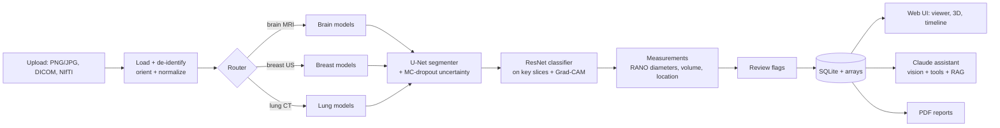

# OncoVision

**AI-assisted tumor detection, segmentation and explanation for medical scans, with an LLM assistant you can ask questions.**

OncoVision takes a brain MRI, breast ultrasound or lung CT scan and:

1. **Detects the scan type** automatically and sends it to the right specialist model.
2. **Classifies** the scan (e.g. glioma / meningioma / pituitary tumor / no tumor) with a confidence score.
3. **Segments** the tumor. For brain MRI it separates the three BraTS sub-regions: necrotic core, edema and enhancing tumor.
4. **Measures** it: volume or area, RANO-style longest and perpendicular diameters, side, approximate brain region, distance from midline.
5. **Explains itself**: Grad-CAM heatmaps show what the classifier looked at, and Monte-Carlo dropout uncertainty maps show where the model is unsure. Uncertain or contradictory results are **flagged for expert review**.
6. **Shows the tumor in 3D** in the browser (rotate, toggle sub-regions).
7. **Tracks change over time** across a patient's scans, with simplified RANO / RECIST response categories (progression, stable, partial response...).
8. **Answers questions** through a Claude-powered assistant that sees the scan, can open other slices, compare scans, and look up facts in a curated medical knowledge base with cited sources. It has a **doctor mode** and a **patient mode**, and answers in **12 languages** (including Hindi, Tamil, Telugu, Kannada, Malayalam, Marathi and Bengali).
9. **Writes PDF reports**: a radiology-style report for doctors or a plain-language summary for patients.
10. **Protects privacy**: DICOM headers (names, IDs, dates, institutions, private tags) are stripped on upload. Only pixel data and a patient *label* you choose are stored.

> ⚠️ **OncoVision is a research and education project, not a medical device.** Its output is not a diagnosis and must be reviewed by a qualified clinician.

---

## Quick start

Requires **Python 3.10+**. No GPU is needed to run the app.

```bash
git clone https://github.com/Vaishnavi220506/Medical.git oncovision
cd oncovision
python -m venv .venv
# Windows: .venv\Scripts\activate      macOS/Linux: source .venv/bin/activate
pip install torch torchvision --index-url https://download.pytorch.org/whl/cpu   # or the CUDA build if you have an NVIDIA GPU
pip install -r requirements.txt

cp .env.example .env          # then put your ANTHROPIC_API_KEY in .env (optional, enables the assistant)
python scripts/make_demo_data.py   # creates synthetic demo scans in demo_data/
uvicorn oncovision.api.main:app --reload
```

Open **http://localhost:8000**, then upload the four `demo_data/brain_t0_*.nii.gz` files together (patient label `Demo-001`, date e.g. 2026-03-01). Then upload the `brain_t1_*` files with the same label and a later date to see tracking over time.

Or with Docker: `docker compose up --build`.

### Demo mode vs trained mode

Out of the box there are **no trained weights**, so OncoVision runs in **demo mode**. A classical image-processing detector finds abnormal regions (bright lesions on MRI/CT, dark lesions on ultrasound, FLAIR-based edema), so every feature works end to end. Demo mode **cannot tell tumor types apart**, and the UI and reports label it clearly.

Once you train the models (below) and drop the checkpoints into `weights/`, the app switches to them automatically. Each model is independent, so you can start with just the brain classifier.

---

## Training the models

The full step-by-step guide, including a free **Google Colab / Kaggle GPU** workflow, is in [docs/TRAINING.md](docs/TRAINING.md). The datasets and their folder layouts are in [docs/DATASETS.md](docs/DATASETS.md).

| Model | Dataset | Command |
|---|---|---|
| Brain classifier | Kaggle Brain Tumor MRI (7k images, 4 classes) | `python -m oncovision.training.train_classifier --profile brain_mri --train-dir .../Training --test-dir .../Testing --pretrained` |
| Brain segmenter | BraTS 2021 (1,251 cases, 4 sequences) | `python -m oncovision.training.train_segmenter --profile brain_mri --format brats --data .../BraTS2021_Training_Data` |
| Breast classifier | BUSI (780 images) | `python -m oncovision.training.train_classifier --profile breast_us --train-dir .../Dataset_BUSI_with_GT --pretrained` |
| Breast segmenter | BUSI masks | `python -m oncovision.training.train_segmenter --profile breast_us --format busi --data .../Dataset_BUSI_with_GT` |
| Lung classifier | IQ-OTH/NCCD | `python -m oncovision.training.train_classifier --profile lung_ct --train-dir ... --pretrained` |
| Lung segmenter | any images + masks folder | `python -m oncovision.training.train_segmenter --profile lung_ct --format maskfolder --data .../images --masks .../masks` |
| Scan-type router | one folder per scan type | `python -m oncovision.training.train_classifier --router --train-dir data/router` |

Checkpoints go to `weights/<profile>/classifier.pt` and `segmenter.pt` by default. Validation and test metrics (accuracy, macro-F1, confusion matrix, Dice for whole tumor / tumor core / enhancing tumor) are stored inside each checkpoint and shown by `GET /api/health`.

Training details that matter:
- **Sequence dropout.** The brain segmenter is trained with randomly missing MRI sequences, so it still works when you upload only one (e.g. just T1ce, or a single JPG).
- **Patient-level splits.** BraTS slices are split by case, so no patient appears in both training and validation.
- **Class-balanced loss** for imbalanced datasets like BUSI, and Dice + cross-entropy loss for segmentation.
- **Same preprocessing in training and inference** (`oncovision.imaging`), including NIfTI orientation.

---

## Will it run on my laptop?

| Task | Needs |
|---|---|
| Running the app (demo or trained) | Any laptop with 8 GB RAM. CPU is fine. A brain MRI volume takes about 2 s in demo mode and roughly 30-90 s with trained models on CPU. Set `ONCOVISION_MC_SAMPLES=4` to speed it up. |
| Training the 2D classifiers | An NVIDIA GPU with 4 GB+ memory, or free Colab/Kaggle GPUs. CPU works but takes hours. |
| Training the BraTS segmenter | 6 GB+ GPU memory (use `--base 16 --batch-size 8` on smaller GPUs), or Colab/Kaggle. |
| The assistant and AI reports | An internet connection and an Anthropic API key. Without a key, chat is disabled and reports use a template. |

---

## How it works



- **Segmentation runs first**, so classification looks at the slices where the tumor is largest. Disagreement between the two models (a tumor segmented but "no tumor" predicted, or the reverse) is flagged.
- **Uncertainty**: the segmenter does a fast pass on every slice, then several Monte-Carlo dropout passes on tumor slices. Per-pixel predictive entropy is the uncertainty map.
- **The assistant** (`oncovision/llm/assistant.py`) uses Claude with streaming, adaptive thinking and these tools: `get_findings`, `view_slice` (returns the image itself), `list_patient_studies`, `compare_studies`, `search_medical_knowledge` (BM25 retrieval over `oncovision/llm/knowledge/*.md`, with sources) and `create_report`. Refusals, rate limits and missing keys are handled gracefully, and server-side fallbacks are enabled.

### Project structure

```
oncovision/
  api/main.py          FastAPI routes + serves the frontend
  analysis/            end-to-end pipeline, longitudinal comparison
  imaging/             loading (DICOM/NIfTI/images), measurements, rendering, 3D meshes
  models/              registry of cancer types, networks, inference engine, demo heuristics
  llm/                 assistant, tools, knowledge base + retrieval, PDF reports
  training/            dataset readers and training scripts
frontend/              single-page web app (no build step)
scripts/               demo data generator
tests/                 pytest suite (runs without GPU or API key)
weights/               put trained checkpoints here
```

### API

| Method | Path | Purpose |
|---|---|---|
| GET | `/api/health` | Mode, loaded models and their metrics, LLM status |
| POST | `/api/analyze` | Upload files (`files`, optional `sequences`, `scan_type`, `patient_label`, `scan_date`, `pixel_spacing_mm`) |
| GET | `/api/studies`, `/api/studies/{id}` | Study results |
| GET | `/api/studies/{id}/slice/{z}.png?layer=overlay\|heatmap\|uncertainty\|original&sequence=flair` | Rendered slice |
| GET | `/api/studies/{id}/mesh` | 3D surfaces |
| GET | `/api/studies/{id}/compare/{other}` | Longitudinal comparison |
| GET | `/api/patients/{id}/timeline` | Size over time |
| GET | `/api/studies/{id}/report.pdf?audience=doctor\|patient` | PDF report |
| POST | `/api/studies/{id}/chat` | Chat (server-sent events) |
| POST | `/api/tools/anonymize` | Return a de-identified copy of a DICOM file |

Interactive docs are at `/docs` while the server runs.

### Running tests

```bash
pip install -r requirements-dev.txt
pytest
```

The tests cover loading and orientation, DICOM anonymization, heuristic detection on phantoms, measurements, response criteria, retrieval, the full API flow, the assistant's tool loop (with a fake LLM client) and smoke runs of every training script.

---

## Adding another cancer type

1. Add a `CancerProfile` in `oncovision/models/registry.py` (classes, segmentation labels, lesion polarity).
2. Add a knowledge file in `oncovision/llm/knowledge/` with a title, source and URL.
3. Train its classifier and segmenter with the scripts above.

## Limitations

- Classifiers only know their training classes. A metastasis or lymphoma will be mapped to the nearest known class.
- Models trained on public datasets may not generalize to other scanners, protocols or populations.
- Sizes from plain JPG/PNG images use an *estimated* pixel size unless you enter the real one.
- Response categories are simplified, imaging-only versions of RANO / RECIST.
- The knowledge base is a small curated starter set. Review it and extend it for your use.

## Roadmap

- Doctor correction loop: edit masks in the browser and save them for retraining
- Logins with doctor and patient roles
- 3D (volumetric) segmentation models
- More cancer types (prostate MRI, liver CT)
