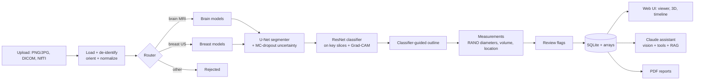

# OncoVision

**AI-assisted tumor detection, segmentation and explanation for medical scans, with an LLM assistant you can ask questions.**


OncoVision takes a brain MRI or breast ultrasound scan and:

1. **Detects the scan type** automatically and rejects images it doesn't support.
2. **Classifies** it: glioma / meningioma / pituitary tumor / no tumor for brain MRI, and normal / benign / malignant for breast ultrasound, with a confidence score.
3. **Outlines the tumor.** It can also separate the three BraTS sub-regions (necrotic core, edema, enhancing tumor) once a BraTS-trained model is added.
4. **Measures** it: area or volume, RANO-style longest and perpendicular diameters, side, approximate brain region, depth from the skin for ultrasound.
5. **Explains itself**: Grad-CAM heatmaps show what the classifier looked at, and Monte-Carlo dropout uncertainty maps show where the model is unsure. Uncertain or contradictory results are **flagged for expert review**.
6. **Shows the tumor in 3D** in the browser for volumetric scans (NIfTI, DICOM series).
7. **Tracks change over time** across a patient's scans, with simplified RANO / RECIST response categories.
8. **Answers questions** through a Claude-powered assistant that sees the scan, can open other slices, compare scans, and look up facts in a curated medical knowledge base with cited sources. It has a **doctor mode** and a **patient mode**, and answers in **12 languages** (including Hindi, Tamil, Telugu, Kannada, Malayalam, Marathi and Bengali).
9. **Writes PDF reports**: a radiology-style report for doctors or a plain-language summary for patients.
10. **Protects privacy**: DICOM headers (names, IDs, dates, institutions, private tags) are stripped on upload. Only pixel data and a patient *label* you choose are stored.

> ⚠️ **OncoVision is a research and education project, not a medical device.** Its output is not a diagnosis and must be reviewed by a qualified clinician.

---

## Quick start

Requires **Python 3.10+**. No GPU is needed: trained models are included and run on a normal laptop CPU in about a second per image.

**Windows:** double-click `run.bat`. **macOS / Linux:** run `./run.sh`.

The first run creates a virtual environment, installs everything, and starts the app at **http://localhost:8000**. To enable the chat assistant and AI-written reports, put an Anthropic API key in the `.env` file and restart. Everything else works without one.

<details>
<summary>Manual setup / Docker</summary>

```bash
git clone https://github.com/Vaishnavi220506/Medical.git oncovision
cd oncovision
python -m venv .venv
# Windows: .venv\Scripts\activate      macOS/Linux: source .venv/bin/activate
pip install torch torchvision --index-url https://download.pytorch.org/whl/cpu   # or the CUDA build with an NVIDIA GPU
pip install -r requirements.txt
cp .env.example .env               # add ANTHROPIC_API_KEY (optional)
uvicorn oncovision.api.main:app
```

Or `docker compose up --build`.
</details>

**Try it:** upload any brain MRI or breast ultrasound image (JPG, PNG, DICOM or NIfTI). For a 3D and over-time demo, run `python scripts/make_demo_data.py`, upload the four `demo_data/brain_t0_*.nii.gz` files together with patient label `Demo-001`, then the `brain_t1_*` files with the same label and a later date. Those are synthetic phantoms, which the brain models were not trained on, so treat their results as a software demo only.

---

## Results

All numbers are on **held-out real scans the models never trained on**, split by patient where patient IDs exist. They come from `scripts/validate_app.py` and `python -m oncovision.training.evaluate`; raw numbers are in [docs/results/app_validation.json](docs/results/app_validation.json).

### Whole app, end to end (automatic scan-type detection → outline → classification → review flags)

| | Brain MRI | Breast ultrasound | Lung CT | Unsupported (chest / bone X-rays) |
|---|---|---|---|---|
| Scans tested | 400 | 117 | 221 | 120 |
| Scan type recognised | **100%** | **100%** | refused (no model yet) | **100% rejected** |
| Correct diagnosis | **95.0%** | **84.6%** | – | – |
| Tumor outlined | 55.7% | 91.8% | – | – |
| Normal scans wrongly outlined | **1%** | 20% | – | – |
| Flagged for expert review | 45% | 30% | – | – |
| Time per image (4-core CPU) | 0.6 s | 0.7 s | – | – |

### Individual models

| Model | Data (held-out set) | Result |
|---|---|---|
| Brain tumor type, ResNet-18 | 1,600 test MRIs (Masoud Nickparvar dataset) | **95.7% accuracy**, macro-F1 0.956. No tumor 99.8% recall, pituitary 99.8%, meningioma 98%, glioma 85% (mostly confused with meningioma) |
| Brain tumor outline, U-Net | 542 slices from held-out patients (Figshare) | **Dice 0.67**; false outline on 1.5% of 400 normal MRIs |
| Breast lesion type, ResNet-18 | 117 BUSI images (validation split) | **85.5% accuracy** (normal 90%, benign 85%, malignant 84% recall) |
| Breast lesion outline, U-Net | 117 BUSI images (validation split) | **Dice 0.61** |
| Scan-type router | brain / breast / lung / other | 100% on validation and on the end-to-end sets above |

<details>
<summary>Figures: confusion matrix, Grad-CAM and outline examples</summary>


Grad-CAM: the classifier focuses on the tumor in nearly all cases, correct or not.


Brain tumor outlines (held-out Figshare patients) and breast lesion outlines (BUSI validation):

 
</details>

### How to read these numbers honestly

- **Brain outlines are missing on ~44% of tumors in the end-to-end test.** The outline model was trained on Figshare (contrast-enhanced T1), while the test set also has T2/FLAIR images and other sources. It misses many small pituitary tumors in particular. When the classifier finds a tumor that isn't outlined, the result is flagged and the heatmap shows its approximate location; no size is invented. Training on more diverse masks (e.g. BraTS) is the fix.
- **The classifier guides the outline.** When the classifier is confident a scan is normal (above 80%), no outline is reported and a note explains why. For brain, when it is confident a tumor is present, a lower threshold extends the outline the model already found. Both rules were checked against expert masks and only kept where they helped.
- **Breast normals:** 20% still get a small outline. BUSI has only 133 normal images.
- **Lung CT is not included yet.** A lung model was trained on 80 LIDC-IDRI cases but did no better than chance on held-out patients, so it was not shipped. Lung CTs are recognised and refused with a clear message (choosing the type manually runs a clearly labeled experimental detector). A proper lung model needs nodule-centred patches and 3D context.
- Review-flag thresholds were calibrated on these same held-out sets. Confidence below 70% or MC-dropout spread above 0.08 flags about 70% of breast errors and 30% of brain errors, while flagging only 10% and 2% of correct answers. Brain errors are mostly confident glioma ↔ meningioma confusions.
- Public datasets are curated. Real-world scans (other scanners, protocols, populations) will usually score lower.

---

## Training your own models

Trained weights are already in `weights/`. To retrain or improve them, use the one-click notebook [`notebooks/train_oncovision.ipynb`](notebooks/train_oncovision.ipynb) on a free **Kaggle / Colab GPU**: it downloads the datasets, trains, and writes evaluation reports. Full guide: [docs/TRAINING.md](docs/TRAINING.md). Datasets and licenses: [docs/DATASETS.md](docs/DATASETS.md).

| Model | Dataset | Command |
|---|---|---|
| Brain classifier | Brain Tumor MRI (Masoud Nickparvar, 7,200 images) | `python -m oncovision.training.train_classifier --profile brain_mri --train-dir data/brain/Training --test-dir data/brain/Testing --pretrained` |
| Brain segmenter | Figshare (3,064 slices) + normal brains | `python scripts/prepare_figshare.py --download --out data/figshare --negatives data/brain/Training/notumor` then `python -m oncovision.training.train_segmenter --profile brain_mri --format maskfolder --data data/figshare/train/images --masks data/figshare/train/masks` |
| Brain sub-regions (optional) | BraTS 2021 (1,251 cases, 4 sequences) | `python -m oncovision.training.train_segmenter --profile brain_mri --format brats --data .../BraTS2021_Training_Data` |
| Breast classifier + segmenter | BUSI (780 images) | `train_classifier --profile breast_us --train-dir data/busi --pretrained` and `train_segmenter --profile breast_us --format busi --data data/busi` |
| Scan-type router | one folder per scan type | `python -m oncovision.training.train_classifier --router --train-dir data/router --pretrained` |

Then measure: `python -m oncovision.training.evaluate classifier|segmenter ...` (figures for your report) and `python scripts/validate_app.py ...` (end to end). Export with `python scripts/export_weights.py --src <run>/weights --dst weights`.

---

## Will it run on my laptop?

| Task | Needs |
|---|---|
| Running the app | Any laptop with 8 GB RAM. CPU is fine: about 1 s per image, longer for 3D volumes. Set `ONCOVISION_MC_SAMPLES=4` to speed it up. |
| Retraining the models | A free Kaggle/Colab GPU (about 1 hour), or an NVIDIA GPU with 4 GB+. CPU works but takes hours. |
| The assistant and AI reports | An internet connection and an Anthropic API key. Without a key, chat is disabled and reports use a template. |

---

## How it works



- **Segmentation runs first**, so classification looks at the slices where the tumor is largest. The classifier then guides the final outline (see Results), and any remaining disagreement between the two models is flagged.
- **Uncertainty**: the segmenter does a fast pass on every slice, then several Monte-Carlo dropout passes on tumor slices. Per-pixel predictive entropy is the uncertainty map.
- **The assistant** (`oncovision/llm/assistant.py`) uses Claude with streaming, adaptive thinking and these tools: `get_findings`, `view_slice` (returns the image itself), `list_patient_studies`, `compare_studies`, `search_medical_knowledge` (BM25 retrieval over `oncovision/llm/knowledge/*.md`, with sources) and `create_report`. Refusals, rate limits and missing keys are handled gracefully, and server-side fallbacks are enabled.

### Project structure

```
oncovision/
  api/main.py          FastAPI routes + serves the frontend
  analysis/            end-to-end pipeline, longitudinal comparison
  imaging/             loading (DICOM/NIfTI/images), measurements, rendering, 3D meshes
  models/              registry of cancer types, networks, inference engine, demo heuristics
  llm/                 assistant, tools, knowledge base + retrieval, PDF reports
  training/            dataset readers and training scripts
frontend/              single-page web app (no build step)
notebooks/             one-click Kaggle/Colab training notebook
scripts/               data preparation, validation, weight export, demo data
docs/                  training guide, datasets, results and figures
tests/                 pytest suite (runs without GPU or API key)
weights/               trained models (float16)
```

### API

| Method | Path | Purpose |
|---|---|---|
| GET | `/api/health` | Mode, loaded models and their metrics, LLM status |
| POST | `/api/analyze` | Upload files (`files`, optional `sequences`, `scan_type`, `patient_label`, `scan_date`, `pixel_spacing_mm`) |
| GET | `/api/studies`, `/api/studies/{id}` | Study results |
| GET | `/api/studies/{id}/slice/{z}.png?layer=overlay\|heatmap\|uncertainty\|original&sequence=flair` | Rendered slice |
| GET | `/api/studies/{id}/mesh` | 3D surfaces |
| GET | `/api/studies/{id}/compare/{other}` | Longitudinal comparison |
| GET | `/api/patients/{id}/timeline` | Size over time |
| GET | `/api/studies/{id}/report.pdf?audience=doctor\|patient` | PDF report |
| POST | `/api/studies/{id}/chat` | Chat (server-sent events) |
| POST | `/api/tools/anonymize` | Return a de-identified copy of a DICOM file |

Interactive docs are at `/docs` while the server runs.

### Running tests

```bash
pip install -r requirements-dev.txt
pytest
```

The tests cover loading and orientation, DICOM anonymization, heuristic detection on phantoms, measurements, response criteria, retrieval, the full API flow, the assistant's tool loop (with a fake LLM client) and smoke runs of every training script.

---

## Adding another cancer type

1. Add a `CancerProfile` in `oncovision/models/registry.py` (classes, segmentation labels, lesion polarity).
2. Add a knowledge file in `oncovision/llm/knowledge/` with a title, source and URL.
3. Train its classifier and segmenter with the scripts above.

## Limitations

- See "How to read these numbers honestly" above.
- Classifiers only know their training classes. A metastasis or lymphoma will be mapped to the nearest known class.
- Models trained on public datasets may not generalize to other scanners, protocols or populations.
- Sizes from plain JPG/PNG images use an *estimated* pixel size unless you enter the real one.
- Response categories are simplified, imaging-only versions of RANO / RECIST.
- The knowledge base is a small curated starter set. Review it and extend it for your use.

## Datasets and credits

Models were trained on public datasets (licenses and citations in [docs/DATASETS.md](docs/DATASETS.md)): the Brain Tumor MRI Dataset (M. Nickparvar; CC-BY-4.0 mirror), the Figshare brain tumor dataset (Cheng et al., 2015; CC-BY-4.0), BUSI (Al-Dhabyani et al., 2020; CC-BY-4.0 mirror), LIDC-IDRI (Armato et al., 2011) and chest/bone X-ray sets for the "other" class. Please cite them if you use these models.

## Roadmap

- Lung CT nodule model (patch-based, 3D)
- BraTS-trained sub-region segmenter for multi-sequence MRI
- Doctor correction loop: edit masks in the browser and save them for retraining
- Logins with doctor and patient roles
- More cancer types (prostate MRI, liver CT)
