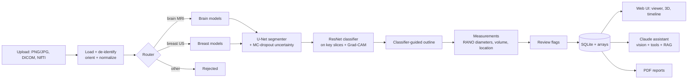

# OncoVision

**AI-assisted tumor detection, segmentation and explanation for medical scans, with an LLM assistant you can ask questions.**


OncoVision takes a brain MRI or breast ultrasound scan and:

1. **Detects the scan type** automatically and rejects images it doesn't support.
2. **Classifies** it: glioma / meningioma / pituitary tumor / no tumor for brain MRI, and normal / benign / malignant for breast ultrasound, with a confidence score.
3. **Outlines the tumor**, and for **3D MRI** (all four sequences: FLAIR, T1, T1ce, T2) it uses a **true 3D U-Net** that separates the necrotic core, edema and active (enhancing) tumor in 3D.
4. **Measures** it: area or volume, RANO-style longest and perpendicular diameters, side, approximate brain region, depth from the skin for ultrasound.
5. **Explains itself**: Grad-CAM heatmaps show what the classifier looked at, and Monte-Carlo dropout uncertainty maps show where the model is unsure. Uncertain or contradictory results are **flagged for expert review**.
6. **Interactive viewer**: zoom, pan, scroll through slices, brightness/contrast, overlay opacity, a ruler in mm, fullscreen, and a **3D view** of the tumor parts you can rotate.
7. **Tracks change over time** across a patient's scans, with simplified RANO / RECIST response categories.
8. **Answers questions** through a Claude-powered assistant that sees the scan, can open other slices, compare scans, and look up facts in a curated medical knowledge base with cited sources. It has a **doctor mode** and a **patient mode**, and answers in **12 languages** (including Hindi, Tamil, Telugu, Kannada, Malayalam, Marathi and Bengali).
9. **Writes PDF reports**: a radiology-style report for doctors or a plain-language summary for patients.
10. **Protects privacy**: DICOM headers (names, IDs, dates, institutions, private tags) are stripped on upload. Only pixel data and a patient *label* you choose are stored.

> ⚠️ **OncoVision is a research and education project, not a medical device.** Its output is not a diagnosis and must be reviewed by a qualified clinician.

---

## Quick start

Requires **Python 3.10+**. No GPU is needed: trained models are included and run on a normal laptop CPU in about a second per image.

**Windows:** double-click `run.bat`. **macOS / Linux:** run `./run.sh`.

The first run creates a virtual environment, installs everything, and starts the app at **http://localhost:8000**. To enable the chat assistant and AI-written reports, put an Anthropic API key in the `.env` file and restart. Everything else works without one.

<details>
<summary>Manual setup / Docker</summary>

```bash
git clone https://github.com/Vaishnavi220506/Medical.git oncovision
cd oncovision
python -m venv .venv
# Windows: .venv\Scripts\activate      macOS/Linux: source .venv/bin/activate
pip install torch torchvision --index-url https://download.pytorch.org/whl/cpu   # or the CUDA build with an NVIDIA GPU
pip install -r requirements.txt
cp .env.example .env               # choose an LLM provider in .env (optional)
uvicorn oncovision.api.main:app
```

Or `docker compose up --build`.

### LLM providers

The assistant supports both Claude and local Ollama. Each contributor can choose independently in `.env`:

```env
# Cloud Claude (requires ANTHROPIC_API_KEY)
ONCOVISION_LLM_PROVIDER=anthropic

# Or free/local Ollama (requires Ollama plus the model installed locally)
ONCOVISION_LLM_PROVIDER=ollama
ONCOVISION_OLLAMA_MODEL=llama3.2:3b
ONCOVISION_OLLAMA_VISION=false
```

For Ollama, install the model once with `ollama pull llama3.2:3b` and keep the Ollama app running. The model must support tool calling (llama3.2, qwen2.5 and mistral do). Text-only models work from the written scan findings; set `ONCOVISION_OLLAMA_VISION=true` only for a vision model that also supports tools (for example `qwen2.5vl`), and it will also see the scan images. Both the chat and the PDF report text use the chosen provider; if the LLM is unavailable, the report falls back to a fixed template. Small local models are much weaker than Claude at medical explanations, so check their answers. The rest of the app works regardless of provider.
</details>

**Try it:** upload any brain MRI or breast ultrasound image (JPG, PNG, DICOM or NIfTI). For real **3D brain MRI**, use the scans in [`samples/brain_mri_3d/`](samples/README.md): drag the four files of one patient in together, then open the **3D** tab. A single 2D image also gets an *estimated* 3D preview in the 3D tab: its depth is guessed from the outline, so it is marked as a preview and shows no volumes. For a 3D and over-time demo, run `python scripts/make_demo_data.py`, upload the four `demo_data/brain_t0_*.nii.gz` files together with patient label `Demo-001`, then the `brain_t1_*` files with the same label and a later date. Those are synthetic phantoms, which the brain models were not trained on, so treat their results as a software demo only.

---

## Results

All numbers are on **held-out real scans the models never trained on**, split by patient where patient IDs exist. They come from `scripts/validate_app.py` and `python -m oncovision.training.evaluate`; raw numbers are in [docs/results/app_validation.json](docs/results/app_validation.json).

### Whole app, end to end (automatic scan-type detection → outline → classification → review flags)

| | Brain MRI | Breast ultrasound | Lung CT | Unsupported (chest / bone X-rays) |
|---|---|---|---|---|
| Scans tested | 400 | 117 | 221 | 120 |
| Scan type recognised | **100%** | **100%** | refused (no model yet) | **100% rejected** |
| Correct diagnosis | **95.0%** | **84.6%** | – | – |
| Tumor outlined | 65.7%¹ | 91.8% | – | – |
| Normal scans wrongly outlined | **1%** | 20% | – | – |
| Flagged for expert review | 45% | 30% | – | – |
| Time per image (4-core CPU) | 0.6 s | 0.7 s | – | – |

¹ With the retrained 2D brain outline model, on 100 test images per class (glioma 84%, meningioma 90%, pituitary 23%); the previous model outlined 61% of the same images. Other brain numbers are from the 400-image run.

### 3D brain tumor model (BraTS 2023, whole 3D volumes)

A 3D U-Net trained on 1,183 BraTS 2023 glioma scans with all four MRI sequences (on a free Kaggle GPU, [`notebooks/train_3d_brats.ipynb`](notebooks/train_3d_brats.ipynb)). Tested through the app itself on **24 scans from 20 patients the model never saw**:

| Tumor part | Dice (mean) |
|---|---|
| Whole tumor (incl. edema) | **0.88** (median 0.95) |
| Tumor core | **0.89** |
| Enhancing (active) tumor | **0.86** |
| Tumor volume error | **6% median** |

For comparison, strong published BraTS methods reach roughly 0.90-0.93 / 0.85-0.90 / 0.80-0.88 on the official BraTS test sets, which differ from ours. It runs in about 30 s per scan on a laptop CPU. It also works with fewer sequences (held-out Dice: T1ce only 0.91, FLAIR only 0.90, T2 only 0.84), so any 3D volume whose MRI sequence is named (by file name or in the upload form) uses it. For these scans the 3D model, not the 2D classifier, decides whether a tumor is present: the 2D classifier was trained on slices with the skull visible and is unreliable on skull-stripped research volumes. The 3D model was trained on gliomas only, so it reports "brain tumor detected" with its sub-regions and does not claim a tumor type.

### Interactive 3D

**[▶ Open the live 3D demo](https://vaishnavi220506.github.io/Medical/docs/demo/)**: rotate and zoom a held-out BraTS patient, move through the real MRI slices, and hover over the brain or the tumor for plain-language explanations (what each tumor part is, which brain area you are on, what it does and how far the tumor is).


The tumor that OncoVision's 3D model outlined for this patient (all sub-regions together). You can drag it to rotate and scroll to zoom right here:

```stl
solid tumor
facet normal 0.6 -0.5 0.6
outer loop
vertex 60 -126 48
vertex 60 -126 48
vertex 60 -126 48
endloop
endfacet
facet normal -0.5 -0.5 0.7
outer loop
vertex 60 -126 48
vertex 60 -126 48
vertex 60 -126 48
endloop
endfacet
facet normal 0.6 0.6 0.6
outer loop
vertex 60 -126 48
vertex 60 -126 48
vertex 60 -126 48
endloop
endfacet
facet normal -0.4 0.6 0.7
outer loop
vertex 60 -126 48
vertex 60 -126 48
vertex 60 -126 48
endloop
endfacet
facet normal 0.7 -0.4 0.7
outer loop
vertex 84 -147 48
vertex 82 -150 48
vertex 84 -150 46
endloop
endfacet
facet normal -0.6 -0.4 0.7
outer loop
vertex 84 -150 46
vertex 86 -150 48
vertex 84 -147 48
endloop
endfacet
facet normal 0.6 -0.5 0.6
outer loop
vertex 72 -154 48
vertex 70 -156 48
vertex 72 -156 46
endloop
endfacet
facet normal -0.6 -0.5 0.6
outer loop
vertex 72 -156 46
vertex 74 -156 48
vertex 72 -154 48
endloop
endfacet
facet normal 0.7 -0.1 0.7
outer loop
vertex 84 -150 46
vertex 82 -150 48
vertex 84 -156 45
endloop
endfacet
facet normal 0.7 -0.1 0.7
outer loop
vertex 84 -156 45
vertex 82 -150 48
vertex 81 -156 48
endloop
endfacet
facet normal -0.6 -0.3 0.7
outer loop
vertex 86 -150 48
vertex 84 -150 46
vertex 89 -156 48
endloop
endfacet
facet normal -0.5 -0.1 0.9
outer loop
vertex 89 -156 48
vertex 84 -150 46
vertex 84 -156 45
endloop
endfacet
facet normal 0.7 0.3 0.7
outer loop
vertex 70 -156 48
vertex 72 -160 48
vertex 72 -156 46
endloop
endfacet
facet normal -0.7 0.3 0.7
outer loop
vertex 72 -156 46
vertex 72 -160 48
vertex 74 -156 48
endloop
endfacet
facet normal 0.7 0.1 0.7
outer loop
vertex 84 -156 45
vertex 81 -156 48
vertex 84 -162 46
endloop
endfacet
facet normal 0.7 0.1 0.7
outer loop
vertex 84 -162 46
vertex 81 -156 48
vertex 82 -162 48
endloop
endfacet
facet normal -0.4 -0.3 0.8
outer loop
vertex 89 -156 48
vertex 84 -156 45
vertex 90 -157 48
endloop
endfacet
facet normal -0.4 -0.4 0.8
outer loop
vertex 84 -156 45
vertex 90 -162 46
vertex 90 -157 48
endloop
endfacet
facet normal 0.1 0.2 1.0
outer loop
vertex 84 -156 45
vertex 84 -162 46
vertex 90 -162 46
endloop
endfacet
facet normal -0.7 -0.3 0.7
outer loop
vertex 90 -162 46
vertex 92 -162 48
vertex 90 -157 48
endloop
endfacet
facet normal 0.7 -0.2 0.7
outer loop
vertex 72 -164 48
vertex 71 -168 48
vertex 72 -168 47
endloop
endfacet
facet normal -0.4 -0.3 0.9
outer loop
vertex 72 -168 47
vertex 75 -168 48
vertex 72 -164 48
endloop
endfacet
facet normal 0.7 0.4 0.7
outer loop
vertex 82 -162 48
vertex 84 -165 48
vertex 84 -162 46
endloop
endfacet
facet normal 0.5 0.4 0.8
outer loop
vertex 87 -168 48
vertex 90 -168 46
vertex 84 -165 48
endloop
endfacet
facet normal 0.5 0.5 0.7
outer loop
vertex 90 -168 46
vertex 84 -162 46
vertex 84 -165 48
endloop
endfacet
facet normal 0.1 0.1 1.0
outer loop
vertex 90 -168 46
vertex 90 -162 46
vertex 84 -162 46
endloop
endfacet
facet normal -0.7 0.1 0.7
outer loop
vertex 92 -162 48
vertex 90 -162 46
vertex 92 -168 48
endloop
endfacet
facet normal -0.7 0.1 0.7
outer loop
vertex 92 -168 48
vertex 90 -162 46
vertex 90 -168 46
endloop
endfacet
facet normal 0.6 0.6 0.6
outer loop
vertex 71 -168 48
vertex 72 -169 48
vertex 72 -168 47
endloop
endfacet
facet normal -0.3 0.7 0.7
outer loop
vertex 72 -168 47
vertex 72 -169 48
vertex 75 -168 48
endloop
endfacet
facet normal 0.4 0.6 0.7
outer loop
vertex 87 -168 48
vertex 90 -170 48
vertex 90 -168 46
endloop
endfacet
facet normal -0.6 0.6 0.6
outer loop
vertex 90 -168 46
vertex 90 -170 48
vertex 92 -168 48
endloop
endfacet
facet normal 0.4 -0.7 0.6
outer loop
vertex 84 -93 54
vertex 79 -96 54
vertex 84 -96 51
endloop
endfacet
facet normal -0.2 -0.7 0.7
outer loop
vertex 90 -96 53
vertex 90 -95 54
vertex 84 -96 51
endloop
endfacet
facet normal -0.2 -0.7 0.7
outer loop
vertex 84 -96 51
vertex 90 -95 54
vertex 84 -93 54
endloop
endfacet
facet normal -0.6 -0.6 0.6
outer loop
vertex 90 -96 53
vertex 91 -96 54
vertex 90 -95 54
endloop
endfacet
facet normal 0.6 -0.3 0.7
outer loop
vertex 78 -97 54
vertex 75 -102 54
vertex 78 -102 52
endloop
endfacet
facet normal 0.5 -0.4 0.8
outer loop
vertex 78 -97 54
vertex 78 -102 52
vertex 79 -96 54
endloop
endfacet
facet normal 0.5 -0.4 0.8
outer loop
vertex 78 -102 52
vertex 84 -96 51
vertex 79 -96 54
endloop
endfacet
facet normal -0.2 0.4 0.9
outer loop
vertex 78 -102 52
vertex 84 -102 53
vertex 84 -96 51
endloop
endfacet
facet normal -0.4 0.5 0.7
outer loop
vertex 90 -98 54
vertex 90 -96 53
vertex 85 -102 54
endloop
endfacet
facet normal -0.4 0.5 0.7
outer loop
vertex 90 -96 53
vertex 84 -102 53
vertex 85 -102 54
endloop
endfacet
facet normal -0.3 0.4 0.9
outer loop
vertex 90 -96 53
vertex 84 -96 51
vertex 84 -102 53
endloop
endfacet
facet normal -0.7 0.4 0.6
outer loop
vertex 90 -96 53
vertex 90 -98 54
vertex 91 -96 54
endloop
endfacet
facet normal 0.7 0.0 0.7
outer loop
vertex 78 -102 52
vertex 75 -102 54
vertex 78 -108 51
endloop
endfacet
facet normal 0.4 -0.2 0.9
outer loop
vertex 78 -108 51
vertex 75 -102 54
vertex 72 -108 54
endloop
endfacet
facet normal -0.3 0.0 1.0
outer loop
vertex 78 -102 52
vertex 84 -108 53
vertex 84 -102 53
endloop
endfacet
facet normal -0.3 0.0 1.0
outer loop
vertex 78 -102 52
vertex 78 -108 51
vertex 84 -108 53
endloop
endfacet
facet normal -0.5 0.0 0.9
outer loop
vertex 85 -102 54
vertex 84 -102 53
vertex 85 -108 54
endloop
endfacet
facet normal -0.7 0.0 0.7
outer loop
vertex 85 -108 54
vertex 84 -102 53
vertex 84 -108 53
endloop
endfacet
facet normal 0.2 -0.5 0.8
outer loop
vertex 66 -112 54
vertex 60 -114 54
vertex 66 -114 52
endloop
endfacet
facet normal 0.1 -0.4 0.9
outer loop
vertex 72 -114 51
vertex 72 -108 54
vertex 66 -114 52
endloop
endfacet
facet normal 0.3 -0.5 0.8
outer loop
vertex 66 -114 52
vertex 72 -108 54
vertex 66 -112 54
endloop
endfacet
facet normal 0.4 -0.4 0.8
outer loop
vertex 72 -108 54
vertex 72 -114 51
vertex 72 -108 54
endloop
endfacet
facet normal 0.4 -0.4 0.8
outer loop
vertex 72 -114 51
vertex 78 -108 51
vertex 72 -108 54
endloop
endfacet
facet normal 0.0 0.0 1.0
outer loop
vertex 72 -114 51
vertex 78 -114 51
vertex 78 -108 51
endloop
endfacet
facet normal -0.6 0.2 0.8
outer loop
vertex 84 -112 54
vertex 84 -108 53
vertex 84 -114 54
endloop
endfacet
facet normal -0.4 0.2 0.9
outer loop
vertex 84 -108 53
vertex 78 -114 51
vertex 84 -114 54
endloop
endfacet
facet normal -0.3 0.0 1.0
outer loop
vertex 84 -108 53
vertex 78 -108 51
vertex 78 -114 51
endloop
endfacet
facet normal -0.7 0.2 0.7
outer loop
vertex 84 -108 53
vertex 84 -112 54
vertex 85 -108 54
endloop
endfacet
facet normal 0.7 -0.4 0.6
outer loop
vertex 60 -114 54
vertex 57 -120 54
vertex 60 -120 51
endloop
endfacet
facet normal 0.2 -0.5 0.8
outer loop
vertex 60 -114 54
vertex 60 -120 51
vertex 60 -114 54
endloop
endfacet
facet normal 0.3 -0.5 0.8
outer loop
vertex 60 -120 51
vertex 66 -114 52
vertex 60 -114 54
endloop
endfacet
facet normal 0.0 -0.2 1.0
outer loop
vertex 60 -120 51
vertex 66 -120 51
vertex 66 -114 52
endloop
endfacet
facet normal 0.1 -0.1 1.0
outer loop
vertex 66 -114 52
vertex 72 -120 51
vertex 72 -114 51
endloop
endfacet
facet normal 0.0 -0.2 1.0
outer loop
vertex 66 -114 52
vertex 66 -120 51
vertex 72 -120 51
endloop
endfacet
facet normal 0.0 0.0 1.0
outer loop
vertex 72 -114 51
vertex 78 -120 51
vertex 78 -114 51
endloop
endfacet
facet normal -0.1 -0.1 1.0
outer loop
vertex 72 -114 51
vertex 72 -120 51
vertex 78 -120 51
endloop
endfacet
facet normal -0.4 -0.3 0.8
outer loop
vertex 84 -114 54
vertex 78 -114 51
vertex 84 -115 54
endloop
endfacet
facet normal -0.4 -0.3 0.8
outer loop
vertex 78 -114 51
vertex 84 -120 52
vertex 84 -115 54
endloop
endfacet
facet normal -0.1 0.0 1.0
outer loop
vertex 78 -114 51
vertex 78 -120 51
vertex 84 -120 52
endloop
endfacet
facet normal -0.6 -0.3 0.7
outer loop
vertex 84 -120 52
vertex 86 -120 54
vertex 84 -115 54
endloop
endfacet
facet normal 0.6 -0.5 0.6
outer loop
vertex 54 -125 54
vertex 53 -126 54
vertex 54 -126 53
endloop
endfacet
facet normal 0.7 -0.5 0.5
outer loop
vertex 54 -125 54
vertex 54 -126 53
vertex 57 -120 54
endloop
endfacet
facet normal 0.7 -0.4 0.6
outer loop
vertex 57 -120 54
vertex 54 -126 53
vertex 60 -120 51
endloop
endfacet
facet normal 0.6 -0.3 0.7
outer loop
vertex 54 -126 53
vertex 60 -126 48
vertex 60 -120 51
endloop
endfacet
facet normal 0.5 -0.4 0.8
outer loop
vertex 60 -126 48
vertex 60 -126 48
vertex 60 -120 51
endloop
endfacet
facet normal -0.3 -0.4 0.8
outer loop
vertex 60 -120 51
vertex 60 -126 48
vertex 60 -126 48
endloop
endfacet
facet normal -0.3 -0.4 0.8
outer loop
vertex 66 -126 50
vertex 60 -120 51
vertex 60 -126 48
endloop
endfacet
facet normal 0.0 -0.1 1.0
outer loop
vertex 66 -120 51
vertex 60 -120 51
vertex 66 -126 50
endloop
endfacet
facet normal 0.0 0.0 1.0
outer loop
vertex 66 -120 51
vertex 72 -126 51
vertex 72 -120 51
endloop
endfacet
facet normal -0.1 -0.1 1.0
outer loop
vertex 66 -120 51
vertex 66 -126 50
vertex 72 -126 51
endloop
endfacet
facet normal 0.0 0.4 0.9
outer loop
vertex 72 -120 51
vertex 78 -126 54
vertex 78 -120 51
endloop
endfacet
facet normal -0.4 0.0 0.9
outer loop
vertex 72 -120 51
vertex 72 -126 51
vertex 78 -126 54
endloop
endfacet
facet normal -0.1 0.4 0.9
outer loop
vertex 84 -125 54
vertex 84 -120 52
vertex 81 -126 54
endloop
endfacet
facet normal -0.1 0.4 0.9
outer loop
vertex 84 -120 52
vertex 78 -126 54
vertex 81 -126 54
endloop
endfacet
facet normal -0.1 0.4 0.9
outer loop
vertex 84 -120 52
vertex 78 -120 51
vertex 78 -126 54
endloop
endfacet
facet normal -0.6 0.3 0.7
outer loop
vertex 84 -120 52
vertex 84 -125 54
vertex 86 -120 54
endloop
endfacet
facet normal 0.7 -0.1 0.7
outer loop
vertex 54 -126 53
vertex 53 -126 54
vertex 54 -132 52
endloop
endfacet
facet normal 0.8 -0.1 0.7
outer loop
vertex 54 -132 52
vertex 53 -126 54
vertex 52 -132 54
endloop
endfacet
facet normal 0.6 0.6 0.6
outer loop
vertex 60 -132 53
vertex 60 -126 48
vertex 60 -126 48
endloop
endfacet
facet normal 0.5 0.6 0.6
outer loop
vertex 54 -126 53
vertex 60 -132 53
vertex 60 -126 48
endloop
endfacet
facet normal -0.2 -0.1 1.0
outer loop
vertex 54 -132 52
vertex 60 -132 53
vertex 54 -126 53
endloop
endfacet
facet normal -0.3 0.5 0.8
outer loop
vertex 66 -126 50
vertex 60 -126 48
vertex 60 -126 48
endloop
endfacet
facet normal -0.3 0.7 0.7
outer loop
vertex 60 -132 53
vertex 66 -126 50
vertex 60 -126 48
endloop
endfacet
facet normal 0.3 0.2 0.9
outer loop
vertex 66 -132 52
vertex 66 -126 50
vertex 60 -132 53
endloop
endfacet
facet normal -0.1 0.1 1.0
outer loop
vertex 66 -126 50
vertex 72 -132 52
vertex 72 -126 51
endloop
endfacet
facet normal 0.0 0.2 1.0
outer loop
vertex 66 -126 50
vertex 66 -132 52
vertex 72 -132 52
endloop
endfacet
facet normal -0.4 -0.2 0.9
outer loop
vertex 72 -126 51
vertex 78 -132 52
vertex 78 -126 54
endloop
endfacet
facet normal -0.1 0.1 1.0
outer loop
vertex 72 -126 51
vertex 72 -132 52
vertex 78 -132 52
endloop
endfacet
facet normal -0.1 0.0 1.0
outer loop
vertex 81 -126 54
vertex 78 -126 54
vertex 81 -132 54
endloop
endfacet
facet normal -0.4 -0.2 0.9
outer loop
vertex 81 -132 54
vertex 78 -126 54
vertex 78 -132 52
endloop
endfacet
facet normal 0.7 0.3 0.6
outer loop
vertex 52 -132 54
vertex 54 -136 54
vertex 54 -132 52
endloop
endfacet
facet normal 0.1 0.5 0.9
outer loop
vertex 59 -138 54
vertex 60 -138 54
vertex 54 -136 54
endloop
endfacet
facet normal 0.1 0.4 0.9
outer loop
vertex 60 -138 54
vertex 54 -132 52
vertex 54 -136 54
endloop
endfacet
facet normal -0.2 0.1 1.0
outer loop
vertex 60 -138 54
vertex 60 -132 53
vertex 54 -132 52
endloop
endfacet
facet normal 0.3 -0.1 1.0
outer loop
vertex 60 -132 53
vertex 66 -138 51
vertex 66 -132 52
endloop
endfacet
facet normal 0.4 0.1 0.9
outer loop
vertex 60 -132 53
vertex 60 -138 54
vertex 66 -138 51
endloop
endfacet
facet normal 0.0 -0.1 1.0
outer loop
vertex 66 -132 52
vertex 72 -138 51
vertex 72 -132 52
endloop
endfacet
facet normal 0.0 -0.1 1.0
outer loop
vertex 66 -132 52
vertex 66 -138 51
vertex 72 -138 51
endloop
endfacet
facet normal -0.1 -0.2 1.0
outer loop
vertex 72 -132 52
vertex 78 -138 51
vertex 78 -132 52
endloop
endfacet
facet normal -0.1 -0.1 1.0
outer loop
vertex 72 -132 52
vertex 72 -138 51
vertex 78 -138 51
endloop
endfacet
facet normal -0.4 -0.1 0.9
outer loop
vertex 81 -132 54
vertex 78 -132 52
vertex 83 -138 54
endloop
endfacet
facet normal -0.5 -0.2 0.9
outer loop
vertex 83 -138 54
vertex 78 -132 52
vertex 78 -138 51
endloop
endfacet
facet normal 0.2 -0.3 0.9
outer loop
vertex 60 -138 54
vertex 59 -138 54
vertex 60 -144 52
endloop
endfacet
facet normal 0.7 -0.2 0.7
outer loop
vertex 60 -144 52
vertex 59 -138 54
vertex 58 -144 54
endloop
endfacet
facet normal 0.4 0.0 0.9
outer loop
vertex 60 -138 54
vertex 66 -144 51
vertex 66 -138 51
endloop
endfacet
facet normal 0.1 -0.3 0.9
outer loop
vertex 60 -138 54
vertex 60 -144 52
vertex 66 -144 51
endloop
endfacet
facet normal 0.0 0.1 1.0
outer loop
vertex 66 -138 51
vertex 72 -144 52
vertex 72 -138 51
endloop
endfacet
facet normal -0.1 0.0 1.0
outer loop
vertex 66 -138 51
vertex 66 -144 51
vertex 72 -144 52
endloop
endfacet
facet normal -0.1 0.1 1.0
outer loop
vertex 72 -138 51
vertex 78 -144 52
vertex 78 -138 51
endloop
endfacet
facet normal -0.1 0.1 1.0
outer loop
vertex 72 -138 51
vertex 72 -144 52
vertex 78 -144 52
endloop
endfacet
facet normal -0.4 -0.5 0.8
outer loop
vertex 83 -138 54
vertex 78 -138 51
vertex 84 -139 54
endloop
endfacet
facet normal -0.4 -0.6 0.7
outer loop
vertex 78 -138 51
vertex 84 -144 50
vertex 84 -139 54
endloop
endfacet
facet normal 0.3 0.1 0.9
outer loop
vertex 78 -138 51
vertex 78 -144 52
vertex 84 -144 50
endloop
endfacet
facet normal -0.7 -0.5 0.6
outer loop
vertex 84 -144 50
vertex 88 -144 54
vertex 84 -139 54
endloop
endfacet
facet normal 0.5 -0.5 0.7
outer loop
vertex 96 -143 54
vertex 95 -144 54
vertex 96 -144 53
endloop
endfacet
facet normal -0.6 -0.5 0.6
outer loop
vertex 96 -144 53
vertex 97 -144 54
vertex 96 -143 54
endloop
endfacet
facet normal 0.6 0.3 0.7
outer loop
vertex 58 -144 54
vertex 60 -148 54
vertex 60 -144 52
endloop
endfacet
facet normal 0.1 0.5 0.9
outer loop
vertex 60 -144 52
vertex 60 -148 54
vertex 66 -144 51
endloop
endfacet
facet normal -0.1 0.7 0.7
outer loop
vertex 66 -144 51
vertex 60 -148 54
vertex 66 -147 54
endloop
endfacet
facet normal 0.5 0.7 0.4
outer loop
vertex 70 -150 54
vertex 72 -150 52
vertex 66 -147 54
endloop
endfacet
facet normal 0.5 0.6 0.6
outer loop
vertex 72 -150 52
vertex 66 -144 51
vertex 66 -147 54
endloop
endfacet
facet normal -0.1 0.0 1.0
outer loop
vertex 72 -150 52
vertex 72 -144 52
vertex 66 -144 51
endloop
endfacet
facet normal -0.1 0.1 1.0
outer loop
vertex 72 -144 52
vertex 78 -150 52
vertex 78 -144 52
endloop
endfacet
facet normal -0.2 0.0 1.0
outer loop
vertex 72 -144 52
vertex 72 -150 52
vertex 78 -150 52
endloop
endfacet
facet normal 0.7 -0.4 0.6
outer loop
vertex 78 -150 52
vertex 82 -150 48
vertex 84 -147 48
endloop
endfacet
facet normal 0.7 -0.4 0.6
outer loop
vertex 84 -144 50
vertex 78 -150 52
vertex 84 -147 48
endloop
endfacet
facet normal 0.3 0.1 0.9
outer loop
vertex 78 -144 52
vertex 78 -150 52
vertex 84 -144 50
endloop
endfacet
facet normal -0.6 -0.4 0.7
outer loop
vertex 84 -147 48
vertex 86 -150 48
vertex 84 -144 50
endloop
endfacet
facet normal -0.7 -0.4 0.6
outer loop
vertex 86 -150 48
vertex 88 -144 54
vertex 84 -144 50
endloop
endfacet
facet normal -1.0 0.0 0.2
outer loop
vertex 86 -150 48
vertex 88 -150 54
vertex 88 -144 54
endloop
endfacet
facet normal 0.5 0.6 0.7
outer loop
vertex 95 -144 54
vertex 96 -145 54
vertex 96 -144 53
endloop
endfacet
facet normal -0.6 0.5 0.6
outer loop
vertex 96 -144 53
vertex 96 -145 54
vertex 97 -144 54
endloop
endfacet
facet normal 0.2 -0.6 0.7
outer loop
vertex 66 -155 54
vertex 63 -156 54
vertex 66 -156 53
endloop
endfacet
facet normal 0.6 -0.5 0.6
outer loop
vertex 66 -155 54
vertex 66 -156 53
vertex 70 -150 54
endloop
endfacet
facet normal 0.7 -0.5 0.5
outer loop
vertex 70 -150 54
vertex 66 -156 53
vertex 72 -150 52
endloop
endfacet
facet normal 0.7 -0.5 0.6
outer loop
vertex 66 -156 53
vertex 70 -156 48
vertex 72 -150 52
endloop
endfacet
facet normal 0.7 -0.5 0.5
outer loop
vertex 70 -156 48
vertex 72 -154 48
vertex 72 -150 52
endloop
endfacet
facet normal -0.7 -0.5 0.5
outer loop
vertex 72 -150 52
vertex 72 -154 48
vertex 74 -156 48
endloop
endfacet
facet normal -0.5 -0.5 0.6
outer loop
vertex 78 -156 52
vertex 72 -150 52
vertex 74 -156 48
endloop
endfacet
facet normal -0.1 -0.1 1.0
outer loop
vertex 78 -150 52
vertex 72 -150 52
vertex 78 -156 52
endloop
endfacet
facet normal 0.7 -0.1 0.7
outer loop
vertex 78 -156 52
vertex 81 -156 48
vertex 82 -150 48
endloop
endfacet
facet normal 0.7 -0.1 0.7
outer loop
vertex 78 -156 52
vertex 82 -150 48
vertex 78 -150 52
endloop
endfacet
facet normal -0.9 -0.5 0.2
outer loop
vertex 89 -156 48
vertex 88 -150 54
vertex 86 -150 48
endloop
endfacet
facet normal -1.0 -0.2 -0.1
outer loop
vertex 89 -156 48
vertex 88 -156 54
vertex 88 -150 54
endloop
endfacet
facet normal 0.3 -0.2 0.9
outer loop
vertex 66 -156 53
vertex 63 -156 54
vertex 66 -162 51
endloop
endfacet
facet normal 0.7 0.1 0.7
outer loop
vertex 66 -162 51
vertex 63 -156 54
vertex 63 -162 54
endloop
endfacet
facet normal 0.7 0.3 0.6
outer loop
vertex 72 -162 49
vertex 72 -160 48
vertex 70 -156 48
endloop
endfacet
facet normal 0.7 0.3 0.6
outer loop
vertex 66 -156 53
vertex 72 -162 49
vertex 70 -156 48
endloop
endfacet
facet normal 0.4 -0.2 0.9
outer loop
vertex 66 -162 51
vertex 72 -162 49
vertex 66 -156 53
endloop
endfacet
facet normal -0.6 0.3 0.7
outer loop
vertex 78 -156 52
vertex 74 -156 48
vertex 72 -160 48
endloop
endfacet
facet normal -0.7 0.4 0.7
outer loop
vertex 72 -162 49
vertex 78 -156 52
vertex 72 -160 48
endloop
endfacet
facet normal -0.3 0.0 0.9
outer loop
vertex 78 -162 51
vertex 78 -156 52
vertex 72 -162 49
endloop
endfacet
facet normal 0.6 0.1 0.8
outer loop
vertex 78 -162 51
vertex 82 -162 48
vertex 81 -156 48
endloop
endfacet
facet normal 0.7 0.0 0.7
outer loop
vertex 78 -162 51
vertex 81 -156 48
vertex 78 -156 52
endloop
endfacet
facet normal -0.9 -0.5 -0.1
outer loop
vertex 90 -158 54
vertex 88 -156 54
vertex 89 -156 48
endloop
endfacet
facet normal -0.8 -0.6 -0.1
outer loop
vertex 90 -158 54
vertex 89 -156 48
vertex 90 -157 48
endloop
endfacet
facet normal -0.9 -0.4 -0.1
outer loop
vertex 90 -157 48
vertex 92 -162 48
vertex 90 -158 54
endloop
endfacet
facet normal -0.9 -0.5 -0.1
outer loop
vertex 90 -158 54
vertex 92 -162 48
vertex 92 -162 54
endloop
endfacet
facet normal 0.6 0.5 0.6
outer loop
vertex 63 -162 54
vertex 66 -165 54
vertex 66 -162 51
endloop
endfacet
facet normal 0.9 -0.3 0.3
outer loop
vertex 68 -168 54
vertex 71 -168 48
vertex 72 -164 48
endloop
endfacet
facet normal 0.6 0.5 0.6
outer loop
vertex 66 -162 51
vertex 68 -168 54
vertex 72 -164 48
endloop
endfacet
facet normal 0.3 -0.4 0.9
outer loop
vertex 72 -162 49
vertex 66 -162 51
vertex 72 -164 48
endloop
endfacet
facet normal 0.6 0.5 0.6
outer loop
vertex 66 -165 54
vertex 68 -168 54
vertex 66 -162 51
endloop
endfacet
facet normal -0.4 -0.3 0.8
outer loop
vertex 72 -162 49
vertex 72 -164 48
vertex 75 -168 48
endloop
endfacet
facet normal -0.4 -0.3 0.9
outer loop
vertex 78 -168 49
vertex 72 -162 49
vertex 75 -168 48
endloop
endfacet
facet normal -0.3 -0.3 0.9
outer loop
vertex 78 -162 51
vertex 72 -162 49
vertex 78 -168 49
endloop
endfacet
facet normal 0.6 0.4 0.7
outer loop
vertex 84 -168 50
vertex 84 -165 48
vertex 82 -162 48
endloop
endfacet
facet normal 0.6 0.4 0.7
outer loop
vertex 78 -162 51
vertex 84 -168 50
vertex 82 -162 48
endloop
endfacet
facet normal -0.1 -0.3 0.9
outer loop
vertex 78 -168 49
vertex 84 -168 50
vertex 78 -162 51
endloop
endfacet
facet normal 0.5 0.4 0.8
outer loop
vertex 84 -168 50
vertex 87 -168 48
vertex 84 -165 48
endloop
endfacet
facet normal -1.0 0.1 -0.1
outer loop
vertex 92 -168 48
vertex 92 -162 54
vertex 92 -162 48
endloop
endfacet
facet normal -1.0 -0.1 0.1
outer loop
vertex 92 -168 48
vertex 92 -168 54
vertex 92 -162 54
endloop
endfacet
facet normal 0.7 0.7 0.2
outer loop
vertex 68 -168 54
vertex 72 -171 54
vertex 71 -168 48
endloop
endfacet
facet normal 0.7 0.7 0.2
outer loop
vertex 71 -168 48
vertex 72 -171 54
vertex 72 -169 48
endloop
endfacet
facet normal -0.4 0.9 0.3
outer loop
vertex 72 -169 48
vertex 72 -171 54
vertex 75 -168 48
endloop
endfacet
facet normal 0.5 0.7 0.6
outer loop
vertex 72 -171 54
vertex 78 -174 52
vertex 75 -168 48
endloop
endfacet
facet normal -0.4 0.4 0.8
outer loop
vertex 78 -174 52
vertex 78 -168 49
vertex 75 -168 48
endloop
endfacet
facet normal 0.5 0.7 0.6
outer loop
vertex 78 -174 52
vertex 72 -171 54
vertex 76 -174 54
endloop
endfacet
facet normal -0.2 0.6 0.8
outer loop
vertex 84 -174 54
vertex 84 -168 50
vertex 83 -174 54
endloop
endfacet
facet normal -0.3 0.6 0.8
outer loop
vertex 84 -168 50
vertex 78 -174 52
vertex 83 -174 54
endloop
endfacet
facet normal -0.1 0.5 0.9
outer loop
vertex 84 -168 50
vertex 78 -168 49
vertex 78 -174 52
endloop
endfacet
facet normal 0.5 0.5 0.7
outer loop
vertex 84 -168 50
vertex 84 -174 54
vertex 87 -168 48
endloop
endfacet
facet normal 0.4 0.6 0.7
outer loop
vertex 84 -174 54
vertex 90 -170 48
vertex 87 -168 48
endloop
endfacet
facet normal -0.3 0.9 0.2
outer loop
vertex 84 -174 54
vertex 90 -171 54
vertex 90 -170 48
endloop
endfacet
facet normal -0.7 0.7 0.1
outer loop
vertex 92 -168 48
vertex 90 -170 48
vertex 92 -168 54
endloop
endfacet
facet normal -0.8 0.6 0.1
outer loop
vertex 92 -168 54
vertex 90 -170 48
vertex 90 -171 54
endloop
endfacet
facet normal 0.5 0.6 0.6
outer loop
vertex 76 -174 54
vertex 78 -176 54
vertex 78 -174 52
endloop
endfacet
facet normal -0.2 0.7 0.7
outer loop
vertex 78 -174 52
vertex 78 -176 54
vertex 83 -174 54
endloop
endfacet
facet normal 0.4 -0.7 -0.7
outer loop
vertex 84 -96 57
vertex 79 -96 54
vertex 84 -93 54
endloop
endfacet
facet normal -0.2 -0.7 -0.7
outer loop
vertex 90 -95 54
vertex 90 -96 55
vertex 84 -93 54
endloop
endfacet
facet normal -0.2 -0.7 -0.7
outer loop
vertex 84 -93 54
vertex 90 -96 55
vertex 84 -96 57
endloop
endfacet
facet normal -0.6 -0.6 -0.6
outer loop
vertex 91 -96 54
vertex 90 -96 55
vertex 90 -95 54
endloop
endfacet
facet normal 0.6 -0.6 0.5
outer loop
vertex 72 -101 60
vertex 71 -102 60
vertex 72 -102 59
endloop
endfacet
facet normal 0.8 -0.4 0.5
outer loop
vertex 75 -102 54
vertex 78 -97 54
vertex 72 -102 59
endloop
endfacet
facet normal 0.8 -0.5 0.4
outer loop
vertex 78 -97 54
vertex 72 -101 60
vertex 72 -102 59
endloop
endfacet
facet normal 0.2 -0.9 -0.4
outer loop
vertex 78 -97 54
vertex 78 -99 60
vertex 72 -101 60
endloop
endfacet
facet normal 0.8 -0.6 -0.2
outer loop
vertex 78 -99 60
vertex 78 -97 54
vertex 79 -96 54
endloop
endfacet
facet normal -0.5 -0.7 -0.5
outer loop
vertex 84 -102 58
vertex 78 -99 60
vertex 79 -96 54
endloop
endfacet
facet normal 0.5 -0.1 -0.9
outer loop
vertex 84 -96 57
vertex 84 -102 58
vertex 79 -96 54
endloop
endfacet
facet normal -0.4 -0.9 -0.1
outer loop
vertex 78 -99 60
vertex 84 -102 58
vertex 83 -102 60
endloop
endfacet
facet normal -0.6 0.7 -0.2
outer loop
vertex 85 -102 54
vertex 84 -102 58
vertex 90 -98 54
endloop
endfacet
facet normal -0.7 0.4 -0.6
outer loop
vertex 84 -102 58
vertex 90 -96 55
vertex 90 -98 54
endloop
endfacet
facet normal -0.2 -0.2 -0.9
outer loop
vertex 84 -102 58
vertex 84 -96 57
vertex 90 -96 55
endloop
endfacet
facet normal -0.7 0.4 -0.6
outer loop
vertex 90 -98 54
vertex 90 -96 55
vertex 91 -96 54
endloop
endfacet
facet normal 0.5 -0.7 0.5
outer loop
vertex 66 -106 60
vertex 62 -108 60
vertex 66 -108 57
endloop
endfacet
facet normal 0.5 -0.7 0.5
outer loop
vertex 66 -106 60
vertex 66 -108 57
vertex 71 -102 60
endloop
endfacet
facet normal 0.5 -0.7 0.5
outer loop
vertex 66 -108 57
vertex 72 -102 59
vertex 71 -102 60
endloop
endfacet
facet normal 0.3 -0.6 0.8
outer loop
vertex 66 -108 57
vertex 72 -108 54
vertex 72 -102 59
endloop
endfacet
facet normal 0.6 -0.3 0.7
outer loop
vertex 72 -108 54
vertex 72 -108 54
vertex 75 -102 54
endloop
endfacet
facet normal 0.8 -0.4 0.5
outer loop
vertex 72 -108 54
vertex 75 -102 54
vertex 72 -102 59
endloop
endfacet
facet normal -0.6 -0.8 -0.2
outer loop
vertex 84 -102 60
vertex 83 -102 60
vertex 84 -102 58
endloop
endfacet
facet normal -0.5 -0.8 -0.2
outer loop
vertex 84 -102 58
vertex 85 -102 54
vertex 84 -102 60
endloop
endfacet
facet normal -0.8 -0.5 -0.2
outer loop
vertex 85 -102 54
vertex 88 -108 60
vertex 84 -102 60
endloop
endfacet
facet normal -0.9 0.0 0.4
outer loop
vertex 85 -102 54
vertex 85 -108 54
vertex 88 -108 60
endloop
endfacet
facet normal 0.8 -0.5 0.4
outer loop
vertex 60 -110 60
vertex 57 -114 60
vertex 60 -114 54
endloop
endfacet
facet normal 0.6 -0.7 0.5
outer loop
vertex 60 -110 60
vertex 60 -114 54
vertex 62 -108 60
endloop
endfacet
facet normal 0.5 -0.7 0.6
outer loop
vertex 62 -108 60
vertex 60 -114 54
vertex 66 -108 57
endloop
endfacet
facet normal 0.3 -0.6 0.7
outer loop
vertex 60 -114 54
vertex 60 -114 54
vertex 66 -108 57
endloop
endfacet
facet normal 0.3 -0.6 0.8
outer loop
vertex 60 -114 54
vertex 66 -112 54
vertex 66 -108 57
endloop
endfacet
facet normal 0.3 -0.6 0.8
outer loop
vertex 66 -108 57
vertex 66 -112 54
vertex 72 -108 54
endloop
endfacet
facet normal 0.3 -0.6 0.8
outer loop
vertex 66 -108 57
vertex 72 -108 54
vertex 72 -108 54
endloop
endfacet
facet normal 0.6 -0.5 0.7
outer loop
vertex 72 -108 54
vertex 72 -108 54
vertex 72 -108 54
endloop
endfacet
facet normal -0.6 0.2 0.7
outer loop
vertex 84 -114 54
vertex 84 -114 54
vertex 84 -112 54
endloop
endfacet
facet normal -0.9 -0.4 0.3
outer loop
vertex 88 -108 60
vertex 85 -108 54
vertex 90 -114 60
endloop
endfacet
facet normal -0.7 0.2 0.7
outer loop
vertex 85 -108 54
vertex 84 -114 54
vertex 90 -114 60
endloop
endfacet
facet normal -0.6 -0.5 0.6
outer loop
vertex 84 -114 54
vertex 90 -114 60
vertex 90 -114 60
endloop
endfacet
facet normal -0.7 0.2 0.7
outer loop
vertex 85 -108 54
vertex 84 -112 54
vertex 84 -114 54
endloop
endfacet
facet normal -0.7 -0.5 0.6
outer loop
vertex 90 -114 60
vertex 90 -114 60
vertex 90 -114 60
endloop
endfacet
facet normal 0.8 -0.4 0.4
outer loop
vertex 60 -114 54
vertex 57 -114 60
vertex 60 -114 54
endloop
endfacet
facet normal 0.8 -0.4 0.4
outer loop
vertex 57 -114 60
vertex 57 -120 54
vertex 60 -114 54
endloop
endfacet
facet normal 0.9 -0.3 0.3
outer loop
vertex 57 -114 60
vertex 55 -120 60
vertex 57 -120 54
endloop
endfacet
facet normal 0.3 -0.7 0.6
outer loop
vertex 60 -114 54
vertex 60 -114 54
vertex 60 -114 54
endloop
endfacet
facet normal -0.6 -0.4 0.7
outer loop
vertex 84 -115 54
vertex 84 -114 54
vertex 84 -114 54
endloop
endfacet
facet normal -0.7 -0.3 0.6
outer loop
vertex 84 -114 54
vertex 84 -115 54
vertex 86 -120 54
endloop
endfacet
facet normal -0.6 -0.3 0.7
outer loop
vertex 90 -120 57
vertex 84 -114 54
vertex 86 -120 54
endloop
endfacet
facet normal -0.6 -0.3 0.7
outer loop
vertex 90 -114 60
vertex 84 -114 54
vertex 90 -120 57
endloop
endfacet
facet normal -0.7 -0.3 0.7
outer loop
vertex 90 -114 60
vertex 90 -114 60
vertex 92 -120 60
endloop
endfacet
facet normal -0.7 -0.3 0.7
outer loop
vertex 92 -120 60
vertex 90 -114 60
vertex 90 -120 57
endloop
endfacet
facet normal 0.8 -0.5 0.3
outer loop
vertex 54 -121 60
vertex 51 -126 60
vertex 54 -125 54
endloop
endfacet
facet normal 0.7 -0.7 0.2
outer loop
vertex 54 -125 54
vertex 51 -126 60
vertex 53 -126 54
endloop
endfacet
facet normal 0.8 -0.5 0.2
outer loop
vertex 54 -125 54
vertex 57 -120 54
vertex 55 -120 60
endloop
endfacet
facet normal 0.7 -0.6 0.3
outer loop
vertex 54 -125 54
vertex 55 -120 60
vertex 54 -121 60
endloop
endfacet
facet normal -0.1 0.5 0.9
outer loop
vertex 81 -126 54
vertex 84 -126 54
vertex 84 -125 54
endloop
endfacet
facet normal -0.7 0.3 0.7
outer loop
vertex 90 -120 57
vertex 86 -120 54
vertex 84 -125 54
endloop
endfacet
facet normal -0.7 0.4 0.6
outer loop
vertex 84 -126 54
vertex 90 -120 57
vertex 84 -125 54
endloop
endfacet
facet normal -0.5 0.0 0.9
outer loop
vertex 90 -126 58
vertex 90 -120 57
vertex 84 -126 54
endloop
endfacet
facet normal -0.7 0.0 0.7
outer loop
vertex 92 -120 60
vertex 90 -120 57
vertex 92 -126 60
endloop
endfacet
facet normal -0.7 0.0 0.7
outer loop
vertex 92 -126 60
vertex 90 -120 57
vertex 90 -126 58
endloop
endfacet
facet normal 1.0 -0.1 0.2
outer loop
vertex 51 -126 60
vertex 52 -132 54
vertex 53 -126 54
endloop
endfacet
facet normal 1.0 0.0 0.2
outer loop
vertex 51 -132 60
vertex 52 -132 54
vertex 51 -126 60
endloop
endfacet
facet normal -0.4 0.2 0.9
outer loop
vertex 81 -132 54
vertex 84 -132 55
vertex 84 -126 54
endloop
endfacet
facet normal -0.1 0.0 1.0
outer loop
vertex 81 -132 54
vertex 84 -126 54
vertex 81 -126 54
endloop
endfacet
facet normal -0.5 0.0 0.9
outer loop
vertex 84 -126 54
vertex 90 -132 57
vertex 90 -126 58
endloop
endfacet
facet normal -0.3 0.2 0.9
outer loop
vertex 84 -126 54
vertex 84 -132 55
vertex 90 -132 57
endloop
endfacet
facet normal -0.7 0.0 0.7
outer loop
vertex 92 -126 60
vertex 90 -126 58
vertex 93 -132 60
endloop
endfacet
facet normal -0.7 0.0 0.7
outer loop
vertex 93 -132 60
vertex 90 -126 58
vertex 90 -132 57
endloop
endfacet
facet normal 0.8 0.3 0.5
outer loop
vertex 54 -136 54
vertex 52 -132 54
vertex 54 -138 55
endloop
endfacet
facet normal 0.8 0.3 0.4
outer loop
vertex 52 -132 54
vertex 51 -138 60
vertex 54 -138 55
endloop
endfacet
facet normal 1.0 0.1 0.2
outer loop
vertex 52 -132 54
vertex 51 -132 60
vertex 51 -138 60
endloop
endfacet
facet normal 0.2 0.5 0.8
outer loop
vertex 54 -138 55
vertex 59 -138 54
vertex 54 -136 54
endloop
endfacet
facet normal -0.6 -0.1 0.8
outer loop
vertex 83 -138 54
vertex 84 -138 55
vertex 84 -132 55
endloop
endfacet
facet normal -0.4 -0.1 0.9
outer loop
vertex 83 -138 54
vertex 84 -132 55
vertex 81 -132 54
endloop
endfacet
facet normal -0.3 -0.1 0.9
outer loop
vertex 84 -132 55
vertex 90 -138 57
vertex 90 -132 57
endloop
endfacet
facet normal -0.3 -0.1 0.9
outer loop
vertex 84 -132 55
vertex 84 -138 55
vertex 90 -138 57
endloop
endfacet
facet normal -0.7 -0.1 0.7
outer loop
vertex 93 -132 60
vertex 90 -132 57
vertex 93 -138 60
endloop
endfacet
facet normal -0.7 0.0 0.7
outer loop
vertex 93 -138 60
vertex 90 -132 57
vertex 90 -138 57
endloop
endfacet
facet normal 0.8 0.3 0.5
outer loop
vertex 54 -138 55
vertex 51 -138 60
vertex 54 -144 59
endloop
endfacet
facet normal 0.7 0.2 0.7
outer loop
vertex 54 -144 59
vertex 51 -138 60
vertex 53 -144 60
endloop
endfacet
facet normal 0.8 -0.2 0.6
outer loop
vertex 54 -144 59
vertex 58 -144 54
vertex 59 -138 54
endloop
endfacet
facet normal 0.2 0.5 0.8
outer loop
vertex 54 -144 59
vertex 59 -138 54
vertex 54 -138 55
endloop
endfacet
facet normal -0.5 -0.6 0.6
outer loop
vertex 84 -139 54
vertex 84 -138 55
vertex 83 -138 54
endloop
endfacet
facet normal -0.7 -0.5 0.5
outer loop
vertex 84 -138 55
vertex 84 -139 54
vertex 88 -144 54
endloop
endfacet
facet normal -0.6 -0.5 0.7
outer loop
vertex 90 -144 56
vertex 84 -138 55
vertex 88 -144 54
endloop
endfacet
facet normal -0.3 -0.1 0.9
outer loop
vertex 90 -138 57
vertex 84 -138 55
vertex 90 -144 56
endloop
endfacet
facet normal 0.6 -0.7 -0.5
outer loop
vertex 96 -144 55
vertex 95 -144 54
vertex 96 -143 54
endloop
endfacet
facet normal -0.7 -0.1 0.7
outer loop
vertex 90 -138 57
vertex 94 -144 60
vertex 93 -138 60
endloop
endfacet
facet normal -0.7 -0.1 0.7
outer loop
vertex 94 -144 60
vertex 90 -138 57
vertex 90 -144 56
endloop
endfacet
facet normal -0.7 -0.6 -0.4
outer loop
vertex 97 -144 54
vertex 96 -144 55
vertex 96 -143 54
endloop
endfacet
facet normal 0.7 0.2 0.7
outer loop
vertex 53 -144 60
vertex 54 -148 60
vertex 54 -144 59
endloop
endfacet
facet normal 0.7 0.2 0.7
outer loop
vertex 54 -148 60
vertex 55 -150 60
vertex 60 -150 55
endloop
endfacet
facet normal 0.7 0.4 0.7
outer loop
vertex 54 -148 60
vertex 60 -150 55
vertex 60 -148 54
endloop
endfacet
facet normal 0.7 0.2 0.7
outer loop
vertex 54 -144 59
vertex 54 -148 60
vertex 60 -148 54
endloop
endfacet
facet normal 0.7 0.4 0.6
outer loop
vertex 58 -144 54
vertex 54 -144 59
vertex 60 -148 54
endloop
endfacet
facet normal -0.1 0.7 0.7
outer loop
vertex 66 -150 57
vertex 66 -147 54
vertex 60 -148 54
endloop
endfacet
facet normal -0.2 0.5 0.8
outer loop
vertex 66 -150 57
vertex 60 -148 54
vertex 60 -150 55
endloop
endfacet
facet normal 0.5 0.6 0.6
outer loop
vertex 66 -150 57
vertex 70 -150 54
vertex 66 -147 54
endloop
endfacet
facet normal -0.7 0.0 0.7
outer loop
vertex 88 -150 54
vertex 90 -150 56
vertex 90 -144 56
endloop
endfacet
facet normal -0.7 0.0 0.7
outer loop
vertex 88 -150 54
vertex 90 -144 56
vertex 88 -144 54
endloop
endfacet
facet normal 0.6 0.7 -0.5
outer loop
vertex 96 -145 54
vertex 95 -144 54
vertex 96 -144 55
endloop
endfacet
facet normal -0.7 -0.3 0.7
outer loop
vertex 90 -144 56
vertex 96 -149 60
vertex 94 -144 60
endloop
endfacet
facet normal -0.7 -0.4 0.6
outer loop
vertex 96 -149 60
vertex 90 -144 56
vertex 96 -150 59
endloop
endfacet
facet normal -0.4 0.0 0.9
outer loop
vertex 90 -150 56
vertex 96 -150 59
vertex 90 -144 56
endloop
endfacet
facet normal -0.7 0.6 -0.4
outer loop
vertex 96 -144 55
vertex 97 -144 54
vertex 96 -145 54
endloop
endfacet
facet normal -0.7 -0.4 0.6
outer loop
vertex 96 -150 60
vertex 96 -149 60
vertex 96 -150 59
endloop
endfacet
facet normal 0.5 0.6 0.6
outer loop
vertex 55 -150 60
vertex 60 -155 60
vertex 60 -150 55
endloop
endfacet
facet normal 0.3 -0.9 0.1
outer loop
vertex 61 -156 60
vertex 63 -156 54
vertex 66 -155 54
endloop
endfacet
facet normal 0.6 0.6 0.6
outer loop
vertex 60 -150 55
vertex 61 -156 60
vertex 66 -155 54
endloop
endfacet
facet normal -0.2 -0.5 0.8
outer loop
vertex 66 -150 57
vertex 60 -150 55
vertex 66 -155 54
endloop
endfacet
facet normal 0.6 0.6 0.6
outer loop
vertex 60 -155 60
vertex 61 -156 60
vertex 60 -150 55
endloop
endfacet
facet normal 0.5 -0.4 0.7
outer loop
vertex 66 -150 57
vertex 66 -155 54
vertex 70 -150 54
endloop
endfacet
facet normal -0.7 -0.1 0.7
outer loop
vertex 88 -156 54
vertex 90 -156 56
vertex 90 -150 56
endloop
endfacet
facet normal -0.7 -0.1 0.7
outer loop
vertex 88 -156 54
vertex 90 -150 56
vertex 88 -150 54
endloop
endfacet
facet normal -0.4 -0.3 0.9
outer loop
vertex 90 -150 56
vertex 96 -156 57
vertex 96 -150 59
endloop
endfacet
facet normal -0.3 -0.2 0.9
outer loop
vertex 90 -150 56
vertex 90 -156 56
vertex 96 -156 57
endloop
endfacet
facet normal -0.7 -0.3 0.6
outer loop
vertex 96 -150 60
vertex 96 -150 59
vertex 99 -156 60
endloop
endfacet
facet normal -0.7 -0.2 0.7
outer loop
vertex 99 -156 60
vertex 96 -150 59
vertex 96 -156 57
endloop
endfacet
facet normal 1.0 0.1 0.3
outer loop
vertex 61 -156 60
vertex 63 -162 54
vertex 63 -156 54
endloop
endfacet
facet normal 1.0 0.2 0.2
outer loop
vertex 62 -162 60
vertex 63 -162 54
vertex 61 -156 60
endloop
endfacet
facet normal -0.7 -0.4 0.6
outer loop
vertex 90 -158 54
vertex 90 -156 56
vertex 88 -156 54
endloop
endfacet
facet normal -0.7 -0.4 0.6
outer loop
vertex 90 -156 56
vertex 90 -158 54
vertex 92 -162 54
endloop
endfacet
facet normal -0.7 -0.4 0.6
outer loop
vertex 96 -162 60
vertex 90 -156 56
vertex 92 -162 54
endloop
endfacet
facet normal -0.2 0.4 0.9
outer loop
vertex 96 -156 57
vertex 90 -156 56
vertex 96 -162 60
endloop
endfacet
facet normal -0.7 0.3 0.7
outer loop
vertex 99 -156 60
vertex 96 -156 57
vertex 96 -162 60
endloop
endfacet
facet normal -0.7 0.3 0.7
outer loop
vertex 96 -162 60
vertex 96 -156 57
vertex 96 -162 60
endloop
endfacet
facet normal 0.6 0.5 0.5
outer loop
vertex 66 -165 54
vertex 63 -162 54
vertex 66 -168 57
endloop
endfacet
facet normal 0.6 0.5 0.6
outer loop
vertex 63 -162 54
vertex 63 -168 60
vertex 66 -168 57
endloop
endfacet
facet normal 1.0 0.1 0.2
outer loop
vertex 63 -162 54
vertex 62 -162 60
vertex 63 -168 60
endloop
endfacet
facet normal 0.6 0.6 0.6
outer loop
vertex 66 -168 57
vertex 68 -168 54
vertex 66 -165 54
endloop
endfacet
facet normal -0.7 0.2 0.7
outer loop
vertex 95 -168 60
vertex 96 -164 60
vertex 96 -162 60
endloop
endfacet
facet normal -0.8 0.2 0.6
outer loop
vertex 92 -162 54
vertex 95 -168 60
vertex 96 -162 60
endloop
endfacet
facet normal -0.9 -0.1 0.4
outer loop
vertex 92 -168 54
vertex 95 -168 60
vertex 92 -162 54
endloop
endfacet
facet normal -0.7 0.2 0.7
outer loop
vertex 96 -162 60
vertex 96 -164 60
vertex 96 -162 60
endloop
endfacet
facet normal 0.6 0.6 0.5
outer loop
vertex 63 -168 60
vertex 66 -171 60
vertex 66 -168 57
endloop
endfacet
facet normal 0.6 0.6 0.5
outer loop
vertex 66 -168 57
vertex 66 -171 60
vertex 68 -168 54
endloop
endfacet
facet normal 0.6 0.6 0.5
outer loop
vertex 66 -171 60
vertex 72 -171 54
vertex 68 -168 54
endloop
endfacet
facet normal 0.3 0.9 0.2
outer loop
vertex 66 -171 60
vertex 72 -172 60
vertex 72 -171 54
endloop
endfacet
facet normal 0.5 0.8 0.2
outer loop
vertex 76 -174 54
vertex 72 -171 54
vertex 72 -172 60
endloop
endfacet
facet normal 0.7 0.7 0.3
outer loop
vertex 76 -174 54
vertex 72 -172 60
vertex 74 -174 60
endloop
endfacet
facet normal -0.3 0.7 0.7
outer loop
vertex 83 -174 54
vertex 84 -174 54
vertex 84 -174 54
endloop
endfacet
facet normal -0.2 0.6 0.8
outer loop
vertex 90 -174 56
vertex 90 -171 54
vertex 84 -174 54
endloop
endfacet
facet normal -0.2 0.7 0.7
outer loop
vertex 90 -174 56
vertex 84 -174 54
vertex 84 -174 54
endloop
endfacet
facet normal -0.9 -0.2 0.4
outer loop
vertex 95 -168 60
vertex 92 -168 54
vertex 96 -173 60
endloop
endfacet
facet normal -0.5 0.5 0.7
outer loop
vertex 92 -168 54
vertex 90 -174 56
vertex 96 -173 60
endloop
endfacet
facet normal -0.5 -0.2 0.8
outer loop
vertex 90 -174 56
vertex 96 -174 60
vertex 96 -173 60
endloop
endfacet
facet normal -0.6 0.5 0.6
outer loop
vertex 92 -168 54
vertex 90 -171 54
vertex 90 -174 56
endloop
endfacet
facet normal -0.7 -0.2 0.7
outer loop
vertex 96 -174 60
vertex 96 -174 60
vertex 96 -173 60
endloop
endfacet
facet normal 0.5 0.8 0.2
outer loop
vertex 74 -174 60
vertex 78 -177 60
vertex 76 -174 54
endloop
endfacet
facet normal 0.6 0.8 0.2
outer loop
vertex 76 -174 54
vertex 78 -177 60
vertex 78 -176 54
endloop
endfacet
facet normal -0.3 0.8 0.6
outer loop
vertex 83 -174 54
vertex 78 -176 54
vertex 84 -174 54
endloop
endfacet
facet normal -0.3 0.8 0.5
outer loop
vertex 78 -176 54
vertex 84 -177 60
vertex 84 -174 54
endloop
endfacet
facet normal 0.0 1.0 0.2
outer loop
vertex 78 -176 54
vertex 78 -177 60
vertex 84 -177 60
endloop
endfacet
facet normal -0.1 0.9 0.5
outer loop
vertex 84 -174 54
vertex 84 -177 60
vertex 90 -174 56
endloop
endfacet
facet normal 0.0 0.8 0.6
outer loop
vertex 90 -174 56
vertex 84 -177 60
vertex 90 -177 60
endloop
endfacet
facet normal 0.6 0.6 0.6
outer loop
vertex 93 -180 60
vertex 96 -180 57
vertex 90 -177 60
endloop
endfacet
facet normal 0.6 0.6 0.5
outer loop
vertex 96 -180 57
vertex 90 -174 56
vertex 90 -177 60
endloop
endfacet
facet normal -0.5 -0.3 0.8
outer loop
vertex 96 -180 57
vertex 96 -174 60
vertex 90 -174 56
endloop
endfacet
facet normal -0.7 -0.3 0.7
outer loop
vertex 96 -174 60
vertex 96 -174 60
vertex 99 -180 60
endloop
endfacet
facet normal -0.7 -0.3 0.7
outer loop
vertex 99 -180 60
vertex 96 -174 60
vertex 96 -180 57
endloop
endfacet
facet normal 0.6 0.6 0.6
outer loop
vertex 93 -180 60
vertex 96 -183 60
vertex 96 -180 57
endloop
endfacet
facet normal -0.6 0.6 0.6
outer loop
vertex 96 -180 57
vertex 96 -183 60
vertex 99 -180 60
endloop
endfacet
facet normal 0.6 -0.6 0.6
outer loop
vertex 66 -102 66
vertex 66 -102 66
vertex 66 -102 66
endloop
endfacet
facet normal 0.6 -0.6 0.5
outer loop
vertex 71 -102 60
vertex 72 -101 60
vertex 66 -102 66
endloop
endfacet
facet normal 0.6 -0.6 0.5
outer loop
vertex 72 -101 60
vertex 66 -102 66
vertex 66 -102 66
endloop
endfacet
facet normal 0.3 -0.9 0.1
outer loop
vertex 72 -101 60
vertex 72 -100 66
vertex 66 -102 66
endloop
endfacet
facet normal 0.2 -0.9 -0.2
outer loop
vertex 78 -101 66
vertex 72 -101 60
vertex 78 -99 60
endloop
endfacet
facet normal -0.1 -1.0 0.1
outer loop
vertex 78 -101 66
vertex 72 -100 66
vertex 72 -101 60
endloop
endfacet
facet normal -0.4 -0.9 -0.2
outer loop
vertex 78 -99 60
vertex 83 -102 60
vertex 78 -101 66
endloop
endfacet
facet normal -0.4 -0.9 -0.2
outer loop
vertex 78 -101 66
vertex 83 -102 60
vertex 80 -102 66
endloop
endfacet
facet normal 0.3 -0.8 0.5
outer loop
vertex 90 -102 66
vertex 89 -102 66
vertex 90 -102 66
endloop
endfacet
facet normal -0.7 -0.7 0.4
outer loop
vertex 90 -102 66
vertex 90 -102 66
vertex 90 -102 66
endloop
endfacet
facet normal 0.5 -0.8 0.5
outer loop
vertex 66 -102 66
vertex 66 -102 66
vertex 66 -106 60
endloop
endfacet
facet normal 0.5 -0.8 0.5
outer loop
vertex 66 -102 66
vertex 62 -108 60
vertex 66 -106 60
endloop
endfacet
facet normal 0.9 -0.5 0.0
outer loop
vertex 66 -102 66
vertex 62 -108 66
vertex 62 -108 60
endloop
endfacet
facet normal 0.5 -0.7 0.4
outer loop
vertex 66 -102 66
vertex 66 -106 60
vertex 71 -102 60
endloop
endfacet
facet normal -0.4 -0.9 -0.2
outer loop
vertex 84 -104 66
vertex 80 -102 66
vertex 83 -102 60
endloop
endfacet
facet normal -0.6 -0.8 -0.2
outer loop
vertex 84 -104 66
vertex 83 -102 60
vertex 84 -102 60
endloop
endfacet
facet normal 0.3 -0.9 -0.2
outer loop
vertex 84 -102 60
vertex 89 -102 66
vertex 84 -104 66
endloop
endfacet
facet normal 0.0 -1.0 0.1
outer loop
vertex 89 -102 66
vertex 84 -102 60
vertex 90 -102 66
endloop
endfacet
facet normal -0.6 -0.4 0.7
outer loop
vertex 88 -108 60
vertex 90 -102 66
vertex 84 -102 60
endloop
endfacet
facet normal -0.9 0.1 0.3
outer loop
vertex 90 -102 66
vertex 88 -108 60
vertex 90 -104 66
endloop
endfacet
facet normal -0.9 0.1 0.3
outer loop
vertex 89 -108 66
vertex 90 -104 66
vertex 88 -108 60
endloop
endfacet
facet normal -0.8 0.1 0.5
outer loop
vertex 90 -102 66
vertex 90 -104 66
vertex 90 -102 66
endloop
endfacet
facet normal 0.8 -0.6 -0.1
outer loop
vertex 60 -111 66
vertex 57 -114 66
vertex 60 -110 60
endloop
endfacet
facet normal 0.8 -0.6 0.0
outer loop
vertex 60 -110 60
vertex 57 -114 66
vertex 57 -114 60
endloop
endfacet
facet normal 0.6 -0.8 0.0
outer loop
vertex 60 -110 60
vertex 62 -108 60
vertex 62 -108 66
endloop
endfacet
facet normal 0.7 -0.7 -0.1
outer loop
vertex 60 -110 60
vertex 62 -108 66
vertex 60 -111 66
endloop
endfacet
facet normal -0.7 -0.6 0.2
outer loop
vertex 90 -109 66
vertex 89 -108 66
vertex 88 -108 60
endloop
endfacet
facet normal -0.9 -0.4 0.3
outer loop
vertex 90 -109 66
vertex 88 -108 60
vertex 90 -114 60
endloop
endfacet
facet normal -0.7 -0.5 0.5
outer loop
vertex 90 -114 60
vertex 90 -114 60
vertex 90 -109 66
endloop
endfacet
facet normal -0.8 -0.4 0.4
outer loop
vertex 90 -109 66
vertex 90 -114 60
vertex 93 -114 66
endloop
endfacet
facet normal 0.9 -0.3 0.0
outer loop
vertex 57 -114 66
vertex 55 -120 60
vertex 57 -114 60
endloop
endfacet
facet normal 1.0 -0.2 -0.2
outer loop
vertex 56 -120 66
vertex 55 -120 60
vertex 57 -114 66
endloop
endfacet
facet normal -0.9 -0.3 0.4
outer loop
vertex 92 -120 60
vertex 93 -114 66
vertex 90 -114 60
endloop
endfacet
facet normal -1.0 -0.1 0.1
outer loop
vertex 92 -120 60
vertex 93 -120 66
vertex 93 -114 66
endloop
endfacet
facet normal 0.8 -0.6 -0.2
outer loop
vertex 54 -123 66
vertex 52 -126 66
vertex 54 -121 60
endloop
endfacet
facet normal 0.9 -0.5 -0.1
outer loop
vertex 54 -121 60
vertex 52 -126 66
vertex 51 -126 60
endloop
endfacet
facet normal 0.8 -0.6 -0.2
outer loop
vertex 54 -121 60
vertex 55 -120 60
vertex 56 -120 66
endloop
endfacet
facet normal 0.8 -0.6 -0.2
outer loop
vertex 54 -121 60
vertex 56 -120 66
vertex 54 -123 66
endloop
endfacet
facet normal -1.0 0.0 0.1
outer loop
vertex 92 -126 60
vertex 93 -120 66
vertex 92 -120 60
endloop
endfacet
facet normal -1.0 -0.1 0.2
outer loop
vertex 92 -126 60
vertex 94 -126 66
vertex 93 -120 66
endloop
endfacet
facet normal 1.0 0.0 -0.1
outer loop
vertex 52 -126 66
vertex 51 -132 60
vertex 51 -126 60
endloop
endfacet
facet normal 1.0 -0.2 0.0
outer loop
vertex 51 -132 66
vertex 51 -132 60
vertex 52 -126 66
endloop
endfacet
facet normal -1.0 -0.1 0.2
outer loop
vertex 93 -132 60
vertex 94 -126 66
vertex 92 -126 60
endloop
endfacet
facet normal -0.9 -0.2 0.3
outer loop
vertex 93 -132 60
vertex 95 -132 66
vertex 94 -126 66
endloop
endfacet
facet normal 1.0 0.1 0.0
outer loop
vertex 51 -132 66
vertex 51 -138 60
vertex 51 -132 60
endloop
endfacet
facet normal 1.0 0.0 0.1
outer loop
vertex 51 -138 66
vertex 51 -138 60
vertex 51 -132 66
endloop
endfacet
facet normal -0.8 -0.2 0.5
outer loop
vertex 93 -138 60
vertex 96 -138 65
vertex 96 -135 66
endloop
endfacet
facet normal -0.8 -0.3 0.5
outer loop
vertex 95 -132 66
vertex 93 -138 60
vertex 96 -135 66
endloop
endfacet
facet normal -0.9 -0.1 0.3
outer loop
vertex 93 -132 60
vertex 93 -138 60
vertex 95 -132 66
endloop
endfacet
facet normal -0.7 -0.3 0.7
outer loop
vertex 96 -138 65
vertex 97 -138 66
vertex 96 -135 66
endloop
endfacet
facet normal 1.0 0.2 0.1
outer loop
vertex 51 -138 66
vertex 53 -144 60
vertex 51 -138 60
endloop
endfacet
facet normal 0.9 0.0 0.3
outer loop
vertex 51 -144 66
vertex 53 -144 60
vertex 51 -138 66
endloop
endfacet
facet normal -0.8 -0.1 0.5
outer loop
vertex 94 -144 60
vertex 96 -144 63
vertex 96 -138 65
endloop
endfacet
facet normal -0.8 -0.1 0.5
outer loop
vertex 94 -144 60
vertex 96 -138 65
vertex 93 -138 60
endloop
endfacet
facet normal -0.7 -0.1 0.7
outer loop
vertex 97 -138 66
vertex 96 -138 65
vertex 98 -144 66
endloop
endfacet
facet normal -0.8 -0.1 0.5
outer loop
vertex 98 -144 66
vertex 96 -138 65
vertex 96 -144 63
endloop
endfacet
facet normal 0.9 0.2 0.4
outer loop
vertex 54 -148 60
vertex 53 -144 60
vertex 54 -150 62
endloop
endfacet
facet normal 0.9 0.2 0.3
outer loop
vertex 53 -144 60
vertex 52 -150 66
vertex 54 -150 62
endloop
endfacet
facet normal 0.9 0.2 0.3
outer loop
vertex 53 -144 60
vertex 51 -144 66
vertex 52 -150 66
endloop
endfacet
facet normal 0.9 0.3 0.4
outer loop
vertex 54 -150 62
vertex 55 -150 60
vertex 54 -148 60
endloop
endfacet
facet normal -0.8 -0.3 0.5
outer loop
vertex 96 -149 60
vertex 96 -144 63
vertex 94 -144 60
endloop
endfacet
facet normal -0.7 -0.4 0.6
outer loop
vertex 96 -149 60
vertex 96 -150 60
vertex 96 -144 63
endloop
endfacet
facet normal -0.8 -0.3 0.5
outer loop
vertex 96 -150 60
vertex 98 -144 66
vertex 96 -144 63
endloop
endfacet
facet normal -1.0 0.0 0.2
outer loop
vertex 96 -150 60
vertex 98 -150 66
vertex 98 -144 66
endloop
endfacet
facet normal 0.7 0.7 0.3
outer loop
vertex 52 -150 66
vertex 54 -152 66
vertex 54 -150 62
endloop
endfacet
facet normal 0.7 0.7 0.3
outer loop
vertex 54 -152 66
vertex 59 -156 66
vertex 60 -156 63
endloop
endfacet
facet normal 0.7 0.7 0.3
outer loop
vertex 54 -152 66
vertex 60 -156 63
vertex 60 -155 60
endloop
endfacet
facet normal 0.6 0.7 0.3
outer loop
vertex 54 -150 62
vertex 54 -152 66
vertex 60 -155 60
endloop
endfacet
facet normal 0.6 0.7 0.3
outer loop
vertex 55 -150 60
vertex 54 -150 62
vertex 60 -155 60
endloop
endfacet
facet normal 0.7 0.7 0.3
outer loop
vertex 60 -156 63
vertex 61 -156 60
vertex 60 -155 60
endloop
endfacet
facet normal -0.9 -0.3 0.2
outer loop
vertex 99 -156 60
vertex 98 -150 66
vertex 96 -150 60
endloop
endfacet
facet normal -1.0 -0.2 0.0
outer loop
vertex 99 -156 60
vertex 99 -156 66
vertex 98 -150 66
endloop
endfacet
facet normal 0.7 0.7 0.3
outer loop
vertex 59 -156 66
vertex 60 -158 66
vertex 60 -156 63
endloop
endfacet
facet normal 0.7 0.7 0.3
outer loop
vertex 61 -156 60
vertex 60 -156 63
vertex 60 -158 66
endloop
endfacet
facet normal 0.8 0.5 0.3
outer loop
vertex 63 -162 66
vertex 61 -156 60
vertex 60 -158 66
endloop
endfacet
facet normal 1.0 0.2 -0.1
outer loop
vertex 62 -162 60
vertex 61 -156 60
vertex 63 -162 66
endloop
endfacet
facet normal -0.9 0.4 0.0
outer loop
vertex 96 -162 60
vertex 99 -156 66
vertex 99 -156 60
endloop
endfacet
facet normal -0.9 0.1 0.3
outer loop
vertex 96 -162 60
vertex 98 -162 66
vertex 99 -156 66
endloop
endfacet
facet normal 1.0 0.1 -0.1
outer loop
vertex 63 -162 66
vertex 63 -168 60
vertex 62 -162 60
endloop
endfacet
facet normal 1.0 0.0 0.0
outer loop
vertex 63 -168 66
vertex 63 -168 60
vertex 63 -162 66
endloop
endfacet
facet normal -0.7 0.2 0.6
outer loop
vertex 95 -168 60
vertex 96 -168 61
vertex 96 -164 60
endloop
endfacet
facet normal -0.9 0.1 0.5
outer loop
vertex 96 -168 61
vertex 99 -168 66
vertex 96 -164 60
endloop
endfacet
facet normal -0.8 0.2 0.5
outer loop
vertex 99 -168 66
vertex 96 -162 60
vertex 96 -164 60
endloop
endfacet
facet normal -0.9 -0.1 0.3
outer loop
vertex 99 -168 66
vertex 98 -162 66
vertex 96 -162 60
endloop
endfacet
facet normal 0.7 0.7 0.0
outer loop
vertex 63 -168 66
vertex 66 -171 66
vertex 63 -168 60
endloop
endfacet
facet normal 0.7 0.7 0.0
outer loop
vertex 63 -168 60
vertex 66 -171 66
vertex 66 -171 60
endloop
endfacet
facet normal 0.3 0.9 -0.1
outer loop
vertex 66 -171 60
vertex 72 -172 66
vertex 72 -172 60
endloop
endfacet
facet normal 0.2 1.0 0.0
outer loop
vertex 66 -171 66
vertex 72 -172 66
vertex 66 -171 60
endloop
endfacet
facet normal 0.6 0.6 -0.6
outer loop
vertex 78 -173 66
vertex 78 -174 65
vertex 74 -174 60
endloop
endfacet
facet normal 0.6 0.6 -0.6
outer loop
vertex 72 -172 60
vertex 78 -173 66
vertex 74 -174 60
endloop
endfacet
facet normal 0.2 1.0 -0.1
outer loop
vertex 72 -172 66
vertex 78 -173 66
vertex 72 -172 60
endloop
endfacet
facet normal 0.4 0.7 -0.6
outer loop
vertex 80 -174 66
vertex 78 -174 65
vertex 78 -173 66
endloop
endfacet
facet normal -1.0 -0.2 -0.2
outer loop
vertex 95 -174 66
vertex 96 -173 60
vertex 96 -174 61
endloop
endfacet
facet normal -1.0 -0.2 -0.2
outer loop
vertex 95 -174 66
vertex 95 -168 60
vertex 96 -173 60
endloop
endfacet
facet normal -0.6 0.5 0.6
outer loop
vertex 96 -168 61
vertex 95 -168 60
vertex 95 -174 66
endloop
endfacet
facet normal -0.6 0.5 0.6
outer loop
vertex 96 -168 61
vertex 95 -174 66
vertex 96 -173 66
endloop
endfacet
facet normal -0.8 0.4 0.5
outer loop
vertex 96 -173 66
vertex 99 -168 66
vertex 96 -168 61
endloop
endfacet
facet normal -0.9 -0.2 -0.2
outer loop
vertex 96 -174 60
vertex 96 -174 61
vertex 96 -173 60
endloop
endfacet
facet normal 0.5 0.7 -0.5
outer loop
vertex 78 -174 65
vertex 78 -177 60
vertex 74 -174 60
endloop
endfacet
facet normal 0.4 0.7 -0.6
outer loop
vertex 80 -174 66
vertex 84 -176 66
vertex 78 -174 65
endloop
endfacet
facet normal 0.4 0.8 -0.5
outer loop
vertex 84 -176 66
vertex 78 -177 60
vertex 78 -174 65
endloop
endfacet
facet normal 0.0 1.0 -0.1
outer loop
vertex 84 -176 66
vertex 84 -177 60
vertex 78 -177 60
endloop
endfacet
facet normal 0.0 0.9 0.3
outer loop
vertex 84 -177 60
vertex 90 -179 66
vertex 90 -177 60
endloop
endfacet
facet normal 0.4 0.9 -0.1
outer loop
vertex 84 -176 66
vertex 90 -179 66
vertex 84 -177 60
endloop
endfacet
facet normal -1.0 -0.2 -0.2
outer loop
vertex 96 -174 61
vertex 96 -178 66
vertex 95 -174 66
endloop
endfacet
facet normal 0.7 0.7 0.2
outer loop
vertex 90 -177 60
vertex 90 -179 66
vertex 93 -180 60
endloop
endfacet
facet normal 0.2 1.0 -0.1
outer loop
vertex 94 -180 66
vertex 93 -180 60
vertex 90 -179 66
endloop
endfacet
facet normal -0.9 -0.2 -0.2
outer loop
vertex 96 -174 61
vertex 96 -174 60
vertex 96 -178 66
endloop
endfacet
facet normal -1.0 -0.2 -0.2
outer loop
vertex 96 -174 60
vertex 96 -180 66
vertex 96 -178 66
endloop
endfacet
facet normal -0.9 -0.4 -0.3
outer loop
vertex 96 -174 60
vertex 99 -180 60
vertex 96 -180 66
endloop
endfacet
facet normal 0.3 1.0 -0.1
outer loop
vertex 94 -180 66
vertex 96 -180 66
vertex 93 -180 60
endloop
endfacet
facet normal 0.7 0.7 -0.3
outer loop
vertex 93 -180 60
vertex 96 -180 66
vertex 96 -183 60
endloop
endfacet
facet normal -0.7 0.7 -0.3
outer loop
vertex 99 -180 60
vertex 96 -183 60
vertex 96 -180 66
endloop
endfacet
facet normal -0.7 0.7 -0.3
outer loop
vertex 96 -180 66
vertex 96 -183 60
vertex 96 -180 66
endloop
endfacet
facet normal 0.7 -0.7 -0.2
outer loop
vertex 66 -102 66
vertex 66 -102 66
vertex 66 -102 66
endloop
endfacet
facet normal 0.5 -0.8 -0.2
outer loop
vertex 66 -102 66
vertex 66 -102 66
vertex 69 -102 72
endloop
endfacet
facet normal 0.4 -0.9 -0.2
outer loop
vertex 66 -102 66
vertex 72 -101 72
vertex 69 -102 72
endloop
endfacet
facet normal 0.3 -0.9 -0.1
outer loop
vertex 66 -102 66
vertex 72 -100 66
vertex 72 -101 72
endloop
endfacet
facet normal -0.1 -1.0 0.1
outer loop
vertex 78 -101 72
vertex 72 -100 66
vertex 78 -101 66
endloop
endfacet
facet normal 0.0 -1.0 -0.1
outer loop
vertex 78 -101 72
vertex 72 -101 72
vertex 72 -100 66
endloop
endfacet
facet normal -0.4 -0.8 0.4
outer loop
vertex 84 -102 70
vertex 84 -101 72
vertex 80 -102 66
endloop
endfacet
facet normal -0.4 -0.8 0.4
outer loop
vertex 84 -101 72
vertex 78 -101 66
vertex 80 -102 66
endloop
endfacet
facet normal 0.0 -1.0 0.1
outer loop
vertex 84 -101 72
vertex 78 -101 72
vertex 78 -101 66
endloop
endfacet
facet normal 0.3 -0.7 -0.6
outer loop
vertex 89 -102 66
vertex 90 -102 66
vertex 90 -102 66
endloop
endfacet
facet normal -0.6 -0.7 0.4
outer loop
vertex 84 -101 72
vertex 84 -102 70
vertex 85 -102 72
endloop
endfacet
facet normal -0.6 -0.6 -0.5
outer loop
vertex 90 -102 66
vertex 90 -102 66
vertex 90 -102 66
endloop
endfacet
facet normal 0.8 -0.5 -0.1
outer loop
vertex 66 -103 72
vertex 63 -108 72
vertex 66 -102 66
endloop
endfacet
facet normal 0.8 -0.6 -0.2
outer loop
vertex 63 -108 72
vertex 66 -102 66
vertex 66 -102 66
endloop
endfacet
facet normal 0.9 -0.5 -0.1
outer loop
vertex 63 -108 72
vertex 62 -108 66
vertex 66 -102 66
endloop
endfacet
facet normal 0.4 -0.9 -0.2
outer loop
vertex 66 -103 72
vertex 66 -102 66
vertex 69 -102 72
endloop
endfacet
facet normal -0.4 -0.8 0.4
outer loop
vertex 84 -104 66
vertex 84 -102 70
vertex 80 -102 66
endloop
endfacet
facet normal -1.0 -0.2 0.2
outer loop
vertex 89 -105 68
vertex 89 -108 66
vertex 90 -108 70
endloop
endfacet
facet normal -1.0 -0.3 0.1
outer loop
vertex 89 -105 68
vertex 90 -108 70
vertex 90 -108 72
endloop
endfacet
facet normal -0.7 -0.6 -0.3
outer loop
vertex 89 -105 68
vertex 90 -108 72
vertex 85 -102 72
endloop
endfacet
facet normal -0.4 -0.9 0.2
outer loop
vertex 89 -105 68
vertex 85 -102 72
vertex 84 -102 70
endloop
endfacet
facet normal -0.3 -0.8 0.4
outer loop
vertex 89 -105 68
vertex 84 -102 70
vertex 84 -104 66
endloop
endfacet
facet normal 0.2 -0.6 -0.8
outer loop
vertex 89 -105 68
vertex 84 -104 66
vertex 89 -102 66
endloop
endfacet
facet normal 0.3 -0.6 -0.7
outer loop
vertex 89 -105 68
vertex 89 -102 66
vertex 90 -102 66
endloop
endfacet
facet normal -0.9 0.1 -0.4
outer loop
vertex 89 -105 68
vertex 90 -102 66
vertex 90 -104 66
endloop
endfacet
facet normal -0.9 0.1 -0.3
outer loop
vertex 89 -105 68
vertex 90 -104 66
vertex 89 -108 66
endloop
endfacet
facet normal -0.8 0.1 -0.7
outer loop
vertex 90 -102 66
vertex 90 -102 66
vertex 90 -104 66
endloop
endfacet
facet normal -0.8 -0.7 0.1
outer loop
vertex 90 -108 72
vertex 90 -108 72
vertex 90 -108 70
endloop
endfacet
facet normal 0.7 -0.6 -0.4
outer loop
vertex 60 -114 70
vertex 57 -114 66
vertex 60 -111 66
endloop
endfacet
facet normal 0.6 -0.7 -0.5
outer loop
vertex 62 -114 72
vertex 60 -114 70
vertex 60 -111 66
endloop
endfacet
facet normal 0.7 -0.6 -0.5
outer loop
vertex 62 -108 66
vertex 62 -114 72
vertex 60 -111 66
endloop
endfacet
facet normal 1.0 -0.2 -0.1
outer loop
vertex 63 -108 72
vertex 62 -114 72
vertex 62 -108 66
endloop
endfacet
facet normal -0.8 -0.7 0.1
outer loop
vertex 90 -109 66
vertex 90 -108 70
vertex 89 -108 66
endloop
endfacet
facet normal -0.9 -0.5 0.1
outer loop
vertex 90 -109 66
vertex 93 -114 66
vertex 90 -108 70
endloop
endfacet
facet normal -0.9 -0.5 0.1
outer loop
vertex 93 -114 66
vertex 90 -108 72
vertex 90 -108 70
endloop
endfacet
facet normal -0.8 -0.5 0.2
outer loop
vertex 93 -114 66
vertex 94 -114 72
vertex 90 -108 72
endloop
endfacet
facet normal 0.8 -0.5 -0.5
outer loop
vertex 60 -116 72
vertex 57 -120 72
vertex 60 -114 70
endloop
endfacet
facet normal 0.7 -0.5 -0.5
outer loop
vertex 57 -120 72
vertex 57 -114 66
vertex 60 -114 70
endloop
endfacet
facet normal 1.0 -0.2 -0.1
outer loop
vertex 57 -120 72
vertex 56 -120 66
vertex 57 -114 66
endloop
endfacet
facet normal 0.6 -0.6 -0.5
outer loop
vertex 60 -116 72
vertex 60 -114 70
vertex 62 -114 72
endloop
endfacet
facet normal -0.6 -0.5 0.6
outer loop
vertex 93 -120 66
vertex 96 -120 69
vertex 96 -116 72
endloop
endfacet
facet normal -0.6 -0.5 0.6
outer loop
vertex 94 -114 72
vertex 93 -120 66
vertex 96 -116 72
endloop
endfacet
facet normal -1.0 -0.1 0.2
outer loop
vertex 93 -114 66
vertex 93 -120 66
vertex 94 -114 72
endloop
endfacet
facet normal -0.3 -0.7 0.7
outer loop
vertex 102 -120 72
vertex 102 -120 72
vertex 96 -120 69
endloop
endfacet
facet normal -0.3 -0.6 0.8
outer loop
vertex 96 -120 69
vertex 102 -120 72
vertex 96 -116 72
endloop
endfacet
facet normal 0.1 -0.7 0.7
outer loop
vertex 108 -120 70
vertex 108 -118 72
vertex 102 -120 72
endloop
endfacet
facet normal 0.1 -0.7 0.7
outer loop
vertex 102 -120 72
vertex 108 -118 72
vertex 102 -120 72
endloop
endfacet
facet normal -0.6 -0.6 0.6
outer loop
vertex 108 -120 70
vertex 110 -120 72
vertex 108 -118 72
endloop
endfacet
facet normal 0.7 -0.5 -0.4
outer loop
vertex 54 -126 69
vertex 52 -126 66
vertex 54 -123 66
endloop
endfacet
facet normal 0.7 -0.6 -0.4
outer loop
vertex 56 -126 72
vertex 54 -126 69
vertex 54 -123 66
endloop
endfacet
facet normal 0.8 -0.5 -0.4
outer loop
vertex 56 -120 66
vertex 56 -126 72
vertex 54 -123 66
endloop
endfacet
facet normal 1.0 -0.2 -0.1
outer loop
vertex 57 -120 72
vertex 56 -126 72
vertex 56 -120 66
endloop
endfacet
facet normal -0.7 -0.1 0.7
outer loop
vertex 94 -126 66
vertex 96 -126 68
vertex 96 -120 69
endloop
endfacet
facet normal -0.7 -0.1 0.7
outer loop
vertex 94 -126 66
vertex 96 -120 69
vertex 93 -120 66
endloop
endfacet
facet normal -0.8 0.2 0.6
outer loop
vertex 102 -121 72
vertex 102 -120 72
vertex 100 -126 72
endloop
endfacet
facet normal -0.6 0.2 0.7
outer loop
vertex 102 -120 72
vertex 96 -126 68
vertex 100 -126 72
endloop
endfacet
facet normal -0.4 -0.1 0.9
outer loop
vertex 102 -120 72
vertex 96 -120 69
vertex 96 -126 68
endloop
endfacet
facet normal 0.6 0.2 0.8
outer loop
vertex 104 -126 72
vertex 108 -126 69
vertex 102 -121 72
endloop
endfacet
facet normal 0.6 0.3 0.7
outer loop
vertex 108 -126 69
vertex 102 -120 72
vertex 102 -121 72
endloop
endfacet
facet normal 0.2 -0.2 1.0
outer loop
vertex 108 -126 69
vertex 108 -120 70
vertex 102 -120 72
endloop
endfacet
facet normal -0.7 -0.1 0.7
outer loop
vertex 110 -120 72
vertex 108 -120 70
vertex 111 -126 72
endloop
endfacet
facet normal -0.7 -0.2 0.7
outer loop
vertex 111 -126 72
vertex 108 -120 70
vertex 108 -126 69
endloop
endfacet
facet normal 0.8 -0.5 -0.4
outer loop
vertex 54 -128 72
vertex 51 -132 72
vertex 54 -126 69
endloop
endfacet
facet normal 0.7 -0.5 -0.4
outer loop
vertex 51 -132 72
vertex 52 -126 66
vertex 54 -126 69
endloop
endfacet
facet normal 1.0 -0.2 -0.1
outer loop
vertex 51 -132 72
vertex 51 -132 66
vertex 52 -126 66
endloop
endfacet
facet normal 0.7 -0.6 -0.4
outer loop
vertex 54 -128 72
vertex 54 -126 69
vertex 56 -126 72
endloop
endfacet
facet normal -0.7 -0.1 0.7
outer loop
vertex 95 -132 66
vertex 96 -132 67
vertex 96 -126 68
endloop
endfacet
facet normal -0.7 -0.1 0.7
outer loop
vertex 95 -132 66
vertex 96 -126 68
vertex 94 -126 66
endloop
endfacet
facet normal -0.6 -0.5 0.6
outer loop
vertex 100 -126 72
vertex 96 -126 68
vertex 102 -128 72
endloop
endfacet
facet normal -0.6 -0.5 0.7
outer loop
vertex 96 -126 68
vertex 102 -132 69
vertex 102 -128 72
endloop
endfacet
facet normal -0.3 -0.2 0.9
outer loop
vertex 96 -126 68
vertex 96 -132 67
vertex 102 -132 69
endloop
endfacet
facet normal -0.5 0.4 0.8
outer loop
vertex 107 -132 72
vertex 108 -131 72
vertex 102 -132 69
endloop
endfacet
facet normal -0.5 0.5 0.8
outer loop
vertex 108 -131 72
vertex 108 -126 69
vertex 102 -132 69
endloop
endfacet
facet normal 0.5 -0.5 0.7
outer loop
vertex 104 -126 72
vertex 102 -128 72
vertex 102 -132 69
endloop
endfacet
facet normal 0.5 -0.5 0.7
outer loop
vertex 104 -126 72
vertex 102 -132 69
vertex 108 -126 69
endloop
endfacet
facet normal -0.7 0.4 0.6
outer loop
vertex 108 -126 69
vertex 108 -131 72
vertex 111 -126 72
endloop
endfacet
facet normal 1.0 0.0 -0.1
outer loop
vertex 51 -132 72
vertex 51 -138 66
vertex 51 -132 66
endloop
endfacet
facet normal 1.0 -0.1 0.0
outer loop
vertex 51 -138 72
vertex 51 -138 66
vertex 51 -132 72
endloop
endfacet
facet normal -0.7 -0.3 0.7
outer loop
vertex 96 -135 66
vertex 96 -132 67
vertex 95 -132 66
endloop
endfacet
facet normal -0.7 -0.3 0.7
outer loop
vertex 96 -132 67
vertex 96 -135 66
vertex 97 -138 66
endloop
endfacet
facet normal -0.5 -0.2 0.8
outer loop
vertex 102 -138 69
vertex 96 -132 67
vertex 97 -138 66
endloop
endfacet
facet normal -0.3 0.0 0.9
outer loop
vertex 102 -132 69
vertex 96 -132 67
vertex 102 -138 69
endloop
endfacet
facet normal -0.5 0.0 0.8
outer loop
vertex 107 -132 72
vertex 102 -132 69
vertex 107 -138 72
endloop
endfacet
facet normal -0.5 0.0 0.9
outer loop
vertex 107 -138 72
vertex 102 -132 69
vertex 102 -138 69
endloop
endfacet
facet normal 1.0 0.0 0.0
outer loop
vertex 51 -138 72
vertex 51 -144 66
vertex 51 -138 66
endloop
endfacet
facet normal 1.0 0.2 -0.2
outer loop
vertex 52 -144 72
vertex 51 -144 66
vertex 51 -138 72
endloop
endfacet
facet normal -0.7 0.1 0.7
outer loop
vertex 98 -144 66
vertex 102 -144 70
vertex 102 -138 69
endloop
endfacet
facet normal -0.5 -0.1 0.8
outer loop
vertex 98 -144 66
vertex 102 -138 69
vertex 97 -138 66
endloop
endfacet
facet normal -0.5 0.3 0.8
outer loop
vertex 107 -138 72
vertex 102 -138 69
vertex 104 -144 72
endloop
endfacet
facet normal -0.7 0.1 0.7
outer loop
vertex 104 -144 72
vertex 102 -138 69
vertex 102 -144 70
endloop
endfacet
facet normal 0.9 0.4 -0.3
outer loop
vertex 54 -150 70
vertex 52 -150 66
vertex 54 -149 72
endloop
endfacet
facet normal 0.9 0.4 -0.3
outer loop
vertex 52 -150 66
vertex 52 -144 72
vertex 54 -149 72
endloop
endfacet
facet normal 1.0 0.2 -0.2
outer loop
vertex 52 -150 66
vertex 51 -144 66
vertex 52 -144 72
endloop
endfacet
facet normal 0.7 0.6 -0.5
outer loop
vertex 55 -150 72
vertex 54 -150 70
vertex 54 -149 72
endloop
endfacet
facet normal -0.7 0.5 0.6
outer loop
vertex 100 -150 72
vertex 102 -146 72
vertex 102 -144 70
endloop
endfacet
facet normal -0.6 0.5 0.6
outer loop
vertex 98 -144 66
vertex 100 -150 72
vertex 102 -144 70
endloop
endfacet
facet normal -1.0 0.0 0.3
outer loop
vertex 98 -150 66
vertex 100 -150 72
vertex 98 -144 66
endloop
endfacet
facet normal -0.6 0.5 0.6
outer loop
vertex 102 -144 70
vertex 102 -146 72
vertex 104 -144 72
endloop
endfacet
facet normal 0.7 0.7 -0.3
outer loop
vertex 54 -150 70
vertex 54 -152 66
vertex 52 -150 66
endloop
endfacet
facet normal 0.5 0.7 -0.5
outer loop
vertex 60 -152 72
vertex 60 -156 67
vertex 59 -156 66
endloop
endfacet
facet normal 0.6 0.6 -0.5
outer loop
vertex 60 -152 72
vertex 59 -156 66
vertex 54 -152 66
endloop
endfacet
facet normal 0.4 0.8 -0.3
outer loop
vertex 55 -150 72
vertex 60 -152 72
vertex 54 -152 66
endloop
endfacet
facet normal 0.5 0.8 -0.3
outer loop
vertex 54 -150 70
vertex 55 -150 72
vertex 54 -152 66
endloop
endfacet
facet normal 0.6 0.6 -0.5
outer loop
vertex 64 -156 72
vertex 60 -156 67
vertex 60 -152 72
endloop
endfacet
facet normal -0.5 0.6 -0.6
outer loop
vertex 69 -156 72
vertex 72 -154 72
vertex 72 -156 70
endloop
endfacet
facet normal 0.2 0.7 -0.7
outer loop
vertex 78 -156 72
vertex 78 -156 72
vertex 72 -156 70
endloop
endfacet
facet normal 0.2 0.7 -0.7
outer loop
vertex 78 -156 72
vertex 72 -156 70
vertex 72 -154 72
endloop
endfacet
facet normal 0.5 0.6 -0.6
outer loop
vertex 78 -156 72
vertex 78 -156 72
vertex 78 -156 72
endloop
endfacet
facet normal -1.0 -0.1 0.2
outer loop
vertex 99 -156 66
vertex 100 -150 72
vertex 98 -150 66
endloop
endfacet
facet normal -1.0 0.1 0.1
outer loop
vertex 99 -156 66
vertex 99 -156 72
vertex 100 -150 72
endloop
endfacet
facet normal 0.6 0.6 -0.6
outer loop
vertex 60 -156 67
vertex 60 -158 66
vertex 59 -156 66
endloop
endfacet
facet normal 0.6 0.5 -0.6
outer loop
vertex 66 -158 72
vertex 66 -162 69
vertex 63 -162 66
endloop
endfacet
facet normal 0.7 0.4 -0.6
outer loop
vertex 66 -158 72
vertex 63 -162 66
vertex 60 -158 66
endloop
endfacet
facet normal 0.6 0.6 -0.5
outer loop
vertex 64 -156 72
vertex 66 -158 72
vertex 60 -158 66
endloop
endfacet
facet normal 0.6 0.5 -0.6
outer loop
vertex 60 -156 67
vertex 64 -156 72
vertex 60 -158 66
endloop
endfacet
facet normal -0.4 0.6 -0.7
outer loop
vertex 66 -162 69
vertex 66 -158 72
vertex 69 -156 72
endloop
endfacet
facet normal -0.5 0.6 -0.7
outer loop
vertex 72 -156 70
vertex 66 -162 69
vertex 69 -156 72
endloop
endfacet
facet normal 0.1 0.1 -1.0
outer loop
vertex 72 -162 69
vertex 66 -162 69
vertex 72 -156 70
endloop
endfacet
facet normal 0.3 0.1 -0.9
outer loop
vertex 78 -162 71
vertex 72 -156 70
vertex 78 -156 72
endloop
endfacet
facet normal 0.2 0.1 -1.0
outer loop
vertex 72 -162 69
vertex 72 -156 70
vertex 78 -162 71
endloop
endfacet
facet normal 0.6 0.1 -0.8
outer loop
vertex 78 -156 72
vertex 78 -156 72
vertex 79 -162 72
endloop
endfacet
facet normal 0.7 0.1 -0.7
outer loop
vertex 78 -156 72
vertex 79 -162 72
vertex 78 -162 71
endloop
endfacet
facet normal -1.0 0.1 0.1
outer loop
vertex 98 -162 66
vertex 99 -156 72
vertex 99 -156 66
endloop
endfacet
facet normal -1.0 0.0 0.1
outer loop
vertex 98 -162 66
vertex 99 -162 72
vertex 99 -156 72
endloop
endfacet
facet normal 0.7 0.0 -0.7
outer loop
vertex 66 -168 69
vertex 63 -168 66
vertex 66 -162 69
endloop
endfacet
facet normal 0.7 0.0 -0.7
outer loop
vertex 66 -162 69
vertex 63 -168 66
vertex 63 -162 66
endloop
endfacet
facet normal 0.5 -0.5 -0.7
outer loop
vertex 72 -162 69
vertex 72 -166 72
vertex 70 -168 72
endloop
endfacet
facet normal 0.5 -0.5 -0.7
outer loop
vertex 66 -168 69
vertex 72 -162 69
vertex 70 -168 72
endloop
endfacet
facet normal 0.1 0.0 -1.0
outer loop
vertex 66 -162 69
vertex 72 -162 69
vertex 66 -168 69
endloop
endfacet
facet normal 0.2 -0.5 -0.8
outer loop
vertex 72 -166 72
vertex 72 -162 69
vertex 78 -162 71
endloop
endfacet
facet normal 0.2 -0.5 -0.8
outer loop
vertex 72 -166 72
vertex 78 -162 71
vertex 78 -164 72
endloop
endfacet
facet normal 0.7 -0.4 -0.7
outer loop
vertex 78 -164 72
vertex 78 -162 71
vertex 79 -162 72
endloop
endfacet
facet normal -1.0 -0.1 0.1
outer loop
vertex 99 -168 66
vertex 99 -162 72
vertex 98 -162 66
endloop
endfacet
facet normal -1.0 0.0 0.0
outer loop
vertex 99 -168 66
vertex 99 -168 72
vertex 99 -162 72
endloop
endfacet
facet normal 0.6 0.6 -0.6
outer loop
vertex 66 -168 69
vertex 66 -171 66
vertex 63 -168 66
endloop
endfacet
facet normal 0.6 0.3 -0.8
outer loop
vertex 70 -168 72
vertex 72 -171 72
vertex 66 -168 69
endloop
endfacet
facet normal 0.6 0.6 -0.5
outer loop
vertex 72 -171 72
vertex 66 -171 66
vertex 66 -168 69
endloop
endfacet
facet normal 0.2 1.0 -0.1
outer loop
vertex 72 -171 72
vertex 72 -172 66
vertex 66 -171 66
endloop
endfacet
facet normal 0.7 0.4 0.6
outer loop
vertex 72 -171 72
vertex 74 -174 72
vertex 78 -174 67
endloop
endfacet
facet normal 0.6 0.6 0.5
outer loop
vertex 78 -173 66
vertex 72 -171 72
vertex 78 -174 67
endloop
endfacet
facet normal 0.2 1.0 -0.1
outer loop
vertex 72 -172 66
vertex 72 -171 72
vertex 78 -173 66
endloop
endfacet
facet normal 0.4 0.7 0.6
outer loop
vertex 78 -174 67
vertex 80 -174 66
vertex 78 -173 66
endloop
endfacet
facet normal -0.8 0.6 0.2
outer loop
vertex 95 -174 66
vertex 96 -174 70
vertex 96 -173 66
endloop
endfacet
facet normal -0.7 0.7 0.2
outer loop
vertex 96 -174 70
vertex 97 -174 72
vertex 96 -173 66
endloop
endfacet
facet normal -0.9 0.5 0.2
outer loop
vertex 97 -174 72
vertex 99 -168 66
vertex 96 -173 66
endloop
endfacet
facet normal -0.9 0.4 0.0
outer loop
vertex 97 -174 72
vertex 99 -168 72
vertex 99 -168 66
endloop
endfacet
facet normal 0.5 0.8 0.5
outer loop
vertex 74 -174 72
vertex 78 -177 72
vertex 78 -174 67
endloop
endfacet
facet normal 0.4 0.8 0.5
outer loop
vertex 78 -174 67
vertex 78 -177 72
vertex 80 -174 66
endloop
endfacet
facet normal 0.4 0.8 0.5
outer loop
vertex 78 -177 72
vertex 84 -176 66
vertex 80 -174 66
endloop
endfacet
facet normal 0.1 1.0 0.2
outer loop
vertex 78 -177 72
vertex 84 -177 72
vertex 84 -176 66
endloop
endfacet
facet normal 0.6 0.8 0.3
outer loop
vertex 84 -177 72
vertex 88 -180 72
vertex 90 -180 68
endloop
endfacet
facet normal 0.6 0.7 0.4
outer loop
vertex 90 -179 66
vertex 84 -177 72
vertex 90 -180 68
endloop
endfacet
facet normal 0.4 0.9 0.2
outer loop
vertex 84 -176 66
vertex 84 -177 72
vertex 90 -179 66
endloop
endfacet
facet normal -0.5 0.8 0.5
outer loop
vertex 95 -177 68
vertex 90 -179 66
vertex 90 -180 68
endloop
endfacet
facet normal -0.5 0.8 0.3
outer loop
vertex 95 -177 68
vertex 90 -180 68
vertex 92 -180 72
endloop
endfacet
facet normal -0.8 0.6 -0.1
outer loop
vertex 95 -177 68
vertex 92 -180 72
vertex 96 -175 72
endloop
endfacet
facet normal -0.9 0.3 0.1
outer loop
vertex 95 -177 68
vertex 96 -175 72
vertex 96 -174 70
endloop
endfacet
facet normal -0.9 0.3 0.2
outer loop
vertex 95 -177 68
vertex 96 -174 70
vertex 95 -174 66
endloop
endfacet
facet normal -0.9 -0.2 -0.5
outer loop
vertex 95 -177 68
vertex 95 -174 66
vertex 96 -178 66
endloop
endfacet
facet normal -0.9 -0.1 -0.5
outer loop
vertex 95 -177 68
vertex 96 -178 66
vertex 96 -180 66
endloop
endfacet
facet normal 0.2 0.6 -0.8
outer loop
vertex 95 -177 68
vertex 96 -180 66
vertex 94 -180 66
endloop
endfacet
facet normal 0.1 0.6 -0.8
outer loop
vertex 95 -177 68
vertex 94 -180 66
vertex 90 -179 66
endloop
endfacet
facet normal -0.8 0.6 0.2
outer loop
vertex 96 -175 72
vertex 97 -174 72
vertex 96 -174 70
endloop
endfacet
facet normal -0.8 -0.2 -0.6
outer loop
vertex 96 -180 66
vertex 96 -180 66
vertex 96 -178 66
endloop
endfacet
facet normal 0.6 0.7 0.3
outer loop
vertex 88 -180 72
vertex 90 -182 72
vertex 90 -180 68
endloop
endfacet
facet normal 0.2 0.8 -0.6
outer loop
vertex 96 -180 66
vertex 96 -180 66
vertex 94 -180 66
endloop
endfacet
facet normal -0.6 0.7 0.3
outer loop
vertex 90 -182 72
vertex 92 -180 72
vertex 90 -180 68
endloop
endfacet
facet normal -0.6 0.6 -0.5
outer loop
vertex 96 -180 66
vertex 96 -180 66
vertex 96 -180 66
endloop
endfacet
facet normal 0.7 -0.7 0.2
outer loop
vertex 72 -99 78
vertex 69 -102 78
vertex 72 -101 72
endloop
endfacet
facet normal 0.4 -0.9 0.0
outer loop
vertex 72 -101 72
vertex 69 -102 78
vertex 69 -102 72
endloop
endfacet
facet normal 0.0 -0.8 0.5
outer loop
vertex 78 -97 78
vertex 72 -101 72
vertex 78 -101 72
endloop
endfacet
facet normal 0.4 -0.9 0.2
outer loop
vertex 78 -97 78
vertex 72 -99 78
vertex 72 -101 72
endloop
endfacet
facet normal 0.0 -1.0 0.0
outer loop
vertex 84 -101 78
vertex 78 -101 72
vertex 84 -101 72
endloop
endfacet
facet normal -0.5 -0.8 0.5
outer loop
vertex 84 -101 78
vertex 78 -97 78
vertex 78 -101 72
endloop
endfacet
facet normal -0.7 -0.8 0.0
outer loop
vertex 84 -101 72
vertex 85 -102 72
vertex 84 -101 78
endloop
endfacet
facet normal -0.7 -0.7 0.0
outer loop
vertex 84 -101 78
vertex 85 -102 72
vertex 85 -102 78
endloop
endfacet
facet normal 0.7 -0.7 -0.3
outer loop
vertex 66 -106 78
vertex 64 -108 78
vertex 66 -103 72
endloop
endfacet
facet normal 0.8 -0.5 -0.1
outer loop
vertex 66 -103 72
vertex 64 -108 78
vertex 63 -108 72
endloop
endfacet
facet normal 0.4 -0.9 0.0
outer loop
vertex 66 -103 72
vertex 69 -102 72
vertex 69 -102 78
endloop
endfacet
facet normal 0.7 -0.7 -0.2
outer loop
vertex 66 -103 72
vertex 69 -102 78
vertex 66 -106 78
endloop
endfacet
facet normal -0.8 -0.6 -0.2
outer loop
vertex 85 -102 72
vertex 90 -108 72
vertex 90 -108 74
endloop
endfacet
facet normal -0.8 -0.6 -0.2
outer loop
vertex 89 -108 78
vertex 85 -102 72
vertex 90 -108 74
endloop
endfacet
facet normal -0.8 -0.5 0.0
outer loop
vertex 85 -102 78
vertex 85 -102 72
vertex 89 -108 78
endloop
endfacet
facet normal -0.8 -0.6 -0.2
outer loop
vertex 90 -108 72
vertex 90 -108 74
vertex 90 -108 72
endloop
endfacet
facet normal 1.0 -0.2 -0.1
outer loop
vertex 64 -108 78
vertex 62 -114 72
vertex 63 -108 72
endloop
endfacet
facet normal 1.0 -0.1 -0.2
outer loop
vertex 63 -114 78
vertex 62 -114 72
vertex 64 -108 78
endloop
endfacet
facet normal -0.7 -0.7 -0.1
outer loop
vertex 90 -109 78
vertex 89 -108 78
vertex 90 -108 74
endloop
endfacet
facet normal -0.7 -0.7 -0.2
outer loop
vertex 90 -108 74
vertex 90 -108 72
vertex 90 -109 78
endloop
endfacet
facet normal -0.8 -0.7 -0.1
outer loop
vertex 90 -108 72
vertex 94 -114 78
vertex 90 -109 78
endloop
endfacet
facet normal -0.8 -0.5 0.0
outer loop
vertex 90 -108 72
vertex 94 -114 72
vertex 94 -114 78
endloop
endfacet
facet normal 0.3 -0.7 0.7
outer loop
vertex 102 -113 78
vertex 100 -114 78
vertex 102 -114 77
endloop
endfacet
facet normal -0.6 -0.6 0.6
outer loop
vertex 102 -114 77
vertex 103 -114 78
vertex 102 -113 78
endloop
endfacet
facet normal 0.7 -0.7 -0.2
outer loop
vertex 60 -118 78
vertex 58 -120 78
vertex 60 -116 72
endloop
endfacet
facet normal 0.8 -0.5 -0.1
outer loop
vertex 60 -116 72
vertex 58 -120 78
vertex 57 -120 72
endloop
endfacet
facet normal 0.7 -0.7 -0.2
outer loop
vertex 60 -116 72
vertex 62 -114 72
vertex 63 -114 78
endloop
endfacet
facet normal 0.8 -0.6 -0.2
outer loop
vertex 60 -116 72
vertex 63 -114 78
vertex 60 -118 78
endloop
endfacet
facet normal -0.8 -0.7 0.0
outer loop
vertex 96 -116 78
vertex 94 -114 78
vertex 94 -114 72
endloop
endfacet
facet normal -0.7 -0.7 0.0
outer loop
vertex 96 -116 78
vertex 94 -114 72
vertex 96 -116 72
endloop
endfacet
facet normal 0.3 -0.6 0.7
outer loop
vertex 102 -120 72
vertex 102 -114 77
vertex 100 -114 78
endloop
endfacet
facet normal 0.3 -0.6 0.7
outer loop
vertex 96 -116 78
vertex 102 -120 72
vertex 100 -114 78
endloop
endfacet
facet normal -0.5 -0.9 0.0
outer loop
vertex 96 -116 72
vertex 102 -120 72
vertex 96 -116 78
endloop
endfacet
facet normal 0.1 -0.7 0.7
outer loop
vertex 102 -120 72
vertex 108 -118 72
vertex 102 -114 77
endloop
endfacet
facet normal -0.7 -0.2 -0.7
outer loop
vertex 108 -118 72
vertex 103 -120 78
vertex 102 -114 77
endloop
endfacet
facet normal -0.7 0.0 0.7
outer loop
vertex 103 -120 78
vertex 103 -114 78
vertex 102 -114 77
endloop
endfacet
facet normal -0.5 -0.6 -0.6
outer loop
vertex 108 -118 72
vertex 108 -120 74
vertex 103 -120 78
endloop
endfacet
facet normal -0.6 -0.6 -0.6
outer loop
vertex 110 -120 72
vertex 108 -120 74
vertex 108 -118 72
endloop
endfacet
facet normal 1.0 -0.2 -0.1
outer loop
vertex 58 -120 78
vertex 56 -126 72
vertex 57 -120 72
endloop
endfacet
facet normal 1.0 -0.2 -0.2
outer loop
vertex 57 -126 78
vertex 56 -126 72
vertex 58 -120 78
endloop
endfacet
facet normal -0.9 0.4 0.1
outer loop
vertex 100 -126 78
vertex 102 -122 78
vertex 102 -121 72
endloop
endfacet
facet normal -0.9 0.3 0.0
outer loop
vertex 100 -126 78
vertex 102 -121 72
vertex 100 -126 72
endloop
endfacet
facet normal 0.7 -0.4 -0.6
outer loop
vertex 108 -120 74
vertex 108 -126 77
vertex 104 -126 72
endloop
endfacet
facet normal -0.6 0.6 -0.5
outer loop
vertex 102 -122 78
vertex 108 -120 74
vertex 104 -126 72
endloop
endfacet
facet normal 0.9 0.3 0.1
outer loop
vertex 102 -121 72
vertex 102 -122 78
vertex 104 -126 72
endloop
endfacet
facet normal -0.7 0.3 -0.7
outer loop
vertex 103 -120 78
vertex 108 -120 74
vertex 102 -122 78
endloop
endfacet
facet normal -0.9 -0.2 -0.5
outer loop
vertex 111 -126 72
vertex 108 -126 77
vertex 110 -120 72
endloop
endfacet
facet normal -0.6 -0.4 -0.7
outer loop
vertex 110 -120 72
vertex 108 -126 77
vertex 108 -120 74
endloop
endfacet
facet normal 0.8 -0.5 -0.4
outer loop
vertex 54 -132 77
vertex 51 -132 72
vertex 54 -128 72
endloop
endfacet
facet normal 0.6 -0.6 -0.5
outer loop
vertex 55 -132 78
vertex 54 -132 77
vertex 54 -128 72
endloop
endfacet
facet normal 0.7 -0.6 -0.5
outer loop
vertex 56 -126 72
vertex 55 -132 78
vertex 54 -128 72
endloop
endfacet
facet normal 0.9 -0.3 -0.2
outer loop
vertex 57 -126 78
vertex 55 -132 78
vertex 56 -126 72
endloop
endfacet
facet normal -0.7 -0.7 0.0
outer loop
vertex 102 -128 78
vertex 100 -126 78
vertex 100 -126 72
endloop
endfacet
facet normal -0.7 -0.7 0.0
outer loop
vertex 102 -128 78
vertex 100 -126 72
vertex 102 -128 72
endloop
endfacet
facet normal -0.7 0.6 0.3
outer loop
vertex 108 -131 72
vertex 107 -132 72
vertex 108 -132 74
endloop
endfacet
facet normal 0.6 -0.6 -0.5
outer loop
vertex 104 -126 72
vertex 108 -126 77
vertex 102 -128 72
endloop
endfacet
facet normal 0.7 -0.3 -0.7
outer loop
vertex 108 -127 78
vertex 102 -128 72
vertex 108 -126 77
endloop
endfacet
facet normal 0.0 -1.0 0.0
outer loop
vertex 102 -128 72
vertex 108 -127 78
vertex 102 -128 78
endloop
endfacet
facet normal -0.8 -0.3 -0.6
outer loop
vertex 108 -127 78
vertex 108 -126 77
vertex 110 -132 78
endloop
endfacet
facet normal -0.8 -0.3 -0.5
outer loop
vertex 108 -126 77
vertex 111 -126 72
vertex 110 -132 78
endloop
endfacet
facet normal -0.7 0.6 0.3
outer loop
vertex 108 -131 72
vertex 108 -132 74
vertex 110 -132 78
endloop
endfacet
facet normal -0.8 0.5 0.3
outer loop
vertex 108 -131 72
vertex 110 -132 78
vertex 111 -126 72
endloop
endfacet
facet normal 0.8 -0.3 -0.6
outer loop
vertex 54 -134 78
vertex 53 -138 78
vertex 54 -132 77
endloop
endfacet
facet normal 0.8 -0.3 -0.5
outer loop
vertex 53 -138 78
vertex 51 -132 72
vertex 54 -132 77
endloop
endfacet
facet normal 1.0 -0.1 -0.3
outer loop
vertex 53 -138 78
vertex 51 -138 72
vertex 51 -132 72
endloop
endfacet
facet normal 0.7 -0.3 -0.6
outer loop
vertex 54 -134 78
vertex 54 -132 77
vertex 55 -132 78
endloop
endfacet
facet normal -0.8 -0.2 0.7
outer loop
vertex 107 -138 72
vertex 108 -138 73
vertex 108 -132 74
endloop
endfacet
facet normal -0.9 -0.1 0.4
outer loop
vertex 107 -138 72
vertex 108 -132 74
vertex 107 -132 72
endloop
endfacet
facet normal -0.9 -0.2 0.4
outer loop
vertex 110 -132 78
vertex 108 -132 74
vertex 111 -138 78
endloop
endfacet
facet normal -0.9 -0.1 0.5
outer loop
vertex 111 -138 78
vertex 108 -132 74
vertex 108 -138 73
endloop
endfacet
facet normal 0.9 0.2 -0.3
outer loop
vertex 53 -138 78
vertex 52 -144 72
vertex 51 -138 72
endloop
endfacet
facet normal 1.0 -0.2 0.1
outer loop
vertex 52 -144 78
vertex 52 -144 72
vertex 53 -138 78
endloop
endfacet
facet normal -0.6 0.3 0.8
outer loop
vertex 104 -144 72
vertex 108 -144 75
vertex 108 -138 73
endloop
endfacet
facet normal -0.7 0.4 0.6
outer loop
vertex 104 -144 72
vertex 108 -138 73
vertex 107 -138 72
endloop
endfacet
facet normal -0.9 0.0 0.5
outer loop
vertex 111 -138 78
vertex 108 -138 73
vertex 111 -144 78
endloop
endfacet
facet normal -0.7 0.3 0.7
outer loop
vertex 111 -144 78
vertex 108 -138 73
vertex 108 -144 75
endloop
endfacet
facet normal 0.7 0.7 0.0
outer loop
vertex 52 -144 78
vertex 54 -146 78
vertex 52 -144 72
endloop
endfacet
facet normal 0.9 0.4 -0.1
outer loop
vertex 52 -144 72
vertex 54 -146 78
vertex 54 -149 72
endloop
endfacet
facet normal 0.7 0.6 -0.2
outer loop
vertex 55 -150 72
vertex 54 -149 72
vertex 54 -146 78
endloop
endfacet
facet normal 0.7 0.7 -0.2
outer loop
vertex 55 -150 72
vertex 54 -146 78
vertex 57 -150 78
endloop
endfacet
facet normal -0.6 0.5 0.6
outer loop
vertex 100 -150 72
vertex 102 -150 74
vertex 102 -146 72
endloop
endfacet
facet normal -0.6 0.5 0.7
outer loop
vertex 108 -144 75
vertex 104 -144 72
vertex 102 -146 72
endloop
endfacet
facet normal -0.6 0.5 0.7
outer loop
vertex 102 -150 74
vertex 108 -144 75
vertex 102 -146 72
endloop
endfacet
facet normal -0.4 0.3 0.9
outer loop
vertex 108 -150 77
vertex 108 -144 75
vertex 102 -150 74
endloop
endfacet
facet normal -0.7 0.2 0.7
outer loop
vertex 111 -144 78
vertex 108 -144 75
vertex 109 -150 78
endloop
endfacet
facet normal -0.7 0.2 0.7
outer loop
vertex 109 -150 78
vertex 108 -144 75
vertex 108 -150 77
endloop
endfacet
facet normal 0.7 0.6 -0.3
outer loop
vertex 57 -150 78
vertex 60 -153 78
vertex 55 -150 72
endloop
endfacet
facet normal 0.4 0.9 0.1
outer loop
vertex 55 -150 72
vertex 60 -153 78
vertex 60 -152 72
endloop
endfacet
facet normal 0.7 0.7 0.1
outer loop
vertex 64 -156 72
vertex 60 -152 72
vertex 60 -153 78
endloop
endfacet
facet normal 0.7 0.7 0.1
outer loop
vertex 64 -156 72
vertex 60 -153 78
vertex 63 -156 78
endloop
endfacet
facet normal -0.5 0.7 0.6
outer loop
vertex 69 -156 72
vertex 72 -156 74
vertex 72 -154 72
endloop
endfacet
facet normal 0.3 0.9 0.3
outer loop
vertex 78 -156 73
vertex 78 -156 72
vertex 72 -154 72
endloop
endfacet
facet normal 0.2 0.7 0.7
outer loop
vertex 78 -156 73
vertex 72 -154 72
vertex 72 -156 74
endloop
endfacet
facet normal 0.6 0.8 0.3
outer loop
vertex 78 -156 73
vertex 78 -156 72
vertex 78 -156 72
endloop
endfacet
facet normal -0.8 0.1 0.6
outer loop
vertex 99 -156 72
vertex 102 -156 76
vertex 102 -150 74
endloop
endfacet
facet normal -0.7 0.0 0.7
outer loop
vertex 99 -156 72
vertex 102 -150 74
vertex 100 -150 72
endloop
endfacet
facet normal -0.7 0.5 0.5
outer loop
vertex 108 -151 78
vertex 108 -150 77
vertex 104 -156 78
endloop
endfacet
facet normal -0.6 0.5 0.6
outer loop
vertex 108 -150 77
vertex 102 -156 76
vertex 104 -156 78
endloop
endfacet
facet normal -0.4 0.2 0.9
outer loop
vertex 108 -150 77
vertex 102 -150 74
vertex 102 -156 76
endloop
endfacet
facet normal -0.6 0.6 0.6
outer loop
vertex 108 -150 77
vertex 108 -151 78
vertex 109 -150 78
endloop
endfacet
facet normal 0.6 0.8 0.1
outer loop
vertex 63 -156 78
vertex 66 -159 78
vertex 64 -156 72
endloop
endfacet
facet normal 0.7 0.7 0.1
outer loop
vertex 64 -156 72
vertex 66 -159 78
vertex 66 -158 72
endloop
endfacet
facet normal -0.5 0.6 0.6
outer loop
vertex 69 -156 72
vertex 66 -158 72
vertex 72 -156 74
endloop
endfacet
facet normal -0.5 0.6 0.6
outer loop
vertex 66 -158 72
vertex 72 -159 78
vertex 72 -156 74
endloop
endfacet
facet normal 0.1 1.0 0.1
outer loop
vertex 66 -158 72
vertex 66 -159 78
vertex 72 -159 78
endloop
endfacet
facet normal 0.2 0.7 0.7
outer loop
vertex 72 -156 74
vertex 72 -159 78
vertex 78 -156 73
endloop
endfacet
facet normal -0.2 0.9 0.4
outer loop
vertex 78 -156 73
vertex 72 -159 78
vertex 78 -158 78
endloop
endfacet
facet normal 0.6 0.8 0.3
outer loop
vertex 78 -156 72
vertex 78 -156 73
vertex 78 -158 78
endloop
endfacet
facet normal 0.8 0.5 0.2
outer loop
vertex 80 -162 78
vertex 78 -156 72
vertex 78 -158 78
endloop
endfacet
facet normal 1.0 0.1 -0.2
outer loop
vertex 79 -162 72
vertex 78 -156 72
vertex 80 -162 78
endloop
endfacet
facet normal -0.8 0.0 0.6
outer loop
vertex 99 -162 72
vertex 102 -162 76
vertex 102 -156 76
endloop
endfacet
facet normal -0.8 0.0 0.6
outer loop
vertex 99 -162 72
vertex 102 -156 76
vertex 99 -156 72
endloop
endfacet
facet normal -0.7 0.0 0.7
outer loop
vertex 104 -156 78
vertex 102 -156 76
vertex 104 -162 78
endloop
endfacet
facet normal -0.7 0.0 0.7
outer loop
vertex 104 -162 78
vertex 102 -156 76
vertex 102 -162 76
endloop
endfacet
facet normal 0.7 -0.7 -0.3
outer loop
vertex 72 -168 76
vertex 70 -168 72
vertex 72 -166 72
endloop
endfacet
facet normal 0.2 -0.5 -0.8
outer loop
vertex 78 -164 72
vertex 78 -168 74
vertex 72 -166 72
endloop
endfacet
facet normal -0.1 -0.9 -0.5
outer loop
vertex 72 -166 72
vertex 78 -168 74
vertex 72 -168 76
endloop
endfacet
facet normal 0.8 -0.3 -0.5
outer loop
vertex 81 -168 78
vertex 78 -168 74
vertex 78 -164 72
endloop
endfacet
facet normal 0.7 -0.4 -0.6
outer loop
vertex 79 -162 72
vertex 81 -168 78
vertex 78 -164 72
endloop
endfacet
facet normal 1.0 0.1 -0.2
outer loop
vertex 80 -162 78
vertex 81 -168 78
vertex 79 -162 72
endloop
endfacet
facet normal -0.7 0.4 0.6
outer loop
vertex 100 -168 78
vertex 102 -165 78
vertex 102 -162 76
endloop
endfacet
facet normal -0.7 0.4 0.5
outer loop
vertex 99 -162 72
vertex 100 -168 78
vertex 102 -162 76
endloop
endfacet
facet normal -1.0 0.0 0.2
outer loop
vertex 99 -168 72
vertex 100 -168 78
vertex 99 -162 72
endloop
endfacet
facet normal -0.7 0.4 0.6
outer loop
vertex 102 -162 76
vertex 102 -165 78
vertex 104 -162 78
endloop
endfacet
facet normal 0.8 0.4 -0.4
outer loop
vertex 72 -168 76
vertex 72 -171 72
vertex 70 -168 72
endloop
endfacet
facet normal 0.8 0.5 -0.4
outer loop
vertex 72 -171 72
vertex 72 -168 76
vertex 74 -174 72
endloop
endfacet
facet normal 0.4 0.6 -0.7
outer loop
vertex 72 -168 76
vertex 78 -174 75
vertex 74 -174 72
endloop
endfacet
facet normal -0.2 -0.1 -1.0
outer loop
vertex 72 -168 76
vertex 78 -168 74
vertex 78 -174 75
endloop
endfacet
facet normal 0.8 0.1 -0.6
outer loop
vertex 78 -168 74
vertex 81 -168 78
vertex 81 -174 78
endloop
endfacet
facet normal 0.7 0.0 -0.7
outer loop
vertex 78 -168 74
vertex 81 -174 78
vertex 78 -174 75
endloop
endfacet
facet normal -0.9 0.3 0.2
outer loop
vertex 97 -174 72
vertex 100 -168 78
vertex 99 -168 72
endloop
endfacet
facet normal -0.9 0.1 0.4
outer loop
vertex 97 -174 72
vertex 99 -174 78
vertex 100 -168 78
endloop
endfacet
facet normal 0.4 0.7 -0.6
outer loop
vertex 78 -174 75
vertex 78 -177 72
vertex 74 -174 72
endloop
endfacet
facet normal 0.1 0.7 -0.7
outer loop
vertex 84 -177 72
vertex 78 -177 72
vertex 78 -174 75
endloop
endfacet
facet normal 0.6 0.6 0.5
outer loop
vertex 82 -180 78
vertex 84 -177 72
vertex 78 -174 75
endloop
endfacet
facet normal 0.7 0.1 -0.7
outer loop
vertex 81 -174 78
vertex 82 -180 78
vertex 78 -174 75
endloop
endfacet
facet normal 0.6 0.6 0.5
outer loop
vertex 84 -180 75
vertex 84 -177 72
vertex 82 -180 78
endloop
endfacet
facet normal 0.5 0.7 0.6
outer loop
vertex 84 -180 75
vertex 88 -180 72
vertex 84 -177 72
endloop
endfacet
facet normal -0.6 0.7 0.4
outer loop
vertex 94 -180 78
vertex 96 -178 78
vertex 96 -175 72
endloop
endfacet
facet normal -0.8 0.6 0.2
outer loop
vertex 94 -180 78
vertex 96 -175 72
vertex 92 -180 72
endloop
endfacet
facet normal -0.7 0.6 0.3
outer loop
vertex 97 -174 72
vertex 96 -175 72
vertex 99 -174 78
endloop
endfacet
facet normal -0.7 0.6 0.3
outer loop
vertex 99 -174 78
vertex 96 -175 72
vertex 96 -178 78
endloop
endfacet
facet normal 0.6 0.6 0.5
outer loop
vertex 82 -180 78
vertex 84 -182 78
vertex 84 -180 75
endloop
endfacet
facet normal 0.5 0.6 0.6
outer loop
vertex 84 -180 75
vertex 84 -182 78
vertex 88 -180 72
endloop
endfacet
facet normal 0.5 0.6 0.6
outer loop
vertex 84 -182 78
vertex 90 -182 72
vertex 88 -180 72
endloop
endfacet
facet normal 0.0 1.0 0.1
outer loop
vertex 84 -182 78
vertex 90 -183 78
vertex 90 -182 72
endloop
endfacet
facet normal -0.7 0.7 0.1
outer loop
vertex 92 -180 72
vertex 90 -182 72
vertex 94 -180 78
endloop
endfacet
facet normal -0.6 0.8 0.1
outer loop
vertex 94 -180 78
vertex 90 -182 72
vertex 90 -183 78
endloop
endfacet
facet normal 0.6 -0.6 -0.5
outer loop
vertex 72 -102 81
vertex 69 -102 78
vertex 72 -99 78
endloop
endfacet
facet normal 0.4 -0.7 -0.6
outer loop
vertex 72 -102 81
vertex 72 -99 78
vertex 76 -102 84
endloop
endfacet
facet normal 0.5 -0.7 -0.6
outer loop
vertex 72 -99 78
vertex 78 -100 84
vertex 76 -102 84
endloop
endfacet
facet normal 0.3 -0.8 -0.5
outer loop
vertex 72 -99 78
vertex 78 -97 78
vertex 78 -100 84
endloop
endfacet
facet normal -0.5 -0.7 -0.5
outer loop
vertex 80 -102 84
vertex 78 -100 84
vertex 84 -102 80
endloop
endfacet
facet normal -0.5 -0.7 -0.5
outer loop
vertex 78 -100 84
vertex 84 -101 78
vertex 84 -102 80
endloop
endfacet
facet normal -0.5 -0.8 -0.4
outer loop
vertex 78 -100 84
vertex 78 -97 78
vertex 84 -101 78
endloop
endfacet
facet normal -0.6 -0.6 -0.4
outer loop
vertex 85 -102 78
vertex 84 -102 80
vertex 84 -101 78
endloop
endfacet
facet normal 0.6 -0.6 -0.6
outer loop
vertex 66 -108 80
vertex 64 -108 78
vertex 66 -106 78
endloop
endfacet
facet normal 0.6 -0.6 -0.5
outer loop
vertex 69 -108 84
vertex 66 -108 80
vertex 66 -106 78
endloop
endfacet
facet normal 0.6 -0.6 -0.5
outer loop
vertex 69 -108 84
vertex 66 -106 78
vertex 69 -102 78
endloop
endfacet
facet normal 0.7 -0.6 -0.5
outer loop
vertex 72 -104 84
vertex 69 -108 84
vertex 69 -102 78
endloop
endfacet
facet normal 0.7 -0.6 -0.5
outer loop
vertex 72 -102 81
vertex 72 -104 84
vertex 69 -102 78
endloop
endfacet
facet normal 0.4 -0.7 -0.6
outer loop
vertex 72 -104 84
vertex 72 -102 81
vertex 76 -102 84
endloop
endfacet
facet normal -0.7 -0.4 -0.6
outer loop
vertex 80 -102 84
vertex 84 -102 80
vertex 84 -108 83
endloop
endfacet
facet normal -0.7 -0.3 -0.7
outer loop
vertex 80 -102 84
vertex 84 -108 83
vertex 83 -108 84
endloop
endfacet
facet normal -0.7 -0.4 -0.6
outer loop
vertex 89 -108 78
vertex 84 -108 83
vertex 85 -102 78
endloop
endfacet
facet normal -0.8 -0.3 -0.5
outer loop
vertex 85 -102 78
vertex 84 -108 83
vertex 84 -102 80
endloop
endfacet
facet normal 0.6 -0.6 -0.5
outer loop
vertex 66 -111 84
vertex 63 -114 84
vertex 66 -108 80
endloop
endfacet
facet normal 0.6 -0.6 -0.6
outer loop
vertex 63 -114 84
vertex 64 -108 78
vertex 66 -108 80
endloop
endfacet
facet normal 1.0 -0.1 -0.1
outer loop
vertex 63 -114 84
vertex 63 -114 78
vertex 64 -108 78
endloop
endfacet
facet normal 0.6 -0.6 -0.5
outer loop
vertex 66 -111 84
vertex 66 -108 80
vertex 69 -108 84
endloop
endfacet
facet normal -0.6 -0.5 -0.6
outer loop
vertex 84 -109 84
vertex 83 -108 84
vertex 84 -108 83
endloop
endfacet
facet normal -0.6 -0.6 -0.6
outer loop
vertex 89 -114 84
vertex 84 -109 84
vertex 90 -114 83
endloop
endfacet
facet normal -0.6 -0.6 -0.6
outer loop
vertex 90 -114 83
vertex 84 -109 84
vertex 90 -109 78
endloop
endfacet
facet normal -0.6 -0.5 -0.6
outer loop
vertex 84 -109 84
vertex 84 -108 83
vertex 90 -109 78
endloop
endfacet
facet normal -0.6 -0.6 -0.6
outer loop
vertex 84 -108 83
vertex 89 -108 78
vertex 90 -109 78
endloop
endfacet
facet normal -0.6 -0.6 -0.5
outer loop
vertex 94 -114 78
vertex 90 -114 83
vertex 90 -109 78
endloop
endfacet
facet normal 0.3 -0.7 -0.7
outer loop
vertex 102 -114 79
vertex 100 -114 78
vertex 102 -113 78
endloop
endfacet
facet normal -0.6 -0.6 -0.6
outer loop
vertex 103 -114 78
vertex 102 -114 79
vertex 102 -113 78
endloop
endfacet
facet normal 0.7 -0.7 -0.3
outer loop
vertex 60 -120 83
vertex 58 -120 78
vertex 60 -118 78
endloop
endfacet
facet normal 0.6 -0.8 -0.3
outer loop
vertex 61 -120 84
vertex 60 -120 83
vertex 60 -118 78
endloop
endfacet
facet normal 0.8 -0.6 -0.3
outer loop
vertex 63 -114 78
vertex 61 -120 84
vertex 60 -118 78
endloop
endfacet
facet normal 0.9 -0.4 -0.1
outer loop
vertex 63 -114 84
vertex 61 -120 84
vertex 63 -114 78
endloop
endfacet
facet normal -0.5 -0.6 -0.6
outer loop
vertex 90 -115 84
vertex 89 -114 84
vertex 90 -114 83
endloop
endfacet
facet normal -0.7 -0.5 -0.5
outer loop
vertex 90 -115 84
vertex 90 -114 83
vertex 94 -114 78
endloop
endfacet
facet normal -0.6 -0.6 -0.5
outer loop
vertex 96 -116 78
vertex 90 -115 84
vertex 94 -114 78
endloop
endfacet
facet normal -0.5 -0.8 -0.3
outer loop
vertex 96 -118 84
vertex 90 -115 84
vertex 96 -116 78
endloop
endfacet
facet normal 0.4 -0.8 -0.3
outer loop
vertex 96 -118 84
vertex 96 -116 78
vertex 100 -114 78
endloop
endfacet
facet normal -0.7 -0.3 -0.7
outer loop
vertex 102 -120 79
vertex 96 -118 84
vertex 100 -114 78
endloop
endfacet
facet normal 0.4 0.0 -0.9
outer loop
vertex 102 -114 79
vertex 102 -120 79
vertex 100 -114 78
endloop
endfacet
facet normal -0.6 -0.6 -0.6
outer loop
vertex 96 -118 84
vertex 102 -120 79
vertex 98 -120 84
endloop
endfacet
facet normal -0.7 0.0 -0.7
outer loop
vertex 103 -120 78
vertex 102 -120 79
vertex 103 -114 78
endloop
endfacet
facet normal -0.7 0.0 -0.7
outer loop
vertex 103 -114 78
vertex 102 -120 79
vertex 102 -114 79
endloop
endfacet
facet normal 0.8 -0.5 -0.3
outer loop
vertex 60 -121 84
vertex 57 -126 84
vertex 60 -120 83
endloop
endfacet
facet normal 0.8 -0.5 -0.3
outer loop
vertex 57 -126 84
vertex 58 -120 78
vertex 60 -120 83
endloop
endfacet
facet normal 1.0 -0.2 -0.1
outer loop
vertex 57 -126 84
vertex 57 -126 78
vertex 58 -120 78
endloop
endfacet
facet normal 0.7 -0.6 -0.4
outer loop
vertex 60 -121 84
vertex 60 -120 83
vertex 61 -120 84
endloop
endfacet
facet normal -0.7 0.3 -0.6
outer loop
vertex 98 -120 84
vertex 102 -120 79
vertex 102 -122 78
endloop
endfacet
facet normal -0.7 0.3 -0.6
outer loop
vertex 100 -126 78
vertex 98 -120 84
vertex 102 -122 78
endloop
endfacet
facet normal -0.9 -0.1 -0.3
outer loop
vertex 98 -126 84
vertex 98 -120 84
vertex 100 -126 78
endloop
endfacet
facet normal -0.7 0.3 -0.7
outer loop
vertex 102 -122 78
vertex 102 -120 79
vertex 103 -120 78
endloop
endfacet
facet normal 0.7 -0.7 0.3
outer loop
vertex 105 -126 84
vertex 108 -126 79
vertex 108 -123 84
endloop
endfacet
facet normal -0.7 -0.7 0.3
outer loop
vertex 108 -126 79
vertex 111 -126 84
vertex 108 -123 84
endloop
endfacet
facet normal 0.9 -0.3 0.0
outer loop
vertex 57 -126 84
vertex 55 -132 78
vertex 57 -126 78
endloop
endfacet
facet normal 0.9 0.0 -0.3
outer loop
vertex 57 -132 84
vertex 55 -132 78
vertex 57 -126 84
endloop
endfacet
facet normal -0.6 -0.6 -0.6
outer loop
vertex 100 -126 78
vertex 102 -128 78
vertex 102 -132 83
endloop
endfacet
facet normal -0.5 -0.6 -0.6
outer loop
vertex 100 -132 84
vertex 100 -126 78
vertex 102 -132 83
endloop
endfacet
facet normal -0.9 -0.3 -0.3
outer loop
vertex 98 -126 84
vertex 100 -126 78
vertex 100 -132 84
endloop
endfacet
facet normal 0.9 -0.1 0.5
outer loop
vertex 105 -126 84
vertex 104 -132 84
vertex 108 -126 79
endloop
endfacet
facet normal 0.2 -0.7 -0.6
outer loop
vertex 104 -132 84
vertex 102 -128 78
vertex 108 -126 79
endloop
endfacet
facet normal 0.0 -0.4 0.9
outer loop
vertex 102 -128 78
vertex 108 -127 78
vertex 108 -126 79
endloop
endfacet
facet normal 0.3 -0.7 -0.7
outer loop
vertex 102 -128 78
vertex 104 -132 84
vertex 102 -132 83
endloop
endfacet
facet normal -0.8 -0.3 0.6
outer loop
vertex 108 -127 78
vertex 110 -132 78
vertex 108 -126 79
endloop
endfacet
facet normal -0.8 -0.3 0.4
outer loop
vertex 110 -132 78
vertex 111 -126 84
vertex 108 -126 79
endloop
endfacet
facet normal -1.0 0.2 0.0
outer loop
vertex 110 -132 78
vertex 110 -132 84
vertex 111 -126 84
endloop
endfacet
facet normal 0.7 -0.2 -0.7
outer loop
vertex 54 -138 79
vertex 53 -138 78
vertex 54 -134 78
endloop
endfacet
facet normal 0.8 -0.2 -0.5
outer loop
vertex 57 -138 84
vertex 54 -138 79
vertex 54 -134 78
endloop
endfacet
facet normal 0.8 -0.3 -0.6
outer loop
vertex 55 -132 78
vertex 57 -138 84
vertex 54 -134 78
endloop
endfacet
facet normal 0.9 0.0 -0.3
outer loop
vertex 57 -132 84
vertex 57 -138 84
vertex 55 -132 78
endloop
endfacet
facet normal -0.5 -0.6 -0.6
outer loop
vertex 102 -133 84
vertex 100 -132 84
vertex 102 -132 83
endloop
endfacet
facet normal 0.4 -0.7 -0.7
outer loop
vertex 102 -133 84
vertex 102 -132 83
vertex 104 -132 84
endloop
endfacet
facet normal -1.0 -0.2 0.0
outer loop
vertex 111 -138 78
vertex 110 -132 84
vertex 110 -132 78
endloop
endfacet
facet normal -1.0 -0.1 -0.1
outer loop
vertex 111 -138 78
vertex 110 -138 84
vertex 110 -132 84
endloop
endfacet
facet normal 0.7 -0.1 -0.7
outer loop
vertex 54 -144 81
vertex 52 -144 78
vertex 54 -138 79
endloop
endfacet
facet normal 0.7 -0.1 -0.7
outer loop
vertex 54 -138 79
vertex 52 -144 78
vertex 53 -138 78
endloop
endfacet
facet normal 0.8 0.0 -0.5
outer loop
vertex 54 -138 79
vertex 57 -138 84
vertex 57 -144 84
endloop
endfacet
facet normal 0.8 -0.1 -0.6
outer loop
vertex 54 -138 79
vertex 57 -144 84
vertex 54 -144 81
endloop
endfacet
facet normal -1.0 0.0 -0.1
outer loop
vertex 111 -144 78
vertex 110 -138 84
vertex 111 -138 78
endloop
endfacet
facet normal -1.0 -0.2 0.0
outer loop
vertex 111 -144 78
vertex 111 -144 84
vertex 110 -138 84
endloop
endfacet
facet normal 0.6 0.6 -0.5
outer loop
vertex 54 -144 81
vertex 54 -146 78
vertex 52 -144 78
endloop
endfacet
facet normal 0.6 0.6 -0.5
outer loop
vertex 60 -147 84
vertex 60 -150 81
vertex 57 -150 78
endloop
endfacet
facet normal 0.6 0.6 -0.5
outer loop
vertex 60 -147 84
vertex 57 -150 78
vertex 54 -146 78
endloop
endfacet
facet normal 0.6 0.6 -0.5
outer loop
vertex 57 -144 84
vertex 60 -147 84
vertex 54 -146 78
endloop
endfacet
facet normal 0.6 0.6 -0.5
outer loop
vertex 54 -144 81
vertex 57 -144 84
vertex 54 -146 78
endloop
endfacet
facet normal 0.6 0.6 -0.6
outer loop
vertex 63 -150 84
vertex 60 -150 81
vertex 60 -147 84
endloop
endfacet
facet normal -0.9 0.3 0.0
outer loop
vertex 109 -150 78
vertex 111 -144 84
vertex 111 -144 78
endloop
endfacet
facet normal -0.9 -0.1 0.5
outer loop
vertex 109 -150 78
vertex 112 -150 84
vertex 111 -144 84
endloop
endfacet
facet normal 0.6 0.5 -0.6
outer loop
vertex 60 -150 81
vertex 60 -153 78
vertex 57 -150 78
endloop
endfacet
facet normal 0.6 0.6 -0.6
outer loop
vertex 63 -156 78
vertex 60 -153 78
vertex 60 -150 81
endloop
endfacet
facet normal 0.6 0.6 -0.6
outer loop
vertex 63 -150 84
vertex 63 -156 78
vertex 60 -150 81
endloop
endfacet
facet normal 1.0 -0.1 0.1
outer loop
vertex 62 -156 84
vertex 63 -156 78
vertex 63 -150 84
endloop
endfacet
facet normal -0.7 0.5 0.5
outer loop
vertex 104 -156 78
vertex 108 -156 84
vertex 108 -151 78
endloop
endfacet
facet normal -0.6 0.6 0.6
outer loop
vertex 108 -156 84
vertex 108 -156 84
vertex 108 -151 78
endloop
endfacet
facet normal -0.6 0.6 0.6
outer loop
vertex 108 -156 84
vertex 109 -150 78
vertex 108 -151 78
endloop
endfacet
facet normal -0.8 0.5 0.4
outer loop
vertex 108 -156 84
vertex 112 -150 84
vertex 109 -150 78
endloop
endfacet
facet normal 0.6 -0.5 0.6
outer loop
vertex 60 -159 84
vertex 58 -162 84
vertex 60 -162 82
endloop
endfacet
facet normal 0.0 0.8 0.7
outer loop
vertex 60 -162 82
vertex 66 -162 82
vertex 66 -159 78
endloop
endfacet
facet normal 0.6 -0.5 0.6
outer loop
vertex 62 -156 84
vertex 60 -162 82
vertex 66 -159 78
endloop
endfacet
facet normal 0.6 0.8 0.0
outer loop
vertex 63 -156 78
vertex 62 -156 84
vertex 66 -159 78
endloop
endfacet
facet normal 0.6 -0.5 0.6
outer loop
vertex 60 -162 82
vertex 62 -156 84
vertex 60 -159 84
endloop
endfacet
facet normal 0.1 0.7 0.7
outer loop
vertex 72 -162 81
vertex 72 -159 78
vertex 66 -159 78
endloop
endfacet
facet normal 0.1 0.7 0.7
outer loop
vertex 72 -162 81
vertex 66 -159 78
vertex 66 -162 82
endloop
endfacet
facet normal -0.1 0.5 0.8
outer loop
vertex 78 -162 80
vertex 78 -158 78
vertex 72 -159 78
endloop
endfacet
facet normal 0.0 0.7 0.7
outer loop
vertex 78 -162 80
vertex 72 -159 78
vertex 72 -162 81
endloop
endfacet
facet normal 0.7 0.4 0.7
outer loop
vertex 78 -162 80
vertex 80 -162 78
vertex 78 -158 78
endloop
endfacet
facet normal -0.8 0.4 0.4
outer loop
vertex 105 -162 84
vertex 108 -156 84
vertex 108 -156 84
endloop
endfacet
facet normal -0.7 0.4 0.5
outer loop
vertex 104 -156 78
vertex 105 -162 84
vertex 108 -156 84
endloop
endfacet
facet normal -1.0 0.0 0.2
outer loop
vertex 104 -162 78
vertex 105 -162 84
vertex 104 -156 78
endloop
endfacet
facet normal -0.6 0.6 0.6
outer loop
vertex 108 -156 84
vertex 108 -156 84
vertex 108 -156 84
endloop
endfacet
facet normal 0.6 0.5 0.6
outer loop
vertex 58 -162 84
vertex 60 -165 84
vertex 60 -162 82
endloop
endfacet
facet normal 0.4 0.7 0.6
outer loop
vertex 65 -168 84
vertex 66 -168 83
vertex 60 -165 84
endloop
endfacet
facet normal 0.3 0.6 0.8
outer loop
vertex 66 -168 83
vertex 60 -162 82
vertex 60 -165 84
endloop
endfacet
facet normal 0.0 0.3 1.0
outer loop
vertex 66 -168 83
vertex 66 -162 82
vertex 60 -162 82
endloop
endfacet
facet normal 0.2 -0.2 1.0
outer loop
vertex 66 -162 82
vertex 72 -168 79
vertex 72 -162 81
endloop
endfacet
facet normal 0.6 0.2 0.8
outer loop
vertex 66 -162 82
vertex 66 -168 83
vertex 72 -168 79
endloop
endfacet
facet normal 0.1 0.1 1.0
outer loop
vertex 72 -162 81
vertex 78 -168 81
vertex 78 -162 80
endloop
endfacet
facet normal -0.2 -0.2 0.9
outer loop
vertex 72 -162 81
vertex 72 -168 79
vertex 78 -168 81
endloop
endfacet
facet normal 0.7 0.0 0.7
outer loop
vertex 78 -168 81
vertex 81 -168 78
vertex 80 -162 78
endloop
endfacet
facet normal 0.7 0.0 0.7
outer loop
vertex 78 -168 81
vertex 80 -162 78
vertex 78 -162 80
endloop
endfacet
facet normal -0.7 0.4 0.6
outer loop
vertex 100 -168 78
vertex 102 -168 80
vertex 102 -165 78
endloop
endfacet
facet normal -0.7 0.4 0.6
outer loop
vertex 102 -168 80
vertex 105 -168 84
vertex 102 -165 78
endloop
endfacet
facet normal -0.7 0.5 0.6
outer loop
vertex 105 -168 84
vertex 104 -162 78
vertex 102 -165 78
endloop
endfacet
facet normal -1.0 0.0 0.2
outer loop
vertex 105 -168 84
vertex 105 -162 84
vertex 104 -162 78
endloop
endfacet
facet normal 0.4 0.7 0.6
outer loop
vertex 65 -168 84
vertex 66 -169 84
vertex 66 -168 83
endloop
endfacet
facet normal 0.4 0.6 0.6
outer loop
vertex 66 -168 83
vertex 66 -169 84
vertex 72 -168 79
endloop
endfacet
facet normal 0.5 0.6 0.6
outer loop
vertex 72 -168 79
vertex 66 -169 84
vertex 72 -173 84
endloop
endfacet
facet normal -0.2 0.7 0.7
outer loop
vertex 72 -168 79
vertex 72 -173 84
vertex 78 -168 81
endloop
endfacet
facet normal 0.1 0.5 0.9
outer loop
vertex 78 -168 81
vertex 72 -173 84
vertex 78 -174 84
endloop
endfacet
facet normal 0.7 0.4 0.7
outer loop
vertex 81 -168 78
vertex 78 -168 81
vertex 78 -174 84
endloop
endfacet
facet normal 0.5 0.5 0.7
outer loop
vertex 78 -174 84
vertex 81 -168 78
vertex 78 -174 84
endloop
endfacet
facet normal 0.9 0.1 0.4
outer loop
vertex 81 -174 78
vertex 81 -168 78
vertex 78 -174 84
endloop
endfacet
facet normal -0.8 0.1 0.6
outer loop
vertex 99 -174 78
vertex 102 -174 82
vertex 102 -168 80
endloop
endfacet
facet normal -0.7 0.1 0.7
outer loop
vertex 99 -174 78
vertex 102 -168 80
vertex 100 -168 78
endloop
endfacet
facet normal -0.8 0.1 0.6
outer loop
vertex 105 -168 84
vertex 102 -168 80
vertex 104 -174 84
endloop
endfacet
facet normal -0.7 0.1 0.7
outer loop
vertex 104 -174 84
vertex 102 -168 80
vertex 102 -174 82
endloop
endfacet
facet normal 0.9 0.1 0.4
outer loop
vertex 78 -174 84
vertex 82 -180 78
vertex 81 -174 78
endloop
endfacet
facet normal 0.9 0.4 0.1
outer loop
vertex 81 -180 84
vertex 82 -180 78
vertex 78 -174 84
endloop
endfacet
facet normal -0.7 0.7 0.1
outer loop
vertex 95 -180 84
vertex 96 -179 84
vertex 96 -178 78
endloop
endfacet
facet normal -0.7 0.7 0.1
outer loop
vertex 95 -180 84
vertex 96 -178 78
vertex 94 -180 78
endloop
endfacet
facet normal -0.7 0.5 0.6
outer loop
vertex 99 -174 78
vertex 96 -178 78
vertex 102 -174 82
endloop
endfacet
facet normal -0.7 0.5 0.5
outer loop
vertex 96 -178 78
vertex 102 -176 84
vertex 102 -174 82
endloop
endfacet
facet normal -0.3 0.9 0.1
outer loop
vertex 96 -178 78
vertex 96 -179 84
vertex 102 -176 84
endloop
endfacet
facet normal -0.6 0.6 0.6
outer loop
vertex 102 -174 82
vertex 102 -176 84
vertex 104 -174 84
endloop
endfacet
facet normal 0.7 0.7 0.1
outer loop
vertex 81 -180 84
vertex 84 -183 84
vertex 82 -180 78
endloop
endfacet
facet normal 0.7 0.7 0.1
outer loop
vertex 82 -180 78
vertex 84 -183 84
vertex 84 -182 78
endloop
endfacet
facet normal 0.0 1.0 0.0
outer loop
vertex 84 -182 78
vertex 90 -183 84
vertex 90 -183 78
endloop
endfacet
facet normal 0.0 1.0 0.1
outer loop
vertex 84 -183 84
vertex 90 -183 84
vertex 84 -182 78
endloop
endfacet
facet normal -0.6 0.8 0.1
outer loop
vertex 94 -180 78
vertex 90 -183 78
vertex 95 -180 84
endloop
endfacet
facet normal -0.5 0.8 0.0
outer loop
vertex 95 -180 84
vertex 90 -183 78
vertex 90 -183 84
endloop
endfacet
facet normal 0.4 -0.6 -0.7
outer loop
vertex 78 -102 86
vertex 76 -102 84
vertex 78 -100 84
endloop
endfacet
facet normal -0.5 -0.6 -0.7
outer loop
vertex 80 -102 84
vertex 78 -102 86
vertex 78 -100 84
endloop
endfacet
facet normal 0.7 -0.6 -0.4
outer loop
vertex 72 -108 89
vertex 69 -108 84
vertex 72 -104 84
endloop
endfacet
facet normal 0.5 -0.7 -0.5
outer loop
vertex 74 -108 90
vertex 72 -108 89
vertex 72 -104 84
endloop
endfacet
facet normal 0.5 -0.7 -0.5
outer loop
vertex 74 -108 90
vertex 72 -104 84
vertex 76 -102 84
endloop
endfacet
facet normal 0.4 -0.7 -0.6
outer loop
vertex 78 -106 90
vertex 74 -108 90
vertex 76 -102 84
endloop
endfacet
facet normal 0.4 -0.7 -0.6
outer loop
vertex 78 -102 86
vertex 78 -106 90
vertex 76 -102 84
endloop
endfacet
facet normal -0.4 -0.7 -0.6
outer loop
vertex 78 -102 86
vertex 80 -102 84
vertex 78 -106 90
endloop
endfacet
facet normal -0.6 -0.6 -0.6
outer loop
vertex 80 -102 84
vertex 80 -108 90
vertex 78 -106 90
endloop
endfacet
facet normal -0.8 -0.4 -0.4
outer loop
vertex 80 -102 84
vertex 83 -108 84
vertex 80 -108 90
endloop
endfacet
facet normal 0.8 -0.6 -0.2
outer loop
vertex 66 -113 90
vertex 65 -114 90
vertex 66 -111 84
endloop
endfacet
facet normal 0.7 -0.7 -0.2
outer loop
vertex 66 -111 84
vertex 65 -114 90
vertex 63 -114 84
endloop
endfacet
facet normal 0.7 -0.6 -0.4
outer loop
vertex 66 -111 84
vertex 69 -108 84
vertex 72 -108 89
endloop
endfacet
facet normal 0.7 -0.6 -0.5
outer loop
vertex 72 -109 90
vertex 66 -111 84
vertex 72 -108 89
endloop
endfacet
facet normal 0.5 -0.8 -0.2
outer loop
vertex 66 -113 90
vertex 66 -111 84
vertex 72 -109 90
endloop
endfacet
facet normal 0.5 -0.7 -0.6
outer loop
vertex 72 -109 90
vertex 72 -108 89
vertex 74 -108 90
endloop
endfacet
facet normal -0.5 -0.4 -0.7
outer loop
vertex 83 -108 84
vertex 84 -109 84
vertex 84 -114 87
endloop
endfacet
facet normal -0.7 -0.4 -0.6
outer loop
vertex 81 -114 90
vertex 83 -108 84
vertex 84 -114 87
endloop
endfacet
facet normal -0.9 -0.1 -0.4
outer loop
vertex 80 -108 90
vertex 83 -108 84
vertex 81 -114 90
endloop
endfacet
facet normal -0.4 -0.5 -0.8
outer loop
vertex 89 -114 84
vertex 84 -114 87
vertex 84 -109 84
endloop
endfacet
facet normal 0.6 -0.6 0.6
outer loop
vertex 96 -111 90
vertex 93 -114 90
vertex 96 -114 87
endloop
endfacet
facet normal -0.6 -0.6 0.6
outer loop
vertex 96 -114 87
vertex 99 -114 90
vertex 96 -111 90
endloop
endfacet
facet normal 0.9 -0.4 -0.2
outer loop
vertex 65 -114 90
vertex 61 -120 84
vertex 63 -114 84
endloop
endfacet
facet normal 0.9 -0.2 -0.4
outer loop
vertex 63 -120 90
vertex 61 -120 84
vertex 65 -114 90
endloop
endfacet
facet normal -0.7 -0.4 -0.6
outer loop
vertex 84 -119 90
vertex 81 -114 90
vertex 84 -114 87
endloop
endfacet
facet normal -0.4 -0.4 -0.8
outer loop
vertex 85 -120 90
vertex 84 -119 90
vertex 90 -120 87
endloop
endfacet
facet normal -0.4 -0.5 -0.8
outer loop
vertex 90 -120 87
vertex 84 -119 90
vertex 90 -115 84
endloop
endfacet
facet normal -0.4 -0.5 -0.8
outer loop
vertex 84 -119 90
vertex 84 -114 87
vertex 90 -115 84
endloop
endfacet
facet normal -0.4 -0.5 -0.8
outer loop
vertex 84 -114 87
vertex 89 -114 84
vertex 90 -115 84
endloop
endfacet
facet normal 0.7 0.0 0.7
outer loop
vertex 93 -114 90
vertex 93 -120 90
vertex 96 -114 87
endloop
endfacet
facet normal 0.4 -0.6 -0.7
outer loop
vertex 93 -120 90
vertex 90 -115 84
vertex 96 -114 87
endloop
endfacet
facet normal -0.3 -0.6 0.8
outer loop
vertex 90 -115 84
vertex 96 -118 84
vertex 96 -114 87
endloop
endfacet
facet normal 0.7 -0.4 -0.7
outer loop
vertex 90 -115 84
vertex 93 -120 90
vertex 90 -120 87
endloop
endfacet
facet normal -0.5 -0.5 0.7
outer loop
vertex 96 -118 84
vertex 98 -120 84
vertex 96 -114 87
endloop
endfacet
facet normal -0.7 -0.5 0.6
outer loop
vertex 98 -120 84
vertex 99 -114 90
vertex 96 -114 87
endloop
endfacet
facet normal -1.0 0.0 0.2
outer loop
vertex 98 -120 84
vertex 99 -120 90
vertex 99 -114 90
endloop
endfacet
facet normal 0.8 -0.4 -0.5
outer loop
vertex 60 -126 89
vertex 57 -126 84
vertex 60 -121 84
endloop
endfacet
facet normal 0.6 -0.5 -0.6
outer loop
vertex 61 -126 90
vertex 60 -126 89
vertex 60 -121 84
endloop
endfacet
facet normal 0.6 -0.6 -0.6
outer loop
vertex 61 -120 84
vertex 61 -126 90
vertex 60 -121 84
endloop
endfacet
facet normal 0.9 -0.3 -0.4
outer loop
vertex 63 -120 90
vertex 61 -126 90
vertex 61 -120 84
endloop
endfacet
facet normal -0.5 0.0 -0.9
outer loop
vertex 85 -120 90
vertex 90 -120 87
vertex 90 -126 88
endloop
endfacet
facet normal -0.7 -0.2 -0.7
outer loop
vertex 85 -120 90
vertex 90 -126 88
vertex 87 -126 90
endloop
endfacet
facet normal 0.7 0.0 -0.7
outer loop
vertex 90 -120 87
vertex 93 -120 90
vertex 92 -126 90
endloop
endfacet
facet normal 0.7 0.0 -0.7
outer loop
vertex 90 -120 87
vertex 92 -126 90
vertex 90 -126 88
endloop
endfacet
facet normal -1.0 -0.1 0.2
outer loop
vertex 98 -126 84
vertex 99 -120 90
vertex 98 -120 84
endloop
endfacet
facet normal -1.0 0.0 0.1
outer loop
vertex 98 -126 84
vertex 99 -126 90
vertex 99 -120 90
endloop
endfacet
facet normal 0.7 -0.7 0.0
outer loop
vertex 108 -123 90
vertex 105 -126 90
vertex 108 -123 84
endloop
endfacet
facet normal 0.7 -0.7 0.0
outer loop
vertex 108 -123 84
vertex 105 -126 90
vertex 105 -126 84
endloop
endfacet
facet normal -0.7 -0.7 0.0
outer loop
vertex 108 -123 84
vertex 111 -126 84
vertex 108 -123 90
endloop
endfacet
facet normal -0.7 -0.7 0.0
outer loop
vertex 108 -123 90
vertex 111 -126 84
vertex 111 -126 90
endloop
endfacet
facet normal 0.6 -0.2 -0.8
outer loop
vertex 60 -132 90
vertex 60 -132 90
vertex 60 -126 89
endloop
endfacet
facet normal 0.8 -0.1 -0.5
outer loop
vertex 60 -132 90
vertex 57 -126 84
vertex 60 -126 89
endloop
endfacet
facet normal 0.9 0.0 -0.4
outer loop
vertex 60 -132 90
vertex 57 -132 84
vertex 57 -126 84
endloop
endfacet
facet normal 0.7 -0.2 -0.7
outer loop
vertex 60 -132 90
vertex 60 -126 89
vertex 61 -126 90
endloop
endfacet
facet normal -0.7 -0.1 -0.7
outer loop
vertex 87 -126 90
vertex 90 -126 88
vertex 90 -132 89
endloop
endfacet
facet normal -0.7 -0.2 -0.7
outer loop
vertex 87 -126 90
vertex 90 -132 89
vertex 89 -132 90
endloop
endfacet
facet normal 0.7 -0.1 -0.7
outer loop
vertex 90 -126 88
vertex 92 -126 90
vertex 91 -132 90
endloop
endfacet
facet normal 0.7 -0.1 -0.7
outer loop
vertex 90 -126 88
vertex 91 -132 90
vertex 90 -132 89
endloop
endfacet
facet normal -0.9 -0.3 0.1
outer loop
vertex 100 -132 84
vertex 99 -126 90
vertex 98 -126 84
endloop
endfacet
facet normal -0.9 -0.3 0.1
outer loop
vertex 100 -132 84
vertex 101 -132 90
vertex 99 -126 90
endloop
endfacet
facet normal 1.0 -0.1 0.0
outer loop
vertex 105 -126 90
vertex 104 -132 84
vertex 105 -126 84
endloop
endfacet
facet normal 0.9 -0.3 0.2
outer loop
vertex 103 -132 90
vertex 104 -132 84
vertex 105 -126 90
endloop
endfacet
facet normal -1.0 0.2 0.0
outer loop
vertex 110 -132 84
vertex 111 -126 90
vertex 111 -126 84
endloop
endfacet
facet normal -1.0 0.1 0.1
outer loop
vertex 110 -132 84
vertex 110 -132 90
vertex 111 -126 90
endloop
endfacet
facet normal 0.9 0.1 -0.5
outer loop
vertex 60 -138 89
vertex 57 -138 84
vertex 60 -133 90
endloop
endfacet
facet normal 0.8 0.1 -0.5
outer loop
vertex 57 -138 84
vertex 60 -132 90
vertex 60 -133 90
endloop
endfacet
facet normal 0.9 0.0 -0.4
outer loop
vertex 57 -138 84
vertex 57 -132 84
vertex 60 -132 90
endloop
endfacet
facet normal 0.7 0.1 -0.8
outer loop
vertex 61 -138 90
vertex 60 -138 89
vertex 60 -133 90
endloop
endfacet
facet normal -0.7 -0.1 -0.7
outer loop
vertex 89 -132 90
vertex 90 -132 89
vertex 90 -138 89
endloop
endfacet
facet normal -0.7 -0.1 -0.7
outer loop
vertex 89 -132 90
vertex 90 -138 89
vertex 89 -138 90
endloop
endfacet
facet normal 0.7 0.0 -0.7
outer loop
vertex 90 -132 89
vertex 91 -132 90
vertex 91 -138 90
endloop
endfacet
facet normal 0.6 -0.1 -0.8
outer loop
vertex 90 -132 89
vertex 91 -138 90
vertex 90 -138 89
endloop
endfacet
facet normal -0.7 -0.7 0.1
outer loop
vertex 102 -133 90
vertex 101 -132 90
vertex 100 -132 84
endloop
endfacet
facet normal -0.7 -0.8 0.1
outer loop
vertex 102 -133 90
vertex 100 -132 84
vertex 102 -133 84
endloop
endfacet
facet normal 0.5 -0.9 0.1
outer loop
vertex 102 -133 84
vertex 104 -132 84
vertex 103 -132 90
endloop
endfacet
facet normal 0.6 -0.8 0.1
outer loop
vertex 102 -133 84
vertex 103 -132 90
vertex 102 -133 90
endloop
endfacet
facet normal -1.0 -0.1 0.1
outer loop
vertex 110 -138 84
vertex 110 -132 90
vertex 110 -132 84
endloop
endfacet
facet normal -0.9 -0.3 0.3
outer loop
vertex 110 -138 84
vertex 112 -138 90
vertex 110 -132 90
endloop
endfacet
facet normal 0.8 0.1 -0.6
outer loop
vertex 60 -144 88
vertex 57 -144 84
vertex 60 -138 89
endloop
endfacet
facet normal 0.9 0.0 -0.5
outer loop
vertex 60 -138 89
vertex 57 -144 84
vertex 57 -138 84
endloop
endfacet
facet normal 0.6 0.2 -0.7
outer loop
vertex 60 -138 89
vertex 61 -138 90
vertex 63 -144 90
endloop
endfacet
facet normal 0.6 0.2 -0.8
outer loop
vertex 60 -138 89
vertex 63 -144 90
vertex 60 -144 88
endloop
endfacet
facet normal -0.6 -0.6 -0.6
outer loop
vertex 90 -139 90
vertex 89 -138 90
vertex 90 -138 89
endloop
endfacet
facet normal 0.5 -0.6 -0.6
outer loop
vertex 90 -139 90
vertex 90 -138 89
vertex 91 -138 90
endloop
endfacet
facet normal -0.6 -0.5 0.6
outer loop
vertex 111 -144 84
vertex 114 -144 87
vertex 114 -140 90
endloop
endfacet
facet normal -0.5 -0.6 0.6
outer loop
vertex 112 -138 90
vertex 111 -144 84
vertex 114 -140 90
endloop
endfacet
facet normal -0.9 -0.2 0.3
outer loop
vertex 110 -138 84
vertex 111 -144 84
vertex 112 -138 90
endloop
endfacet
facet normal -0.7 -0.4 0.6
outer loop
vertex 114 -144 87
vertex 117 -144 90
vertex 114 -140 90
endloop
endfacet
facet normal 0.6 0.6 -0.5
outer loop
vertex 60 -144 88
vertex 60 -147 84
vertex 57 -144 84
endloop
endfacet
facet normal 0.7 0.5 -0.6
outer loop
vertex 66 -147 90
vertex 66 -150 88
vertex 63 -150 84
endloop
endfacet
facet normal 0.6 0.6 -0.6
outer loop
vertex 66 -147 90
vertex 63 -150 84
vertex 60 -147 84
endloop
endfacet
facet normal 0.5 0.6 -0.6
outer loop
vertex 63 -144 90
vertex 66 -147 90
vertex 60 -147 84
endloop
endfacet
facet normal 0.4 0.7 -0.6
outer loop
vertex 60 -144 88
vertex 63 -144 90
vertex 60 -147 84
endloop
endfacet
facet normal 0.2 0.7 -0.7
outer loop
vertex 72 -149 90
vertex 72 -150 89
vertex 66 -150 88
endloop
endfacet
facet normal 0.2 0.6 -0.8
outer loop
vertex 72 -149 90
vertex 66 -150 88
vertex 66 -147 90
endloop
endfacet
facet normal 0.4 0.7 -0.7
outer loop
vertex 74 -150 90
vertex 72 -150 89
vertex 72 -149 90
endloop
endfacet
facet normal -0.6 0.5 0.6
outer loop
vertex 112 -150 90
vertex 114 -148 90
vertex 114 -144 87
endloop
endfacet
facet normal -0.6 0.5 0.6
outer loop
vertex 111 -144 84
vertex 112 -150 90
vertex 114 -144 87
endloop
endfacet
facet normal -1.0 -0.1 0.0
outer loop
vertex 112 -150 84
vertex 112 -150 90
vertex 111 -144 84
endloop
endfacet
facet normal -0.6 0.5 0.6
outer loop
vertex 114 -144 87
vertex 114 -148 90
vertex 117 -144 90
endloop
endfacet
facet normal 0.7 -0.6 0.4
outer loop
vertex 60 -155 90
vertex 59 -156 90
vertex 60 -156 89
endloop
endfacet
facet normal 0.3 -0.7 -0.7
outer loop
vertex 66 -152 90
vertex 60 -155 90
vertex 66 -150 88
endloop
endfacet
facet normal 0.7 -0.6 0.3
outer loop
vertex 60 -155 90
vertex 62 -156 84
vertex 66 -150 88
endloop
endfacet
facet normal 0.7 -0.1 -0.7
outer loop
vertex 62 -156 84
vertex 63 -150 84
vertex 66 -150 88
endloop
endfacet
facet normal 0.8 -0.5 0.4
outer loop
vertex 60 -155 90
vertex 60 -156 89
vertex 62 -156 84
endloop
endfacet
facet normal 0.1 -0.7 -0.7
outer loop
vertex 66 -152 90
vertex 66 -150 88
vertex 72 -150 89
endloop
endfacet
facet normal 0.1 -0.7 -0.8
outer loop
vertex 66 -152 90
vertex 72 -150 89
vertex 72 -151 90
endloop
endfacet
facet normal 0.4 -0.6 -0.7
outer loop
vertex 72 -151 90
vertex 72 -150 89
vertex 74 -150 90
endloop
endfacet
facet normal -0.9 0.5 0.0
outer loop
vertex 108 -156 84
vertex 112 -150 90
vertex 112 -150 84
endloop
endfacet
facet normal -0.9 0.5 0.0
outer loop
vertex 108 -156 84
vertex 108 -156 90
vertex 112 -150 90
endloop
endfacet
facet normal 0.6 -0.7 0.4
outer loop
vertex 60 -156 89
vertex 59 -156 90
vertex 60 -159 84
endloop
endfacet
facet normal 0.8 -0.6 0.4
outer loop
vertex 59 -156 90
vertex 58 -162 84
vertex 60 -159 84
endloop
endfacet
facet normal 1.0 -0.1 -0.1
outer loop
vertex 59 -156 90
vertex 58 -162 90
vertex 58 -162 84
endloop
endfacet
facet normal 0.8 -0.6 0.3
outer loop
vertex 60 -156 89
vertex 60 -159 84
vertex 62 -156 84
endloop
endfacet
facet normal -0.9 0.5 0.0
outer loop
vertex 105 -162 90
vertex 108 -157 90
vertex 108 -156 84
endloop
endfacet
facet normal -0.9 0.5 0.0
outer loop
vertex 105 -162 90
vertex 108 -156 84
vertex 105 -162 84
endloop
endfacet
facet normal -0.7 0.7 0.0
outer loop
vertex 108 -156 84
vertex 108 -156 84
vertex 108 -156 90
endloop
endfacet
facet normal -0.7 0.7 0.0
outer loop
vertex 108 -156 90
vertex 108 -156 84
vertex 108 -157 90
endloop
endfacet
facet normal 0.9 0.5 -0.1
outer loop
vertex 58 -162 90
vertex 60 -164 90
vertex 58 -162 84
endloop
endfacet
facet normal 0.8 0.6 0.0
outer loop
vertex 58 -162 84
vertex 60 -164 90
vertex 60 -165 84
endloop
endfacet
facet normal 0.5 0.9 -0.1
outer loop
vertex 65 -168 84
vertex 60 -165 84
vertex 60 -164 90
endloop
endfacet
facet normal 0.8 0.4 0.4
outer loop
vertex 65 -168 84
vertex 60 -164 90
vertex 62 -168 90
endloop
endfacet
facet normal -1.0 0.0 0.0
outer loop
vertex 105 -168 84
vertex 105 -162 90
vertex 105 -162 84
endloop
endfacet
facet normal -1.0 0.0 0.1
outer loop
vertex 105 -168 84
vertex 105 -168 90
vertex 105 -162 90
endloop
endfacet
facet normal 0.6 0.8 0.3
outer loop
vertex 62 -168 90
vertex 66 -171 90
vertex 65 -168 84
endloop
endfacet
facet normal 0.5 0.8 0.3
outer loop
vertex 65 -168 84
vertex 66 -171 90
vertex 66 -169 84
endloop
endfacet
facet normal 0.6 0.8 0.0
outer loop
vertex 66 -169 84
vertex 72 -173 90
vertex 72 -173 84
endloop
endfacet
facet normal 0.3 0.9 0.3
outer loop
vertex 66 -171 90
vertex 72 -173 90
vertex 66 -169 84
endloop
endfacet
facet normal 0.6 0.5 0.6
outer loop
vertex 72 -173 90
vertex 73 -174 90
vertex 78 -174 84
endloop
endfacet
facet normal 0.6 0.6 0.6
outer loop
vertex 78 -174 84
vertex 72 -173 90
vertex 78 -174 84
endloop
endfacet
facet normal 0.1 1.0 0.0
outer loop
vertex 72 -173 84
vertex 72 -173 90
vertex 78 -174 84
endloop
endfacet
facet normal 0.6 0.6 0.6
outer loop
vertex 78 -174 84
vertex 78 -174 84
vertex 78 -174 84
endloop
endfacet
facet normal -1.0 0.1 0.1
outer loop
vertex 104 -174 84
vertex 105 -168 90
vertex 105 -168 84
endloop
endfacet
facet normal -1.0 0.1 0.1
outer loop
vertex 104 -174 84
vertex 105 -174 90
vertex 105 -168 90
endloop
endfacet
facet normal 0.7 0.5 0.6
outer loop
vertex 78 -174 84
vertex 73 -174 90
vertex 78 -180 89
endloop
endfacet
facet normal 0.6 0.4 0.6
outer loop
vertex 78 -180 89
vertex 73 -174 90
vertex 77 -180 90
endloop
endfacet
facet normal 0.8 0.4 0.5
outer loop
vertex 78 -180 89
vertex 81 -180 84
vertex 78 -174 84
endloop
endfacet
facet normal 0.6 0.5 0.6
outer loop
vertex 78 -180 89
vertex 78 -174 84
vertex 78 -174 84
endloop
endfacet
facet normal -0.5 0.8 -0.2
outer loop
vertex 92 -180 90
vertex 96 -177 90
vertex 96 -179 84
endloop
endfacet
facet normal -0.7 0.7 -0.3
outer loop
vertex 92 -180 90
vertex 96 -179 84
vertex 95 -180 84
endloop
endfacet
facet normal -0.3 0.9 0.1
outer loop
vertex 96 -179 84
vertex 102 -177 90
vertex 102 -176 84
endloop
endfacet
facet normal -0.1 1.0 -0.2
outer loop
vertex 96 -177 90
vertex 102 -177 90
vertex 96 -179 84
endloop
endfacet
facet normal -0.7 0.7 0.0
outer loop
vertex 104 -174 84
vertex 102 -176 84
vertex 105 -174 90
endloop
endfacet
facet normal -0.7 0.7 0.0
outer loop
vertex 105 -174 90
vertex 102 -176 84
vertex 102 -177 90
endloop
endfacet
facet normal 0.6 0.6 0.6
outer loop
vertex 77 -180 90
vertex 78 -181 90
vertex 78 -180 89
endloop
endfacet
facet normal 0.7 0.5 0.5
outer loop
vertex 78 -180 89
vertex 78 -181 90
vertex 81 -180 84
endloop
endfacet
facet normal 0.6 0.6 0.5
outer loop
vertex 78 -181 90
vertex 84 -183 84
vertex 81 -180 84
endloop
endfacet
facet normal 0.3 1.0 0.0
outer loop
vertex 78 -181 90
vertex 84 -183 90
vertex 84 -183 84
endloop
endfacet
facet normal 0.0 1.0 -0.2
outer loop
vertex 84 -183 84
vertex 90 -181 90
vertex 90 -183 84
endloop
endfacet
facet normal -0.3 1.0 0.0
outer loop
vertex 84 -183 90
vertex 90 -181 90
vertex 84 -183 84
endloop
endfacet
facet normal -0.5 0.8 -0.3
outer loop
vertex 95 -180 84
vertex 90 -183 84
vertex 92 -180 90
endloop
endfacet
facet normal -0.6 0.8 -0.2
outer loop
vertex 92 -180 90
vertex 90 -183 84
vertex 90 -181 90
endloop
endfacet
facet normal 0.4 -0.7 -0.7
outer loop
vertex 78 -108 92
vertex 74 -108 90
vertex 78 -106 90
endloop
endfacet
facet normal -0.6 -0.6 -0.6
outer loop
vertex 80 -108 90
vertex 78 -108 92
vertex 78 -106 90
endloop
endfacet
facet normal 0.6 -0.5 -0.6
outer loop
vertex 66 -114 91
vertex 65 -114 90
vertex 66 -113 90
endloop
endfacet
facet normal 0.3 -0.5 -0.8
outer loop
vertex 72 -109 90
vertex 72 -114 93
vertex 66 -113 90
endloop
endfacet
facet normal 0.3 -0.6 -0.7
outer loop
vertex 66 -113 90
vertex 72 -114 93
vertex 66 -114 91
endloop
endfacet
facet normal 0.4 -0.5 -0.7
outer loop
vertex 74 -108 90
vertex 78 -108 92
vertex 72 -109 90
endloop
endfacet
facet normal 0.4 -0.5 -0.8
outer loop
vertex 78 -108 92
vertex 72 -114 93
vertex 72 -109 90
endloop
endfacet
facet normal 0.1 -0.2 -1.0
outer loop
vertex 78 -108 92
vertex 78 -114 94
vertex 72 -114 93
endloop
endfacet
facet normal -0.7 -0.1 -0.7
outer loop
vertex 81 -114 90
vertex 78 -114 94
vertex 80 -108 90
endloop
endfacet
facet normal -0.7 -0.1 -0.7
outer loop
vertex 80 -108 90
vertex 78 -114 94
vertex 78 -108 92
endloop
endfacet
facet normal 0.7 -0.7 0.0
outer loop
vertex 96 -111 96
vertex 93 -114 96
vertex 96 -111 90
endloop
endfacet
facet normal 0.7 -0.7 0.0
outer loop
vertex 96 -111 90
vertex 93 -114 96
vertex 93 -114 90
endloop
endfacet
facet normal -0.7 -0.7 0.0
outer loop
vertex 96 -111 90
vertex 99 -114 90
vertex 96 -111 96
endloop
endfacet
facet normal -0.7 -0.7 0.0
outer loop
vertex 96 -111 96
vertex 99 -114 90
vertex 99 -114 96
endloop
endfacet
facet normal 0.7 -0.2 -0.7
outer loop
vertex 66 -120 92
vertex 63 -120 90
vertex 66 -114 91
endloop
endfacet
facet normal 0.7 -0.2 -0.7
outer loop
vertex 66 -114 91
vertex 63 -120 90
vertex 65 -114 90
endloop
endfacet
facet normal 0.3 0.0 -0.9
outer loop
vertex 72 -120 93
vertex 66 -114 91
vertex 72 -114 93
endloop
endfacet
facet normal 0.1 -0.2 -1.0
outer loop
vertex 66 -120 92
vertex 66 -114 91
vertex 72 -120 93
endloop
endfacet
facet normal 0.1 0.1 -1.0
outer loop
vertex 78 -120 93
vertex 72 -114 93
vertex 78 -114 94
endloop
endfacet
facet normal 0.0 0.0 -1.0
outer loop
vertex 72 -120 93
vertex 72 -114 93
vertex 78 -120 93
endloop
endfacet
facet normal -0.8 -0.4 -0.5
outer loop
vertex 84 -119 90
vertex 84 -120 91
vertex 81 -114 90
endloop
endfacet
facet normal -0.7 -0.4 -0.6
outer loop
vertex 84 -120 91
vertex 78 -114 94
vertex 81 -114 90
endloop
endfacet
facet normal -0.4 0.1 -0.9
outer loop
vertex 84 -120 91
vertex 78 -120 93
vertex 78 -114 94
endloop
endfacet
facet normal -0.5 -0.5 -0.7
outer loop
vertex 85 -120 90
vertex 84 -120 91
vertex 84 -119 90
endloop
endfacet
facet normal 1.0 0.0 0.0
outer loop
vertex 93 -114 96
vertex 93 -120 90
vertex 93 -114 90
endloop
endfacet
facet normal 1.0 -0.1 0.0
outer loop
vertex 93 -120 96
vertex 93 -120 90
vertex 93 -114 96
endloop
endfacet
facet normal -1.0 0.0 0.0
outer loop
vertex 99 -120 90
vertex 99 -114 96
vertex 99 -114 90
endloop
endfacet
facet normal -1.0 0.0 0.0
outer loop
vertex 99 -120 90
vertex 99 -120 96
vertex 99 -114 96
endloop
endfacet
facet normal 0.5 -0.1 -0.8
outer loop
vertex 66 -126 93
vertex 61 -126 90
vertex 66 -120 92
endloop
endfacet
facet normal 0.7 -0.2 -0.7
outer loop
vertex 66 -120 92
vertex 61 -126 90
vertex 63 -120 90
endloop
endfacet
facet normal 0.5 -0.5 -0.7
outer loop
vertex 72 -120 93
vertex 72 -124 96
vertex 70 -126 96
endloop
endfacet
facet normal 0.5 -0.5 -0.7
outer loop
vertex 66 -126 93
vertex 72 -120 93
vertex 70 -126 96
endloop
endfacet
facet normal 0.1 -0.1 -1.0
outer loop
vertex 66 -120 92
vertex 72 -120 93
vertex 66 -126 93
endloop
endfacet
facet normal 0.0 -0.5 -0.8
outer loop
vertex 72 -124 96
vertex 72 -120 93
vertex 78 -120 93
endloop
endfacet
facet normal 0.0 -0.6 -0.8
outer loop
vertex 72 -124 96
vertex 78 -120 93
vertex 78 -124 96
endloop
endfacet
facet normal -0.6 -0.5 -0.7
outer loop
vertex 84 -126 93
vertex 80 -126 96
vertex 78 -124 96
endloop
endfacet
facet normal -0.6 -0.5 -0.7
outer loop
vertex 78 -120 93
vertex 84 -126 93
vertex 78 -124 96
endloop
endfacet
facet normal -0.3 -0.3 -0.9
outer loop
vertex 84 -120 91
vertex 84 -126 93
vertex 78 -120 93
endloop
endfacet
facet normal -0.6 -0.2 -0.7
outer loop
vertex 87 -126 90
vertex 84 -126 93
vertex 85 -120 90
endloop
endfacet
facet normal -0.6 -0.2 -0.8
outer loop
vertex 85 -120 90
vertex 84 -126 93
vertex 84 -120 91
endloop
endfacet
facet normal 1.0 0.0 0.0
outer loop
vertex 93 -120 96
vertex 92 -126 90
vertex 93 -120 90
endloop
endfacet
facet normal 1.0 0.0 -0.1
outer loop
vertex 93 -126 96
vertex 92 -126 90
vertex 93 -120 96
endloop
endfacet
facet normal -1.0 0.0 0.0
outer loop
vertex 99 -126 90
vertex 99 -120 96
vertex 99 -120 90
endloop
endfacet
facet normal -0.9 -0.2 0.2
outer loop
vertex 99 -126 90
vertex 100 -126 96
vertex 99 -120 96
endloop
endfacet
facet normal 0.6 -0.6 -0.5
outer loop
vertex 108 -126 93
vertex 105 -126 90
vertex 108 -123 90
endloop
endfacet
facet normal -0.6 -0.6 -0.5
outer loop
vertex 111 -126 90
vertex 108 -126 93
vertex 108 -123 90
endloop
endfacet
facet normal 0.7 -0.2 -0.7
outer loop
vertex 60 -132 90
vertex 60 -132 90
vertex 60 -132 90
endloop
endfacet
facet normal 0.5 -0.1 -0.8
outer loop
vertex 61 -126 90
vertex 66 -126 93
vertex 60 -132 90
endloop
endfacet
facet normal 0.6 -0.2 -0.8
outer loop
vertex 66 -126 93
vertex 60 -132 90
vertex 60 -132 90
endloop
endfacet
facet normal 0.4 0.0 -0.9
outer loop
vertex 66 -126 93
vertex 66 -132 93
vertex 60 -132 90
endloop
endfacet
facet normal 0.5 0.5 -0.7
outer loop
vertex 66 -126 93
vertex 70 -126 96
vertex 72 -128 96
endloop
endfacet
facet normal 0.5 0.5 -0.7
outer loop
vertex 72 -132 93
vertex 66 -126 93
vertex 72 -128 96
endloop
endfacet
facet normal 0.0 0.0 -1.0
outer loop
vertex 66 -132 93
vertex 66 -126 93
vertex 72 -132 93
endloop
endfacet
facet normal 0.6 0.4 -0.6
outer loop
vertex 75 -132 96
vertex 72 -132 93
vertex 72 -128 96
endloop
endfacet
facet normal -0.6 -0.1 -0.8
outer loop
vertex 80 -126 96
vertex 84 -126 93
vertex 84 -132 93
endloop
endfacet
facet normal -0.7 -0.2 -0.7
outer loop
vertex 80 -126 96
vertex 84 -132 93
vertex 82 -132 96
endloop
endfacet
facet normal -0.6 -0.1 -0.8
outer loop
vertex 89 -132 90
vertex 84 -132 93
vertex 87 -126 90
endloop
endfacet
facet normal -0.6 -0.1 -0.8
outer loop
vertex 87 -126 90
vertex 84 -132 93
vertex 84 -126 93
endloop
endfacet
facet normal 1.0 -0.2 -0.1
outer loop
vertex 93 -126 96
vertex 91 -132 90
vertex 92 -126 90
endloop
endfacet
facet normal 1.0 -0.3 0.0
outer loop
vertex 91 -132 96
vertex 91 -132 90
vertex 93 -126 96
endloop
endfacet
facet normal -0.5 -0.6 0.6
outer loop
vertex 101 -132 90
vertex 102 -132 91
vertex 102 -128 96
endloop
endfacet
facet normal -0.6 -0.6 0.5
outer loop
vertex 100 -126 96
vertex 101 -132 90
vertex 102 -128 96
endloop
endfacet
facet normal -0.9 -0.3 0.2
outer loop
vertex 99 -126 90
vertex 101 -132 90
vertex 100 -126 96
endloop
endfacet
facet normal 0.6 -0.2 0.8
outer loop
vertex 105 -126 90
vertex 102 -132 91
vertex 103 -132 90
endloop
endfacet
facet normal 0.9 -0.4 0.3
outer loop
vertex 102 -132 91
vertex 105 -126 90
vertex 102 -128 96
endloop
endfacet
facet normal 0.2 -1.0 -0.2
outer loop
vertex 108 -126 93
vertex 102 -128 96
vertex 105 -126 90
endloop
endfacet
facet normal -0.3 -0.3 -0.9
outer loop
vertex 102 -128 96
vertex 108 -126 93
vertex 106 -132 96
endloop
endfacet
facet normal -0.8 -0.1 -0.6
outer loop
vertex 108 -132 94
vertex 106 -132 96
vertex 108 -126 93
endloop
endfacet
facet normal -0.8 0.1 -0.5
outer loop
vertex 110 -132 90
vertex 108 -132 94
vertex 111 -126 90
endloop
endfacet
facet normal -0.8 -0.1 -0.7
outer loop
vertex 111 -126 90
vertex 108 -132 94
vertex 108 -126 93
endloop
endfacet
facet normal 0.7 0.1 -0.7
outer loop
vertex 60 -132 90
vertex 60 -133 90
vertex 60 -132 90
endloop
endfacet
facet normal 0.7 0.1 -0.7
outer loop
vertex 60 -133 90
vertex 60 -132 90
vertex 61 -138 90
endloop
endfacet
facet normal 0.5 0.1 -0.9
outer loop
vertex 60 -132 90
vertex 66 -138 93
vertex 61 -138 90
endloop
endfacet
facet normal 0.4 0.0 -0.9
outer loop
vertex 60 -132 90
vertex 66 -132 93
vertex 66 -138 93
endloop
endfacet
facet normal 0.0 0.0 -1.0
outer loop
vertex 72 -138 93
vertex 66 -132 93
vertex 72 -132 93
endloop
endfacet
facet normal 0.0 0.0 -1.0
outer loop
vertex 66 -138 93
vertex 66 -132 93
vertex 72 -138 93
endloop
endfacet
facet normal 0.7 0.1 -0.7
outer loop
vertex 72 -132 93
vertex 75 -132 96
vertex 76 -138 96
endloop
endfacet
facet normal 0.6 0.0 -0.8
outer loop
vertex 72 -132 93
vertex 76 -138 96
vertex 72 -138 93
endloop
endfacet
facet normal -0.6 -0.6 -0.6
outer loop
vertex 84 -135 96
vertex 82 -132 96
vertex 84 -132 93
endloop
endfacet
facet normal -0.6 -0.1 -0.8
outer loop
vertex 89 -132 90
vertex 89 -138 90
vertex 84 -132 93
endloop
endfacet
facet normal -0.6 -0.7 0.3
outer loop
vertex 89 -138 90
vertex 90 -136 96
vertex 84 -132 93
endloop
endfacet
facet normal -0.1 -0.7 -0.7
outer loop
vertex 90 -136 96
vertex 84 -135 96
vertex 84 -132 93
endloop
endfacet
facet normal -0.9 -0.3 0.2
outer loop
vertex 90 -136 96
vertex 89 -138 90
vertex 90 -138 93
endloop
endfacet
facet normal 0.9 -0.3 0.2
outer loop
vertex 91 -132 96
vertex 90 -136 96
vertex 90 -138 93
endloop
endfacet
facet normal 0.9 -0.4 0.3
outer loop
vertex 91 -138 90
vertex 91 -132 96
vertex 90 -138 93
endloop
endfacet
facet normal 1.0 -0.1 0.0
outer loop
vertex 91 -132 90
vertex 91 -132 96
vertex 91 -138 90
endloop
endfacet
facet normal -0.6 -0.6 0.6
outer loop
vertex 102 -133 90
vertex 102 -132 91
vertex 101 -132 90
endloop
endfacet
facet normal -0.8 -0.2 -0.6
outer loop
vertex 108 -132 94
vertex 108 -138 96
vertex 106 -132 96
endloop
endfacet
facet normal 0.4 -0.6 0.6
outer loop
vertex 103 -132 90
vertex 102 -132 91
vertex 102 -133 90
endloop
endfacet
facet normal -0.8 -0.2 -0.5
outer loop
vertex 110 -132 90
vertex 112 -138 90
vertex 108 -132 94
endloop
endfacet
facet normal -0.7 -0.6 0.2
outer loop
vertex 112 -138 90
vertex 114 -138 96
vertex 108 -132 94
endloop
endfacet
facet normal 0.0 -0.4 -0.9
outer loop
vertex 114 -138 96
vertex 108 -138 96
vertex 108 -132 94
endloop
endfacet
facet normal -0.8 -0.6 0.2
outer loop
vertex 114 -138 96
vertex 112 -138 90
vertex 114 -138 96
endloop
endfacet
facet normal -0.7 -0.7 0.3
outer loop
vertex 114 -138 96
vertex 114 -138 96
vertex 114 -138 96
endloop
endfacet
facet normal 0.6 0.1 -0.8
outer loop
vertex 66 -144 92
vertex 63 -144 90
vertex 66 -138 93
endloop
endfacet
facet normal 0.5 0.2 -0.9
outer loop
vertex 66 -138 93
vertex 63 -144 90
vertex 61 -138 90
endloop
endfacet
facet normal 0.0 0.0 -1.0
outer loop
vertex 72 -144 93
vertex 66 -138 93
vertex 72 -138 93
endloop
endfacet
facet normal 0.1 0.1 -1.0
outer loop
vertex 66 -144 92
vertex 66 -138 93
vertex 72 -144 93
endloop
endfacet
facet normal 0.5 0.5 -0.7
outer loop
vertex 72 -138 93
vertex 76 -138 96
vertex 78 -140 96
endloop
endfacet
facet normal 0.5 0.6 -0.7
outer loop
vertex 78 -144 93
vertex 72 -138 93
vertex 78 -140 96
endloop
endfacet
facet normal 0.0 0.0 -1.0
outer loop
vertex 72 -144 93
vertex 72 -138 93
vertex 78 -144 93
endloop
endfacet
facet normal 0.2 0.7 -0.7
outer loop
vertex 84 -143 96
vertex 84 -144 95
vertex 78 -144 93
endloop
endfacet
facet normal 0.3 0.6 -0.7
outer loop
vertex 84 -143 96
vertex 78 -144 93
vertex 78 -140 96
endloop
endfacet
facet normal -0.7 -0.7 0.2
outer loop
vertex 89 -138 90
vertex 90 -139 90
vertex 90 -138 93
endloop
endfacet
facet normal -0.4 0.7 -0.6
outer loop
vertex 84 -143 96
vertex 90 -139 96
vertex 84 -144 95
endloop
endfacet
facet normal -0.2 0.4 -0.9
outer loop
vertex 90 -144 94
vertex 84 -144 95
vertex 90 -139 96
endloop
endfacet
facet normal 0.6 -0.8 0.2
outer loop
vertex 90 -139 90
vertex 91 -138 90
vertex 90 -138 93
endloop
endfacet
facet normal 0.6 0.4 -0.8
outer loop
vertex 90 -144 94
vertex 90 -139 96
vertex 93 -144 96
endloop
endfacet
facet normal -0.6 -0.5 -0.6
outer loop
vertex 112 -144 96
vertex 114 -140 90
vertex 114 -144 93
endloop
endfacet
facet normal -0.6 -0.6 -0.6
outer loop
vertex 112 -144 96
vertex 112 -138 90
vertex 114 -140 90
endloop
endfacet
facet normal -0.9 0.4 0.3
outer loop
vertex 114 -138 96
vertex 112 -138 90
vertex 112 -144 96
endloop
endfacet
facet normal -0.9 0.4 0.2
outer loop
vertex 114 -138 96
vertex 112 -144 96
vertex 114 -138 96
endloop
endfacet
facet normal -0.8 0.6 0.3
outer loop
vertex 114 -138 96
vertex 114 -138 96
vertex 114 -138 96
endloop
endfacet
facet normal -0.7 -0.5 -0.6
outer loop
vertex 117 -144 90
vertex 114 -144 93
vertex 114 -140 90
endloop
endfacet
facet normal 0.5 0.5 -0.7
outer loop
vertex 66 -144 92
vertex 66 -147 90
vertex 63 -144 90
endloop
endfacet
facet normal 0.2 0.6 -0.8
outer loop
vertex 66 -147 90
vertex 66 -144 92
vertex 72 -149 90
endloop
endfacet
facet normal 0.1 0.5 -0.8
outer loop
vertex 72 -149 90
vertex 66 -144 92
vertex 72 -144 93
endloop
endfacet
facet normal 0.3 0.5 -0.8
outer loop
vertex 72 -149 90
vertex 72 -144 93
vertex 74 -150 90
endloop
endfacet
facet normal 0.4 0.5 -0.8
outer loop
vertex 72 -144 93
vertex 78 -150 92
vertex 74 -150 90
endloop
endfacet
facet normal 0.0 0.2 -1.0
outer loop
vertex 72 -144 93
vertex 78 -144 93
vertex 78 -150 92
endloop
endfacet
facet normal 0.3 0.5 -0.8
outer loop
vertex 84 -150 91
vertex 78 -144 93
vertex 84 -144 95
endloop
endfacet
facet normal -0.1 0.2 -1.0
outer loop
vertex 78 -150 92
vertex 78 -144 93
vertex 84 -150 91
endloop
endfacet
facet normal -0.2 0.1 -1.0
outer loop
vertex 90 -150 93
vertex 84 -144 95
vertex 90 -144 94
endloop
endfacet
facet normal 0.2 0.5 -0.8
outer loop
vertex 84 -150 91
vertex 84 -144 95
vertex 90 -150 93
endloop
endfacet
facet normal 0.6 0.0 -0.8
outer loop
vertex 90 -144 94
vertex 93 -144 96
vertex 93 -150 96
endloop
endfacet
facet normal 0.7 0.1 -0.7
outer loop
vertex 90 -144 94
vertex 93 -150 96
vertex 90 -150 93
endloop
endfacet
facet normal -0.6 0.5 -0.6
outer loop
vertex 112 -144 96
vertex 114 -144 93
vertex 114 -148 90
endloop
endfacet
facet normal -0.6 0.6 -0.6
outer loop
vertex 112 -150 90
vertex 112 -144 96
vertex 114 -148 90
endloop
endfacet
facet normal -0.9 0.2 -0.3
outer loop
vertex 110 -150 96
vertex 112 -144 96
vertex 112 -150 90
endloop
endfacet
facet normal -0.7 0.5 -0.6
outer loop
vertex 114 -148 90
vertex 114 -144 93
vertex 117 -144 90
endloop
endfacet
facet normal 0.6 -0.5 -0.6
outer loop
vertex 60 -156 91
vertex 59 -156 90
vertex 60 -155 90
endloop
endfacet
facet normal 0.3 -0.6 -0.7
outer loop
vertex 66 -152 90
vertex 66 -156 93
vertex 60 -155 90
endloop
endfacet
facet normal 0.3 -0.6 -0.7
outer loop
vertex 60 -155 90
vertex 66 -156 93
vertex 60 -156 91
endloop
endfacet
facet normal 0.1 -0.6 -0.8
outer loop
vertex 72 -151 90
vertex 72 -156 93
vertex 66 -152 90
endloop
endfacet
facet normal 0.0 -0.7 -0.8
outer loop
vertex 66 -152 90
vertex 72 -156 93
vertex 66 -156 93
endloop
endfacet
facet normal 0.4 -0.6 -0.7
outer loop
vertex 74 -150 90
vertex 78 -150 92
vertex 72 -151 90
endloop
endfacet
facet normal 0.4 -0.5 -0.8
outer loop
vertex 78 -150 92
vertex 72 -156 93
vertex 72 -151 90
endloop
endfacet
facet normal 0.2 -0.4 -0.9
outer loop
vertex 78 -150 92
vertex 78 -156 94
vertex 72 -156 93
endloop
endfacet
facet normal 0.3 -0.7 -0.6
outer loop
vertex 84 -150 91
vertex 84 -154 96
vertex 79 -156 96
endloop
endfacet
facet normal 0.6 -0.7 -0.3
outer loop
vertex 78 -156 94
vertex 84 -150 91
vertex 79 -156 96
endloop
endfacet
facet normal -0.1 -0.4 -0.9
outer loop
vertex 78 -150 92
vertex 84 -150 91
vertex 78 -156 94
endloop
endfacet
facet normal 0.2 -0.8 -0.6
outer loop
vertex 84 -154 96
vertex 84 -150 91
vertex 90 -150 93
endloop
endfacet
facet normal 0.1 -0.7 -0.7
outer loop
vertex 84 -154 96
vertex 90 -150 93
vertex 90 -153 96
endloop
endfacet
facet normal 0.6 -0.6 -0.6
outer loop
vertex 90 -153 96
vertex 90 -150 93
vertex 93 -150 96
endloop
endfacet
facet normal -0.7 0.5 -0.4
outer loop
vertex 105 -156 96
vertex 108 -152 96
vertex 108 -156 91
endloop
endfacet
facet normal -0.7 0.6 -0.5
outer loop
vertex 108 -152 96
vertex 110 -150 96
vertex 108 -156 91
endloop
endfacet
facet normal -0.6 0.7 -0.5
outer loop
vertex 110 -150 96
vertex 108 -156 90
vertex 108 -156 91
endloop
endfacet
facet normal -0.8 0.5 -0.3
outer loop
vertex 110 -150 96
vertex 112 -150 90
vertex 108 -156 90
endloop
endfacet
facet normal 0.7 -0.1 -0.7
outer loop
vertex 60 -162 92
vertex 58 -162 90
vertex 60 -156 91
endloop
endfacet
facet normal 0.7 -0.1 -0.7
outer loop
vertex 60 -156 91
vertex 58 -162 90
vertex 59 -156 90
endloop
endfacet
facet normal 0.6 -0.6 -0.6
outer loop
vertex 66 -156 93
vertex 66 -159 96
vertex 63 -162 96
endloop
endfacet
facet normal 0.7 -0.5 -0.5
outer loop
vertex 60 -162 92
vertex 66 -156 93
vertex 63 -162 96
endloop
endfacet
facet normal 0.4 -0.1 -0.9
outer loop
vertex 60 -156 91
vertex 66 -156 93
vertex 60 -162 92
endloop
endfacet
facet normal 0.0 -0.7 -0.8
outer loop
vertex 66 -159 96
vertex 66 -156 93
vertex 72 -156 93
endloop
endfacet
facet normal 0.1 -0.7 -0.7
outer loop
vertex 66 -159 96
vertex 72 -156 93
vertex 72 -158 96
endloop
endfacet
facet normal 0.1 -0.7 -0.7
outer loop
vertex 72 -158 96
vertex 72 -156 93
vertex 78 -156 94
endloop
endfacet
facet normal 0.3 -0.9 -0.3
outer loop
vertex 72 -158 96
vertex 78 -156 94
vertex 78 -157 96
endloop
endfacet
facet normal 0.5 -0.8 -0.3
outer loop
vertex 78 -157 96
vertex 78 -156 94
vertex 79 -156 96
endloop
endfacet
facet normal -0.8 0.4 -0.4
outer loop
vertex 105 -156 96
vertex 108 -156 91
vertex 108 -157 90
endloop
endfacet
facet normal -0.8 0.4 -0.4
outer loop
vertex 105 -162 90
vertex 105 -156 96
vertex 108 -157 90
endloop
endfacet
facet normal -1.0 0.0 0.0
outer loop
vertex 105 -162 96
vertex 105 -156 96
vertex 105 -162 90
endloop
endfacet
facet normal -0.6 0.6 -0.6
outer loop
vertex 108 -157 90
vertex 108 -156 91
vertex 108 -156 90
endloop
endfacet
facet normal 0.7 0.4 -0.6
outer loop
vertex 60 -162 92
vertex 60 -164 90
vertex 58 -162 90
endloop
endfacet
facet normal 0.7 0.4 -0.6
outer loop
vertex 62 -168 90
vertex 60 -164 90
vertex 60 -162 92
endloop
endfacet
facet normal 0.8 0.4 -0.5
outer loop
vertex 63 -162 96
vertex 62 -168 90
vertex 60 -162 92
endloop
endfacet
facet normal 1.0 -0.2 0.0
outer loop
vertex 62 -168 96
vertex 62 -168 90
vertex 63 -162 96
endloop
endfacet
facet normal -1.0 0.0 0.0
outer loop
vertex 105 -168 90
vertex 105 -162 96
vertex 105 -162 90
endloop
endfacet
facet normal -1.0 0.0 -0.1
outer loop
vertex 105 -168 90
vertex 105 -168 96
vertex 105 -162 96
endloop
endfacet
facet normal 0.6 0.8 0.0
outer loop
vertex 62 -168 96
vertex 66 -171 96
vertex 62 -168 90
endloop
endfacet
facet normal 0.6 0.8 0.0
outer loop
vertex 62 -168 90
vertex 66 -171 96
vertex 66 -171 90
endloop
endfacet
facet normal 0.3 0.9 -0.3
outer loop
vertex 66 -171 90
vertex 72 -171 96
vertex 72 -173 90
endloop
endfacet
facet normal 0.0 1.0 0.0
outer loop
vertex 66 -171 96
vertex 72 -171 96
vertex 66 -171 90
endloop
endfacet
facet normal 0.8 0.6 -0.2
outer loop
vertex 73 -174 90
vertex 72 -173 90
vertex 72 -171 96
endloop
endfacet
facet normal 0.6 0.8 -0.3
outer loop
vertex 73 -174 90
vertex 72 -171 96
vertex 76 -174 96
endloop
endfacet
facet normal -0.6 0.6 -0.6
outer loop
vertex 89 -174 96
vertex 90 -173 96
vertex 90 -174 95
endloop
endfacet
facet normal -0.1 0.7 -0.7
outer loop
vertex 96 -172 96
vertex 96 -174 94
vertex 90 -174 95
endloop
endfacet
facet normal -0.1 0.7 -0.7
outer loop
vertex 96 -172 96
vertex 90 -174 95
vertex 90 -173 96
endloop
endfacet
facet normal 0.0 0.7 -0.7
outer loop
vertex 102 -172 96
vertex 102 -174 94
vertex 96 -174 94
endloop
endfacet
facet normal 0.0 0.7 -0.7
outer loop
vertex 102 -172 96
vertex 96 -174 94
vertex 96 -172 96
endloop
endfacet
facet normal -0.7 0.5 -0.5
outer loop
vertex 102 -172 96
vertex 105 -168 96
vertex 102 -174 94
endloop
endfacet
facet normal -0.7 0.5 -0.5
outer loop
vertex 105 -168 96
vertex 105 -174 90
vertex 102 -174 94
endloop
endfacet
facet normal -1.0 0.1 -0.1
outer loop
vertex 105 -168 96
vertex 105 -168 90
vertex 105 -174 90
endloop
endfacet
facet normal 0.8 0.5 -0.4
outer loop
vertex 76 -174 96
vertex 77 -180 90
vertex 73 -174 90
endloop
endfacet
facet normal 1.0 0.2 -0.1
outer loop
vertex 77 -180 96
vertex 77 -180 90
vertex 76 -174 96
endloop
endfacet
facet normal -0.2 0.7 -0.7
outer loop
vertex 81 -180 96
vertex 84 -179 96
vertex 84 -180 95
endloop
endfacet
facet normal -0.6 0.6 -0.6
outer loop
vertex 84 -180 95
vertex 84 -179 96
vertex 89 -174 96
endloop
endfacet
facet normal -0.6 0.6 -0.6
outer loop
vertex 90 -174 95
vertex 84 -180 95
vertex 89 -174 96
endloop
endfacet
facet normal -0.5 0.5 -0.8
outer loop
vertex 90 -180 91
vertex 84 -180 95
vertex 90 -174 95
endloop
endfacet
facet normal -0.4 0.7 -0.5
outer loop
vertex 92 -180 90
vertex 90 -180 91
vertex 96 -177 90
endloop
endfacet
facet normal -0.4 0.7 -0.5
outer loop
vertex 90 -180 91
vertex 96 -174 94
vertex 96 -177 90
endloop
endfacet
facet normal -0.1 0.5 -0.8
outer loop
vertex 90 -180 91
vertex 90 -174 95
vertex 96 -174 94
endloop
endfacet
facet normal -0.1 0.8 -0.6
outer loop
vertex 96 -177 90
vertex 96 -174 94
vertex 102 -177 90
endloop
endfacet
facet normal 0.0 0.8 -0.6
outer loop
vertex 102 -177 90
vertex 96 -174 94
vertex 102 -174 94
endloop
endfacet
facet normal -0.6 0.6 -0.4
outer loop
vertex 102 -177 90
vertex 102 -174 94
vertex 105 -174 90
endloop
endfacet
facet normal 0.7 0.7 0.0
outer loop
vertex 77 -180 96
vertex 78 -181 96
vertex 77 -180 90
endloop
endfacet
facet normal 0.7 0.7 0.0
outer loop
vertex 77 -180 90
vertex 78 -181 96
vertex 78 -181 90
endloop
endfacet
facet normal -0.2 0.8 -0.5
outer loop
vertex 84 -180 95
vertex 84 -183 90
vertex 81 -180 96
endloop
endfacet
facet normal -0.3 0.8 -0.5
outer loop
vertex 84 -183 90
vertex 78 -181 96
vertex 81 -180 96
endloop
endfacet
facet normal 0.3 0.9 0.0
outer loop
vertex 84 -183 90
vertex 78 -181 90
vertex 78 -181 96
endloop
endfacet
facet normal -0.2 0.8 -0.5
outer loop
vertex 84 -183 90
vertex 84 -180 95
vertex 90 -181 90
endloop
endfacet
facet normal -0.4 0.7 -0.7
outer loop
vertex 90 -181 90
vertex 84 -180 95
vertex 90 -180 91
endloop
endfacet
facet normal -0.5 0.6 -0.6
outer loop
vertex 90 -181 90
vertex 90 -180 91
vertex 92 -180 90
endloop
endfacet
facet normal 0.6 -0.6 -0.6
outer loop
vertex 96 -114 99
vertex 93 -114 96
vertex 96 -111 96
endloop
endfacet
facet normal -0.6 -0.6 -0.6
outer loop
vertex 99 -114 96
vertex 96 -114 99
vertex 96 -111 96
endloop
endfacet
facet normal 0.5 -0.5 -0.7
outer loop
vertex 96 -118 102
vertex 94 -120 102
vertex 96 -114 99
endloop
endfacet
facet normal 0.6 -0.5 -0.6
outer loop
vertex 94 -120 102
vertex 93 -114 96
vertex 96 -114 99
endloop
endfacet
facet normal 1.0 -0.1 -0.2
outer loop
vertex 94 -120 102
vertex 93 -120 96
vertex 93 -114 96
endloop
endfacet
facet normal -0.6 -0.5 -0.6
outer loop
vertex 96 -114 99
vertex 99 -114 96
vertex 96 -118 102
endloop
endfacet
facet normal -0.6 -0.6 -0.6
outer loop
vertex 99 -114 96
vertex 98 -120 102
vertex 96 -118 102
endloop
endfacet
facet normal -1.0 0.0 -0.2
outer loop
vertex 99 -114 96
vertex 99 -120 96
vertex 98 -120 102
endloop
endfacet
facet normal 0.6 -0.5 -0.6
outer loop
vertex 72 -126 98
vertex 70 -126 96
vertex 72 -124 96
endloop
endfacet
facet normal 0.0 -0.7 -0.7
outer loop
vertex 78 -124 96
vertex 78 -126 98
vertex 72 -124 96
endloop
endfacet
facet normal 0.1 -0.7 -0.8
outer loop
vertex 72 -124 96
vertex 78 -126 98
vertex 72 -126 98
endloop
endfacet
facet normal -0.6 -0.5 -0.6
outer loop
vertex 80 -126 96
vertex 78 -126 98
vertex 78 -124 96
endloop
endfacet
facet normal 1.0 0.0 -0.2
outer loop
vertex 94 -120 102
vertex 93 -126 96
vertex 93 -120 96
endloop
endfacet
facet normal 1.0 -0.2 0.0
outer loop
vertex 93 -126 102
vertex 93 -126 96
vertex 94 -120 102
endloop
endfacet
facet normal -1.0 -0.2 -0.2
outer loop
vertex 100 -126 96
vertex 98 -120 102
vertex 99 -120 96
endloop
endfacet
facet normal -1.0 -0.2 -0.2
outer loop
vertex 100 -126 96
vertex 99 -126 102
vertex 98 -120 102
endloop
endfacet
facet normal 0.6 0.5 -0.6
outer loop
vertex 72 -126 98
vertex 72 -128 96
vertex 70 -126 96
endloop
endfacet
facet normal 0.7 0.5 -0.5
outer loop
vertex 72 -128 96
vertex 72 -126 98
vertex 75 -132 96
endloop
endfacet
facet normal 0.6 0.5 -0.7
outer loop
vertex 72 -126 98
vertex 78 -132 99
vertex 75 -132 96
endloop
endfacet
facet normal 0.1 -0.2 -1.0
outer loop
vertex 72 -126 98
vertex 78 -126 98
vertex 78 -132 99
endloop
endfacet
facet normal -0.7 -0.2 -0.7
outer loop
vertex 82 -132 96
vertex 78 -132 99
vertex 80 -126 96
endloop
endfacet
facet normal -0.7 -0.1 -0.7
outer loop
vertex 80 -126 96
vertex 78 -132 99
vertex 78 -126 98
endloop
endfacet
facet normal 1.0 -0.3 0.0
outer loop
vertex 93 -126 102
vertex 91 -132 96
vertex 93 -126 96
endloop
endfacet
facet normal 1.0 0.0 -0.2
outer loop
vertex 93 -132 102
vertex 91 -132 96
vertex 93 -126 102
endloop
endfacet
facet normal -0.6 -0.6 -0.6
outer loop
vertex 100 -126 96
vertex 102 -128 96
vertex 102 -132 101
endloop
endfacet
facet normal -0.6 -0.6 -0.6
outer loop
vertex 101 -132 102
vertex 100 -126 96
vertex 102 -132 101
endloop
endfacet
facet normal -1.0 -0.2 -0.2
outer loop
vertex 99 -126 102
vertex 100 -126 96
vertex 101 -132 102
endloop
endfacet
facet normal -0.6 -0.6 -0.6
outer loop
vertex 106 -132 96
vertex 102 -132 101
vertex 102 -128 96
endloop
endfacet
facet normal 0.7 0.1 -0.7
outer loop
vertex 78 -138 98
vertex 76 -138 96
vertex 78 -132 99
endloop
endfacet
facet normal 0.7 0.1 -0.7
outer loop
vertex 78 -132 99
vertex 76 -138 96
vertex 75 -132 96
endloop
endfacet
facet normal -0.6 -0.5 -0.6
outer loop
vertex 84 -135 96
vertex 84 -138 99
vertex 82 -132 96
endloop
endfacet
facet normal -0.6 -0.5 -0.6
outer loop
vertex 84 -138 99
vertex 78 -132 99
vertex 82 -132 96
endloop
endfacet
facet normal 0.1 0.1 -1.0
outer loop
vertex 84 -138 99
vertex 78 -138 98
vertex 78 -132 99
endloop
endfacet
facet normal -0.1 -0.5 -0.9
outer loop
vertex 90 -136 96
vertex 90 -138 97
vertex 84 -135 96
endloop
endfacet
facet normal -0.2 -0.6 -0.7
outer loop
vertex 84 -135 96
vertex 90 -138 97
vertex 84 -138 99
endloop
endfacet
facet normal 0.9 -0.2 -0.4
outer loop
vertex 92 -138 102
vertex 90 -138 97
vertex 90 -136 96
endloop
endfacet
facet normal 0.8 -0.3 -0.5
outer loop
vertex 91 -132 96
vertex 92 -138 102
vertex 90 -136 96
endloop
endfacet
facet normal 1.0 -0.1 -0.2
outer loop
vertex 93 -132 102
vertex 92 -138 102
vertex 91 -132 96
endloop
endfacet
facet normal -0.6 -0.5 -0.6
outer loop
vertex 102 -134 102
vertex 101 -132 102
vertex 102 -132 101
endloop
endfacet
facet normal -0.7 -0.7 -0.2
outer loop
vertex 106 -138 102
vertex 102 -134 102
vertex 108 -138 97
endloop
endfacet
facet normal -0.7 -0.6 -0.4
outer loop
vertex 108 -138 97
vertex 102 -134 102
vertex 108 -138 96
endloop
endfacet
facet normal -0.8 -0.4 -0.5
outer loop
vertex 102 -134 102
vertex 102 -132 101
vertex 108 -138 96
endloop
endfacet
facet normal -0.7 -0.2 -0.7
outer loop
vertex 102 -132 101
vertex 106 -132 96
vertex 108 -138 96
endloop
endfacet
facet normal -0.1 -0.7 -0.7
outer loop
vertex 114 -138 96
vertex 114 -138 96
vertex 108 -138 96
endloop
endfacet
facet normal -0.1 -0.8 -0.6
outer loop
vertex 108 -138 96
vertex 114 -138 96
vertex 108 -138 97
endloop
endfacet
facet normal -0.6 -0.6 -0.6
outer loop
vertex 114 -138 96
vertex 114 -138 96
vertex 114 -138 96
endloop
endfacet
facet normal 0.6 0.6 -0.6
outer loop
vertex 78 -138 98
vertex 78 -140 96
vertex 76 -138 96
endloop
endfacet
facet normal 0.3 0.7 -0.7
outer loop
vertex 78 -140 96
vertex 78 -138 98
vertex 84 -143 96
endloop
endfacet
facet normal 0.1 0.5 -0.9
outer loop
vertex 84 -143 96
vertex 78 -138 98
vertex 84 -138 99
endloop
endfacet
facet normal -0.3 0.5 -0.8
outer loop
vertex 84 -143 96
vertex 84 -138 99
vertex 90 -139 96
endloop
endfacet
facet normal -0.2 0.7 -0.7
outer loop
vertex 90 -139 96
vertex 84 -138 99
vertex 90 -138 97
endloop
endfacet
facet normal 0.7 0.5 -0.5
outer loop
vertex 93 -144 96
vertex 90 -139 96
vertex 90 -138 97
endloop
endfacet
facet normal 0.8 0.5 -0.4
outer loop
vertex 92 -138 102
vertex 93 -144 96
vertex 90 -138 97
endloop
endfacet
facet normal 1.0 0.1 0.0
outer loop
vertex 93 -144 102
vertex 93 -144 96
vertex 92 -138 102
endloop
endfacet
facet normal -0.9 -0.4 -0.2
outer loop
vertex 108 -141 102
vertex 106 -138 102
vertex 108 -138 97
endloop
endfacet
facet normal -0.9 0.4 -0.4
outer loop
vertex 112 -144 96
vertex 109 -144 102
vertex 114 -138 96
endloop
endfacet
facet normal -0.1 -0.7 -0.7
outer loop
vertex 109 -144 102
vertex 108 -138 97
vertex 114 -138 96
endloop
endfacet
facet normal -0.1 0.6 -0.8
outer loop
vertex 108 -138 97
vertex 114 -138 96
vertex 114 -138 96
endloop
endfacet
facet normal -0.9 -0.3 -0.2
outer loop
vertex 109 -144 102
vertex 108 -141 102
vertex 108 -138 97
endloop
endfacet
facet normal -0.6 0.5 -0.6
outer loop
vertex 114 -138 96
vertex 114 -138 96
vertex 114 -138 96
endloop
endfacet
facet normal 0.5 -0.6 0.6
outer loop
vertex 72 -149 102
vertex 70 -150 102
vertex 72 -150 101
endloop
endfacet
facet normal -0.1 -0.7 0.7
outer loop
vertex 78 -150 101
vertex 78 -149 102
vertex 72 -150 101
endloop
endfacet
facet normal -0.1 -0.7 0.7
outer loop
vertex 72 -150 101
vertex 78 -149 102
vertex 72 -149 102
endloop
endfacet
facet normal 0.0 -0.7 0.7
outer loop
vertex 84 -150 101
vertex 84 -149 102
vertex 78 -150 101
endloop
endfacet
facet normal 0.0 -0.7 0.7
outer loop
vertex 78 -150 101
vertex 84 -149 102
vertex 78 -149 102
endloop
endfacet
facet normal 0.2 -0.7 0.7
outer loop
vertex 90 -150 99
vertex 90 -148 102
vertex 84 -150 101
endloop
endfacet
facet normal 0.2 -0.7 0.7
outer loop
vertex 84 -150 101
vertex 90 -148 102
vertex 84 -149 102
endloop
endfacet
facet normal 0.7 -0.6 0.5
outer loop
vertex 93 -144 102
vertex 90 -148 102
vertex 90 -150 99
endloop
endfacet
facet normal 0.6 -0.6 0.6
outer loop
vertex 93 -150 96
vertex 93 -144 102
vertex 90 -150 99
endloop
endfacet
facet normal 1.0 0.0 0.0
outer loop
vertex 93 -144 96
vertex 93 -144 102
vertex 93 -150 96
endloop
endfacet
facet normal -0.6 0.5 -0.6
outer loop
vertex 104 -150 102
vertex 108 -145 102
vertex 108 -150 98
endloop
endfacet
facet normal -0.5 0.5 -0.7
outer loop
vertex 108 -145 102
vertex 109 -144 102
vertex 108 -150 98
endloop
endfacet
facet normal -0.6 0.5 -0.6
outer loop
vertex 109 -144 102
vertex 110 -150 96
vertex 108 -150 98
endloop
endfacet
facet normal -0.9 0.2 -0.4
outer loop
vertex 109 -144 102
vertex 112 -144 96
vertex 110 -150 96
endloop
endfacet
facet normal 0.6 -0.6 0.6
outer loop
vertex 66 -153 102
vertex 63 -156 102
vertex 66 -156 99
endloop
endfacet
facet normal 0.4 -0.6 0.6
outer loop
vertex 66 -153 102
vertex 66 -156 99
vertex 70 -150 102
endloop
endfacet
facet normal 0.5 -0.7 0.6
outer loop
vertex 66 -156 99
vertex 72 -150 101
vertex 70 -150 102
endloop
endfacet
facet normal 0.1 -0.3 0.9
outer loop
vertex 66 -156 99
vertex 72 -156 99
vertex 72 -150 101
endloop
endfacet
facet normal -0.1 -0.6 0.8
outer loop
vertex 72 -150 101
vertex 78 -156 97
vertex 78 -150 101
endloop
endfacet
facet normal 0.3 -0.3 0.9
outer loop
vertex 72 -150 101
vertex 72 -156 99
vertex 78 -156 97
endloop
endfacet
facet normal 0.3 -0.8 0.5
outer loop
vertex 78 -156 97
vertex 79 -156 96
vertex 84 -154 96
endloop
endfacet
facet normal 0.3 -0.8 0.6
outer loop
vertex 84 -150 101
vertex 78 -156 97
vertex 84 -154 96
endloop
endfacet
facet normal 0.0 -0.6 0.8
outer loop
vertex 78 -150 101
vertex 78 -156 97
vertex 84 -150 101
endloop
endfacet
facet normal 0.1 -0.8 0.6
outer loop
vertex 84 -150 101
vertex 84 -154 96
vertex 90 -153 96
endloop
endfacet
facet normal 0.2 -0.8 0.6
outer loop
vertex 84 -150 101
vertex 90 -153 96
vertex 90 -150 99
endloop
endfacet
facet normal 0.6 -0.6 0.5
outer loop
vertex 90 -150 99
vertex 90 -153 96
vertex 93 -150 96
endloop
endfacet
facet normal -0.6 0.6 -0.6
outer loop
vertex 104 -150 102
vertex 108 -150 98
vertex 108 -152 96
endloop
endfacet
facet normal -0.7 0.5 -0.6
outer loop
vertex 105 -156 96
vertex 104 -150 102
vertex 108 -152 96
endloop
endfacet
facet normal -0.9 0.2 -0.3
outer loop
vertex 103 -156 102
vertex 104 -150 102
vertex 105 -156 96
endloop
endfacet
facet normal -0.6 0.6 -0.6
outer loop
vertex 108 -152 96
vertex 108 -150 98
vertex 110 -150 96
endloop
endfacet
facet normal 0.6 -0.6 0.6
outer loop
vertex 66 -156 99
vertex 63 -156 102
vertex 66 -159 96
endloop
endfacet
facet normal 0.6 -0.6 0.6
outer loop
vertex 63 -156 102
vertex 63 -162 96
vertex 66 -159 96
endloop
endfacet
facet normal 1.0 -0.1 0.1
outer loop
vertex 63 -156 102
vertex 63 -162 102
vertex 63 -162 96
endloop
endfacet
facet normal 0.1 -0.7 0.7
outer loop
vertex 66 -156 99
vertex 66 -159 96
vertex 72 -158 96
endloop
endfacet
facet normal 0.1 -0.7 0.7
outer loop
vertex 66 -156 99
vertex 72 -158 96
vertex 72 -156 99
endloop
endfacet
facet normal 0.2 -0.7 0.7
outer loop
vertex 72 -156 99
vertex 72 -158 96
vertex 78 -157 96
endloop
endfacet
facet normal 0.2 -0.7 0.7
outer loop
vertex 72 -156 99
vertex 78 -157 96
vertex 78 -156 97
endloop
endfacet
facet normal 0.4 -0.6 0.6
outer loop
vertex 78 -156 97
vertex 78 -157 96
vertex 79 -156 96
endloop
endfacet
facet normal -0.9 0.0 -0.3
outer loop
vertex 105 -162 96
vertex 103 -156 102
vertex 105 -156 96
endloop
endfacet
facet normal -1.0 -0.1 -0.3
outer loop
vertex 105 -162 96
vertex 103 -162 102
vertex 103 -156 102
endloop
endfacet
facet normal 1.0 -0.2 0.1
outer loop
vertex 63 -162 102
vertex 62 -168 96
vertex 63 -162 96
endloop
endfacet
facet normal 1.0 0.1 -0.2
outer loop
vertex 63 -168 102
vertex 62 -168 96
vertex 63 -162 102
endloop
endfacet
facet normal -0.6 0.5 -0.6
outer loop
vertex 76 -168 102
vertex 78 -166 102
vertex 78 -168 100
endloop
endfacet
facet normal -0.1 0.7 -0.7
outer loop
vertex 84 -165 102
vertex 84 -168 99
vertex 78 -168 100
endloop
endfacet
facet normal -0.1 0.6 -0.8
outer loop
vertex 84 -165 102
vertex 78 -168 100
vertex 78 -166 102
endloop
endfacet
facet normal 0.1 0.7 -0.7
outer loop
vertex 90 -166 102
vertex 90 -168 100
vertex 84 -168 99
endloop
endfacet
facet normal 0.1 0.7 -0.7
outer loop
vertex 90 -166 102
vertex 84 -168 99
vertex 84 -165 102
endloop
endfacet
facet normal 0.6 0.6 -0.6
outer loop
vertex 92 -168 102
vertex 90 -168 100
vertex 90 -166 102
endloop
endfacet
facet normal -0.7 0.3 -0.7
outer loop
vertex 101 -168 102
vertex 102 -166 102
vertex 102 -168 101
endloop
endfacet
facet normal -0.7 0.3 -0.6
outer loop
vertex 102 -166 102
vertex 103 -162 102
vertex 102 -168 101
endloop
endfacet
facet normal -0.8 0.3 -0.5
outer loop
vertex 103 -162 102
vertex 105 -168 96
vertex 102 -168 101
endloop
endfacet
facet normal -1.0 0.0 -0.3
outer loop
vertex 103 -162 102
vertex 105 -162 96
vertex 105 -168 96
endloop
endfacet
facet normal 0.7 0.7 -0.1
outer loop
vertex 63 -168 102
vertex 66 -171 102
vertex 62 -168 96
endloop
endfacet
facet normal 0.6 0.8 0.0
outer loop
vertex 62 -168 96
vertex 66 -171 102
vertex 66 -171 96
endloop
endfacet
facet normal 0.0 1.0 0.0
outer loop
vertex 66 -171 96
vertex 72 -171 102
vertex 72 -171 96
endloop
endfacet
facet normal 0.1 1.0 0.0
outer loop
vertex 66 -171 102
vertex 72 -171 102
vertex 66 -171 96
endloop
endfacet
facet normal 0.7 0.3 -0.7
outer loop
vertex 78 -168 100
vertex 78 -174 98
vertex 76 -174 96
endloop
endfacet
facet normal -0.5 0.6 -0.6
outer loop
vertex 72 -171 102
vertex 78 -168 100
vertex 76 -174 96
endloop
endfacet
facet normal 0.6 0.8 0.0
outer loop
vertex 72 -171 96
vertex 72 -171 102
vertex 76 -174 96
endloop
endfacet
facet normal -0.5 0.7 -0.5
outer loop
vertex 76 -168 102
vertex 78 -168 100
vertex 72 -171 102
endloop
endfacet
facet normal -0.2 0.0 -1.0
outer loop
vertex 84 -174 99
vertex 78 -168 100
vertex 84 -168 99
endloop
endfacet
facet normal 0.2 0.3 -0.9
outer loop
vertex 78 -174 98
vertex 78 -168 100
vertex 84 -174 99
endloop
endfacet
facet normal -0.5 0.5 -0.7
outer loop
vertex 89 -174 96
vertex 84 -174 99
vertex 90 -173 96
endloop
endfacet
facet normal -0.5 0.5 -0.7
outer loop
vertex 84 -174 99
vertex 90 -168 100
vertex 90 -173 96
endloop
endfacet
facet normal 0.1 0.0 -1.0
outer loop
vertex 84 -174 99
vertex 84 -168 99
vertex 90 -168 100
endloop
endfacet
facet normal 0.5 0.7 -0.6
outer loop
vertex 92 -168 102
vertex 96 -171 102
vertex 90 -168 100
endloop
endfacet
facet normal 0.5 0.5 -0.7
outer loop
vertex 96 -171 102
vertex 90 -173 96
vertex 90 -168 100
endloop
endfacet
facet normal -0.1 1.0 -0.3
outer loop
vertex 96 -171 102
vertex 96 -172 96
vertex 90 -173 96
endloop
endfacet
facet normal -0.5 0.6 -0.6
outer loop
vertex 102 -168 101
vertex 102 -172 96
vertex 101 -168 102
endloop
endfacet
facet normal -0.4 0.7 -0.6
outer loop
vertex 102 -172 96
vertex 96 -171 102
vertex 101 -168 102
endloop
endfacet
facet normal 0.0 1.0 -0.3
outer loop
vertex 102 -172 96
vertex 96 -172 96
vertex 96 -171 102
endloop
endfacet
facet normal -0.8 0.5 -0.4
outer loop
vertex 102 -172 96
vertex 102 -168 101
vertex 105 -168 96
endloop
endfacet
facet normal 0.7 0.1 -0.7
outer loop
vertex 78 -180 97
vertex 77 -180 96
vertex 78 -174 98
endloop
endfacet
facet normal 0.7 0.1 -0.7
outer loop
vertex 78 -174 98
vertex 77 -180 96
vertex 76 -174 96
endloop
endfacet
facet normal -0.2 0.7 -0.7
outer loop
vertex 81 -180 96
vertex 78 -180 97
vertex 84 -179 96
endloop
endfacet
facet normal -0.2 0.5 -0.8
outer loop
vertex 78 -180 97
vertex 84 -174 99
vertex 84 -179 96
endloop
endfacet
facet normal 0.2 0.1 -1.0
outer loop
vertex 78 -180 97
vertex 78 -174 98
vertex 84 -174 99
endloop
endfacet
facet normal -0.5 0.5 -0.7
outer loop
vertex 84 -179 96
vertex 84 -174 99
vertex 89 -174 96
endloop
endfacet
facet normal 0.6 0.6 -0.6
outer loop
vertex 78 -180 97
vertex 78 -181 96
vertex 77 -180 96
endloop
endfacet
facet normal -0.2 0.7 -0.7
outer loop
vertex 78 -181 96
vertex 78 -180 97
vertex 81 -180 96
endloop
endfacet
facet normal 0.6 -0.6 -0.6
outer loop
vertex 96 -120 104
vertex 94 -120 102
vertex 96 -118 102
endloop
endfacet
facet normal -0.6 -0.6 -0.6
outer loop
vertex 98 -120 102
vertex 96 -120 104
vertex 96 -118 102
endloop
endfacet
facet normal 0.7 -0.1 -0.7
outer loop
vertex 96 -126 105
vertex 93 -126 102
vertex 96 -120 104
endloop
endfacet
facet normal 0.7 -0.1 -0.7
outer loop
vertex 96 -120 104
vertex 93 -126 102
vertex 94 -120 102
endloop
endfacet
facet normal -0.7 -0.1 -0.7
outer loop
vertex 99 -126 102
vertex 96 -126 105
vertex 98 -120 102
endloop
endfacet
facet normal -0.7 -0.1 -0.7
outer loop
vertex 98 -120 102
vertex 96 -126 105
vertex 96 -120 104
endloop
endfacet
facet normal 0.8 -0.1 -0.6
outer loop
vertex 96 -132 106
vertex 93 -132 102
vertex 96 -126 105
endloop
endfacet
facet normal 0.7 0.0 -0.7
outer loop
vertex 96 -126 105
vertex 93 -132 102
vertex 93 -126 102
endloop
endfacet
facet normal -0.6 -0.1 -0.8
outer loop
vertex 101 -132 102
vertex 96 -132 106
vertex 99 -126 102
endloop
endfacet
facet normal -0.7 -0.1 -0.7
outer loop
vertex 99 -126 102
vertex 96 -132 106
vertex 96 -126 105
endloop
endfacet
facet normal 0.8 -0.1 -0.6
outer loop
vertex 96 -138 106
vertex 92 -138 102
vertex 96 -132 106
endloop
endfacet
facet normal 0.8 -0.1 -0.7
outer loop
vertex 96 -132 106
vertex 92 -138 102
vertex 93 -132 102
endloop
endfacet
facet normal -0.6 -0.4 -0.7
outer loop
vertex 102 -134 102
vertex 102 -138 104
vertex 101 -132 102
endloop
endfacet
facet normal -0.6 -0.4 -0.7
outer loop
vertex 102 -138 104
vertex 96 -132 106
vertex 101 -132 102
endloop
endfacet
facet normal -0.3 -0.1 -0.9
outer loop
vertex 102 -138 104
vertex 96 -138 106
vertex 96 -132 106
endloop
endfacet
facet normal -0.4 -0.5 -0.8
outer loop
vertex 106 -138 102
vertex 102 -138 104
vertex 102 -134 102
endloop
endfacet
facet normal 0.8 -0.1 -0.5
outer loop
vertex 96 -144 107
vertex 93 -144 102
vertex 96 -138 106
endloop
endfacet
facet normal 0.8 0.1 -0.6
outer loop
vertex 96 -138 106
vertex 93 -144 102
vertex 92 -138 102
endloop
endfacet
facet normal -0.3 0.0 -1.0
outer loop
vertex 102 -144 104
vertex 96 -138 106
vertex 102 -138 104
endloop
endfacet
facet normal -0.4 -0.1 -0.9
outer loop
vertex 96 -144 107
vertex 96 -138 106
vertex 102 -144 104
endloop
endfacet
facet normal -0.6 -0.3 -0.8
outer loop
vertex 108 -141 102
vertex 108 -144 103
vertex 106 -138 102
endloop
endfacet
facet normal -0.5 -0.2 -0.8
outer loop
vertex 108 -144 103
vertex 102 -138 104
vertex 106 -138 102
endloop
endfacet
facet normal -0.3 0.0 -1.0
outer loop
vertex 108 -144 103
vertex 102 -144 104
vertex 102 -138 104
endloop
endfacet
facet normal -0.7 -0.2 -0.7
outer loop
vertex 109 -144 102
vertex 108 -144 103
vertex 108 -141 102
endloop
endfacet
facet normal 0.6 -0.6 -0.6
outer loop
vertex 72 -150 104
vertex 70 -150 102
vertex 72 -149 102
endloop
endfacet
facet normal -0.1 -0.9 -0.4
outer loop
vertex 78 -149 102
vertex 78 -150 104
vertex 72 -149 102
endloop
endfacet
facet normal 0.1 -0.8 -0.7
outer loop
vertex 72 -149 102
vertex 78 -150 104
vertex 72 -150 104
endloop
endfacet
facet normal 0.5 -0.8 -0.3
outer loop
vertex 78 -150 104
vertex 78 -149 102
vertex 80 -150 108
endloop
endfacet
facet normal 0.4 -0.8 -0.3
outer loop
vertex 78 -149 102
vertex 84 -148 108
vertex 80 -150 108
endloop
endfacet
facet normal 0.0 -1.0 0.1
outer loop
vertex 78 -149 102
vertex 84 -149 102
vertex 84 -148 108
endloop
endfacet
facet normal 0.2 -0.9 -0.3
outer loop
vertex 90 -150 108
vertex 84 -149 102
vertex 90 -148 102
endloop
endfacet
facet normal -0.2 -1.0 0.1
outer loop
vertex 90 -150 108
vertex 84 -148 108
vertex 84 -149 102
endloop
endfacet
facet normal 0.7 -0.6 -0.2
outer loop
vertex 90 -150 108
vertex 90 -148 102
vertex 93 -144 102
endloop
endfacet
facet normal -0.3 -0.6 -0.7
outer loop
vertex 96 -150 105
vertex 90 -150 108
vertex 93 -144 102
endloop
endfacet
facet normal 0.8 0.1 -0.5
outer loop
vertex 96 -144 107
vertex 96 -150 105
vertex 93 -144 102
endloop
endfacet
facet normal -0.4 -0.5 -0.8
outer loop
vertex 90 -150 108
vertex 96 -150 105
vertex 91 -150 108
endloop
endfacet
facet normal -0.4 0.1 -0.9
outer loop
vertex 102 -150 104
vertex 96 -144 107
vertex 102 -144 104
endloop
endfacet
facet normal -0.2 0.2 -0.9
outer loop
vertex 96 -150 105
vertex 96 -144 107
vertex 102 -150 104
endloop
endfacet
facet normal -0.6 0.5 -0.6
outer loop
vertex 104 -150 102
vertex 102 -150 104
vertex 108 -145 102
endloop
endfacet
facet normal -0.6 0.5 -0.6
outer loop
vertex 102 -150 104
vertex 108 -144 103
vertex 108 -145 102
endloop
endfacet
facet normal -0.2 0.1 -1.0
outer loop
vertex 102 -150 104
vertex 102 -144 104
vertex 108 -144 103
endloop
endfacet
facet normal -0.6 0.6 -0.6
outer loop
vertex 108 -145 102
vertex 108 -144 103
vertex 109 -144 102
endloop
endfacet
facet normal 0.7 -0.7 -0.1
outer loop
vertex 66 -154 108
vertex 64 -156 108
vertex 66 -153 102
endloop
endfacet
facet normal 0.7 -0.7 -0.1
outer loop
vertex 66 -153 102
vertex 64 -156 108
vertex 63 -156 102
endloop
endfacet
facet normal 0.6 -0.8 -0.1
outer loop
vertex 66 -154 108
vertex 66 -153 102
vertex 70 -150 102
endloop
endfacet
facet normal -0.3 -0.7 -0.7
outer loop
vertex 72 -156 107
vertex 66 -154 108
vertex 70 -150 102
endloop
endfacet
facet normal 0.7 -0.4 -0.6
outer loop
vertex 72 -150 104
vertex 72 -156 107
vertex 70 -150 102
endloop
endfacet
facet normal -0.3 -0.8 -0.6
outer loop
vertex 66 -154 108
vertex 72 -156 107
vertex 71 -156 108
endloop
endfacet
facet normal 0.1 -0.4 -0.9
outer loop
vertex 78 -156 107
vertex 72 -150 104
vertex 78 -150 104
endloop
endfacet
facet normal -0.1 -0.5 -0.8
outer loop
vertex 72 -156 107
vertex 72 -150 104
vertex 78 -156 107
endloop
endfacet
facet normal 0.8 -0.2 -0.5
outer loop
vertex 78 -150 104
vertex 80 -150 108
vertex 79 -156 108
endloop
endfacet
facet normal 0.7 -0.3 -0.7
outer loop
vertex 78 -150 104
vertex 79 -156 108
vertex 78 -156 107
endloop
endfacet
facet normal -0.4 -0.3 -0.9
outer loop
vertex 91 -150 108
vertex 96 -150 105
vertex 96 -156 108
endloop
endfacet
facet normal -0.6 -0.5 -0.6
outer loop
vertex 91 -150 108
vertex 96 -156 108
vertex 96 -156 108
endloop
endfacet
facet normal -0.2 0.2 -1.0
outer loop
vertex 102 -156 103
vertex 96 -150 105
vertex 102 -150 104
endloop
endfacet
facet normal -0.6 -0.3 -0.8
outer loop
vertex 96 -156 108
vertex 96 -150 105
vertex 102 -156 103
endloop
endfacet
facet normal -0.7 0.1 -0.7
outer loop
vertex 103 -156 102
vertex 102 -156 103
vertex 104 -150 102
endloop
endfacet
facet normal -0.7 0.1 -0.7
outer loop
vertex 104 -150 102
vertex 102 -156 103
vertex 102 -150 104
endloop
endfacet
facet normal 0.7 0.4 -0.6
outer loop
vertex 66 -162 106
vertex 63 -162 102
vertex 66 -158 108
endloop
endfacet
facet normal 0.6 0.5 -0.6
outer loop
vertex 63 -162 102
vertex 64 -156 108
vertex 66 -158 108
endloop
endfacet
facet normal 1.0 -0.1 -0.1
outer loop
vertex 63 -162 102
vertex 63 -156 102
vertex 64 -156 108
endloop
endfacet
facet normal -0.3 0.6 -0.8
outer loop
vertex 66 -162 106
vertex 66 -158 108
vertex 71 -156 108
endloop
endfacet
facet normal -0.4 0.6 -0.7
outer loop
vertex 72 -156 107
vertex 66 -162 106
vertex 71 -156 108
endloop
endfacet
facet normal -0.1 0.4 -0.9
outer loop
vertex 72 -162 105
vertex 66 -162 106
vertex 72 -156 107
endloop
endfacet
facet normal -0.1 0.3 -0.9
outer loop
vertex 78 -162 104
vertex 72 -156 107
vertex 78 -156 107
endloop
endfacet
facet normal 0.0 0.4 -0.9
outer loop
vertex 72 -162 105
vertex 72 -156 107
vertex 78 -162 104
endloop
endfacet
facet normal 0.6 0.4 -0.6
outer loop
vertex 78 -156 107
vertex 79 -156 108
vertex 83 -162 108
endloop
endfacet
facet normal 0.5 0.3 -0.8
outer loop
vertex 78 -156 107
vertex 83 -162 108
vertex 78 -162 104
endloop
endfacet
facet normal -0.6 -0.5 -0.6
outer loop
vertex 96 -157 108
vertex 96 -156 108
vertex 96 -156 108
endloop
endfacet
facet normal -0.8 -0.4 -0.5
outer loop
vertex 102 -162 103
vertex 99 -162 108
vertex 96 -157 108
endloop
endfacet
facet normal -0.8 -0.4 -0.5
outer loop
vertex 96 -156 108
vertex 102 -162 103
vertex 96 -157 108
endloop
endfacet
facet normal -0.6 -0.1 -0.8
outer loop
vertex 102 -156 103
vertex 102 -162 103
vertex 96 -156 108
endloop
endfacet
facet normal -0.7 -0.1 -0.7
outer loop
vertex 103 -162 102
vertex 102 -162 103
vertex 103 -156 102
endloop
endfacet
facet normal -0.7 -0.1 -0.7
outer loop
vertex 103 -156 102
vertex 102 -162 103
vertex 102 -156 103
endloop
endfacet
facet normal 0.7 0.1 -0.7
outer loop
vertex 66 -168 105
vertex 63 -168 102
vertex 66 -162 106
endloop
endfacet
facet normal 0.7 0.0 -0.7
outer loop
vertex 66 -162 106
vertex 63 -168 102
vertex 63 -162 102
endloop
endfacet
facet normal -0.1 -0.1 -1.0
outer loop
vertex 72 -168 105
vertex 66 -162 106
vertex 72 -162 105
endloop
endfacet
facet normal 0.0 0.1 -1.0
outer loop
vertex 66 -168 105
vertex 66 -162 106
vertex 72 -168 105
endloop
endfacet
facet normal -0.5 0.4 -0.7
outer loop
vertex 76 -168 102
vertex 72 -168 105
vertex 78 -166 102
endloop
endfacet
facet normal -0.5 0.5 -0.7
outer loop
vertex 72 -168 105
vertex 78 -162 104
vertex 78 -166 102
endloop
endfacet
facet normal 0.0 -0.1 -1.0
outer loop
vertex 72 -168 105
vertex 72 -162 105
vertex 78 -162 104
endloop
endfacet
facet normal 0.5 0.5 -0.7
outer loop
vertex 83 -162 108
vertex 84 -163 108
vertex 78 -162 104
endloop
endfacet
facet normal 0.5 0.5 -0.7
outer loop
vertex 84 -163 108
vertex 78 -166 102
vertex 78 -162 104
endloop
endfacet
facet normal -0.1 0.9 -0.4
outer loop
vertex 84 -163 108
vertex 84 -165 102
vertex 78 -166 102
endloop
endfacet
facet normal 0.1 1.0 -0.2
outer loop
vertex 84 -165 102
vertex 90 -164 108
vertex 90 -166 102
endloop
endfacet
facet normal 0.3 0.9 -0.4
outer loop
vertex 84 -163 108
vertex 90 -164 108
vertex 84 -165 102
endloop
endfacet
facet normal 0.6 0.6 -0.6
outer loop
vertex 96 -166 108
vertex 96 -168 106
vertex 92 -168 102
endloop
endfacet
facet normal 0.6 0.6 -0.6
outer loop
vertex 90 -166 102
vertex 96 -166 108
vertex 92 -168 102
endloop
endfacet
facet normal 0.2 0.9 -0.2
outer loop
vertex 90 -164 108
vertex 96 -166 108
vertex 90 -166 102
endloop
endfacet
facet normal -0.7 0.5 -0.5
outer loop
vertex 96 -168 106
vertex 96 -166 108
vertex 99 -162 108
endloop
endfacet
facet normal -0.7 0.5 -0.5
outer loop
vertex 96 -168 106
vertex 99 -162 108
vertex 102 -162 103
endloop
endfacet
facet normal -0.6 0.3 -0.8
outer loop
vertex 101 -168 102
vertex 96 -168 106
vertex 102 -162 103
endloop
endfacet
facet normal -0.6 0.3 -0.7
outer loop
vertex 102 -166 102
vertex 101 -168 102
vertex 102 -162 103
endloop
endfacet
facet normal -0.7 0.2 -0.7
outer loop
vertex 102 -166 102
vertex 102 -162 103
vertex 103 -162 102
endloop
endfacet
facet normal 0.6 0.6 -0.6
outer loop
vertex 66 -168 105
vertex 66 -171 102
vertex 63 -168 102
endloop
endfacet
facet normal 0.1 0.7 -0.7
outer loop
vertex 66 -171 102
vertex 66 -168 105
vertex 72 -171 102
endloop
endfacet
facet normal 0.0 0.7 -0.7
outer loop
vertex 72 -171 102
vertex 66 -168 105
vertex 72 -168 105
endloop
endfacet
facet normal -0.5 0.6 -0.7
outer loop
vertex 72 -171 102
vertex 72 -168 105
vertex 76 -168 102
endloop
endfacet
facet normal 0.5 0.7 -0.5
outer loop
vertex 96 -168 106
vertex 96 -171 102
vertex 92 -168 102
endloop
endfacet
facet normal -0.4 0.7 -0.5
outer loop
vertex 96 -171 102
vertex 96 -168 106
vertex 101 -168 102
endloop
endfacet
facet normal 0.3 -0.7 -0.7
outer loop
vertex 84 -150 110
vertex 80 -150 108
vertex 84 -148 108
endloop
endfacet
facet normal -0.1 -0.7 -0.7
outer loop
vertex 90 -150 108
vertex 90 -150 108
vertex 84 -148 108
endloop
endfacet
facet normal -0.1 -0.7 -0.7
outer loop
vertex 84 -148 108
vertex 90 -150 108
vertex 84 -150 110
endloop
endfacet
facet normal -0.5 -0.6 -0.6
outer loop
vertex 91 -150 108
vertex 90 -150 108
vertex 90 -150 108
endloop
endfacet
facet normal 0.6 -0.6 -0.6
outer loop
vertex 66 -156 110
vertex 64 -156 108
vertex 66 -154 108
endloop
endfacet
facet normal -0.3 -0.7 -0.7
outer loop
vertex 71 -156 108
vertex 66 -156 110
vertex 66 -154 108
endloop
endfacet
facet normal 0.6 -0.2 -0.8
outer loop
vertex 84 -156 111
vertex 79 -156 108
vertex 84 -150 110
endloop
endfacet
facet normal 0.5 -0.1 -0.9
outer loop
vertex 84 -150 110
vertex 79 -156 108
vertex 80 -150 108
endloop
endfacet
facet normal -0.2 -0.4 -0.9
outer loop
vertex 90 -156 111
vertex 84 -150 110
vertex 90 -150 108
endloop
endfacet
facet normal 0.0 -0.2 -1.0
outer loop
vertex 84 -156 111
vertex 84 -150 110
vertex 90 -156 111
endloop
endfacet
facet normal -0.5 -0.4 -0.8
outer loop
vertex 96 -156 108
vertex 90 -156 111
vertex 91 -150 108
endloop
endfacet
facet normal -0.6 -0.3 -0.8
outer loop
vertex 91 -150 108
vertex 90 -156 111
vertex 90 -150 108
endloop
endfacet
facet normal 0.6 0.5 -0.6
outer loop
vertex 66 -156 110
vertex 66 -158 108
vertex 64 -156 108
endloop
endfacet
facet normal -0.3 0.6 -0.7
outer loop
vertex 66 -158 108
vertex 66 -156 110
vertex 71 -156 108
endloop
endfacet
facet normal 0.7 0.3 -0.7
outer loop
vertex 84 -162 109
vertex 83 -162 108
vertex 84 -156 111
endloop
endfacet
facet normal 0.5 0.3 -0.8
outer loop
vertex 84 -156 111
vertex 83 -162 108
vertex 79 -156 108
endloop
endfacet
facet normal 0.0 0.1 -1.0
outer loop
vertex 90 -162 110
vertex 84 -156 111
vertex 90 -156 111
endloop
endfacet
facet normal 0.3 0.4 -0.9
outer loop
vertex 84 -162 109
vertex 84 -156 111
vertex 90 -162 110
endloop
endfacet
facet normal -0.5 -0.4 -0.8
outer loop
vertex 96 -157 108
vertex 96 -162 111
vertex 96 -156 108
endloop
endfacet
facet normal -0.4 -0.4 -0.8
outer loop
vertex 96 -162 111
vertex 90 -156 111
vertex 96 -156 108
endloop
endfacet
facet normal 0.1 0.1 -1.0
outer loop
vertex 96 -162 111
vertex 90 -162 110
vertex 90 -156 111
endloop
endfacet
facet normal -0.7 -0.3 -0.7
outer loop
vertex 99 -162 108
vertex 96 -162 111
vertex 96 -157 108
endloop
endfacet
facet normal 0.6 0.6 -0.6
outer loop
vertex 84 -162 109
vertex 84 -163 108
vertex 83 -162 108
endloop
endfacet
facet normal 0.2 0.7 -0.7
outer loop
vertex 84 -163 108
vertex 84 -162 109
vertex 90 -164 108
endloop
endfacet
facet normal 0.2 0.7 -0.7
outer loop
vertex 90 -164 108
vertex 84 -162 109
vertex 90 -162 110
endloop
endfacet
facet normal 0.2 0.7 -0.7
outer loop
vertex 90 -164 108
vertex 90 -162 110
vertex 96 -166 108
endloop
endfacet
facet normal 0.0 0.6 -0.8
outer loop
vertex 96 -166 108
vertex 90 -162 110
vertex 96 -162 111
endloop
endfacet
facet normal -0.6 0.5 -0.6
outer loop
vertex 96 -166 108
vertex 96 -162 111
vertex 99 -162 108
endloop
endfacet
endsolid tumor
```

3D model files you can open in GitHub's viewer or any 3D program: [brain and tumor](docs/results/brain_and_tumor_3d.stl) · [tumor only](docs/results/tumor_3d.stl).

### Individual models

| Model | Data (held-out set) | Result |
|---|---|---|
| Brain tumor type, ResNet-18 | 1,600 test MRIs (Masoud Nickparvar dataset) | **95.7% accuracy**, macro-F1 0.956. No tumor 99.8% recall, pituitary 99.8%, meningioma 98%, glioma 85% (mostly confused with meningioma) |
| Brain tumor outline, U-Net | 542 slices from held-out Figshare patients; 240 slices (all views, T1ce / FLAIR / T2) from held-out BraTS patients | **Dice 0.68** (Figshare), **0.67** (BraTS; previous Figshare-only model 0.17); in the app, false outlines on 1% of normal MRIs |
| Breast lesion type, ResNet-18 | 117 BUSI images (validation split) | **85.5% accuracy** (normal 90%, benign 85%, malignant 84% recall) |
| Breast lesion outline, U-Net | 117 BUSI images (validation split) | **Dice 0.61** |
| Scan-type router | brain / breast / lung / other | 100% on validation and on the end-to-end sets above |
| 3D brain tumor U-Net | 24 held-out BraTS 2023 scans (whole volumes) | **Dice 0.88 / 0.89 / 0.86** (whole tumor / core / enhancing) |

<details>
<summary>Figures: confusion matrix, Grad-CAM and outline examples</summary>


Grad-CAM: the classifier focuses on the tumor in nearly all cases, correct or not.


Brain tumor outlines (held-out Figshare patients) and breast lesion outlines (BUSI validation):

 
</details>

### How to read these numbers honestly

- **2D brain outlines (single JPG/PNG images) are missing on about a third of tumors in the end-to-end test.** The outline model is trained on Figshare (contrast-enhanced T1), normal brains and BraTS slices in all three views and sequences; it now outlines 84% of gliomas and 90% of meningiomas, but misses most small pituitary tumors (23% outlined). When the classifier finds a tumor that isn't outlined, the result is flagged and the heatmap shows its approximate location; no size is invented. With full 3D MRI (four sequences) the 3D model is used instead and is far more accurate (Dice 0.88).
- **The classifier guides the outline.** When the classifier is confident a scan is normal (above 80%), no outline is reported and a note explains why. For brain, when it is confident a tumor is present, a lower threshold extends the outline the model already found. Both rules were checked against expert masks and only kept where they helped.
- **Breast normals:** 20% still get a small outline. BUSI has only 133 normal images.
- **Lung CT is not included yet.** A lung model was trained on 80 LIDC-IDRI cases but did no better than chance on held-out patients, so it was not shipped. Lung CTs are recognised and refused with a clear message (choosing the type manually runs a clearly labeled experimental detector). A proper lung model needs nodule-centred patches and 3D context.
- Review-flag thresholds were calibrated on these same held-out sets. Confidence below 70% or MC-dropout spread above 0.08 flags about 70% of breast errors and 30% of brain errors, while flagging only 10% and 2% of correct answers. Brain errors are mostly confident glioma ↔ meningioma confusions.
- Public datasets are curated. Real-world scans (other scanners, protocols, populations) will usually score lower.

---

## Training your own models

Trained weights are already in `weights/`. To retrain or improve them, use the one-click notebook [`notebooks/train_oncovision.ipynb`](notebooks/train_oncovision.ipynb) on a free **Kaggle / Colab GPU**: it downloads the datasets, trains, and writes evaluation reports. Full guide: [docs/TRAINING.md](docs/TRAINING.md). Datasets and licenses: [docs/DATASETS.md](docs/DATASETS.md).

| Model | Dataset | Command |
|---|---|---|
| Brain classifier | Brain Tumor MRI (Masoud Nickparvar, 7,200 images) | `python -m oncovision.training.train_classifier --profile brain_mri --train-dir data/brain/Training --test-dir data/brain/Testing --pretrained` |
| Brain segmenter | Figshare (3,064 slices) + normal brains + BraTS 2023 slices (all views and sequences) | `python scripts/prepare_figshare.py --download --out data/figshare --negatives data/brain/Training/notumor` and `python scripts/prepare_brats_slices2d.py --data data/BraTS2023 --out data/brats2d`, put both image/mask folders together, then `python -m oncovision.training.train_segmenter --profile brain_mri --format maskfolder --data <images> --masks <masks>` |
| 3D brain tumor (sub-regions) | BraTS 2023 (1,251 scans, 4 sequences) | Kaggle notebook [`notebooks/train_3d_brats.ipynb`](notebooks/train_3d_brats.ipynb), or `python -m oncovision.training.train_segmenter3d --data .../BraTS2023 --prepared-dir /tmp/brats3d` (needs a GPU) |
| Breast classifier + segmenter | BUSI (780 images) | `train_classifier --profile breast_us --train-dir data/busi --pretrained` and `train_segmenter --profile breast_us --format busi --data data/busi` |
| Scan-type router | one folder per scan type | `python -m oncovision.training.train_classifier --router --train-dir data/router --pretrained` |

Then measure: `python -m oncovision.training.evaluate classifier|segmenter ...` (figures for your report) and `python scripts/validate_app.py ...` (end to end). Export with `python scripts/export_weights.py --src <run>/weights --dst weights`.

---

## Will it run on my laptop?

| Task | Needs |
|---|---|
| Running the app | Any laptop with 8 GB RAM. CPU is fine: about 1 s per image, longer for 3D volumes. Set `ONCOVISION_MC_SAMPLES=4` to speed it up. |
| Retraining the models | A free Kaggle/Colab GPU (about 1 hour), or an NVIDIA GPU with 4 GB+. CPU works but takes hours. |
| The assistant and AI reports | An internet connection and an Anthropic API key. Without a key, chat is disabled and reports use a template. |

---

## How it works



- **Segmentation runs first**, so classification looks at the slices where the tumor is largest. The classifier then guides the final outline (see Results), and any remaining disagreement between the two models is flagged.
- **Uncertainty**: the segmenter does a fast pass on every slice, then several Monte-Carlo dropout passes on tumor slices. Per-pixel predictive entropy is the uncertainty map.
- **The assistant** (`oncovision/llm/assistant.py`) uses Claude with streaming, adaptive thinking and these tools: `get_findings`, `view_slice` (returns the image itself), `list_patient_studies`, `compare_studies`, `search_medical_knowledge` (BM25 retrieval over `oncovision/llm/knowledge/*.md`, with sources) and `create_report`. Refusals, rate limits and missing keys are handled gracefully, and server-side fallbacks are enabled.

### Project structure

```
oncovision/
  api/main.py          FastAPI routes + serves the frontend
  analysis/            end-to-end pipeline, longitudinal comparison
  imaging/             loading (DICOM/NIfTI/images), measurements, rendering, 3D meshes
  models/              registry of cancer types, networks, inference engine, demo heuristics
  llm/                 assistant, tools, knowledge base + retrieval, PDF reports
  training/            dataset readers and training scripts
frontend/              single-page web app (no build step)
notebooks/             one-click Kaggle/Colab training notebook
scripts/               data preparation, validation, weight export, demo data
docs/                  training guide, datasets, results and figures
tests/                 pytest suite (runs without GPU or API key)
weights/               trained models (float16)
```

### API

| Method | Path | Purpose |
|---|---|---|
| GET | `/api/health` | Mode, loaded models and their metrics, LLM status |
| POST | `/api/analyze` | Upload files (`files`, optional `sequences`, `scan_type`, `patient_label`, `scan_date`, `pixel_spacing_mm`) |
| GET | `/api/studies`, `/api/studies/{id}` | Study results |
| GET | `/api/studies/{id}/slice/{z}.png?layer=overlay\|heatmap\|uncertainty\|original&sequence=flair` | Rendered slice |
| GET | `/api/studies/{id}/mesh` | 3D surfaces |
| GET | `/api/studies/{id}/compare/{other}` | Longitudinal comparison |
| GET | `/api/patients/{id}/timeline` | Size over time |
| GET | `/api/studies/{id}/report.pdf?audience=doctor\|patient` | PDF report |
| POST | `/api/studies/{id}/chat` | Chat (server-sent events) |
| POST | `/api/tools/anonymize` | Return a de-identified copy of a DICOM file |

Interactive docs are at `/docs` while the server runs.

### Running tests

```bash
pip install -r requirements-dev.txt
pytest
```

The tests cover loading and orientation, DICOM anonymization, heuristic detection on phantoms, measurements, response criteria, retrieval, the full API flow, the assistant's tool loop (with a fake LLM client) and smoke runs of every training script.

---

## Adding another cancer type

1. Add a `CancerProfile` in `oncovision/models/registry.py` (classes, segmentation labels, lesion polarity).
2. Add a knowledge file in `oncovision/llm/knowledge/` with a title, source and URL.
3. Train its classifier and segmenter with the scripts above.

## Limitations

- See "How to read these numbers honestly" above.
- Classifiers only know their training classes. A metastasis or lymphoma will be mapped to the nearest known class.
- Models trained on public datasets may not generalize to other scanners, protocols or populations.
- Sizes from plain JPG/PNG images use an *estimated* pixel size unless you enter the real one.
- Response categories are simplified, imaging-only versions of RANO / RECIST.
- The knowledge base is a small curated starter set. Review it and extend it for your use.

## Datasets and credits

Models were trained on public datasets (licenses and citations in [docs/DATASETS.md](docs/DATASETS.md)): the Brain Tumor MRI Dataset (M. Nickparvar; CC-BY-4.0 mirror), the Figshare brain tumor dataset (Cheng et al., 2015; CC-BY-4.0), BUSI (Al-Dhabyani et al., 2020; CC-BY-4.0 mirror), LIDC-IDRI (Armato et al., 2011) and chest/bone X-ray sets for the "other" class. Please cite them if you use these models.

## Roadmap

- Lung CT nodule model (patch-based, 3D)
- Doctor correction loop: edit masks in the browser and save them for retraining
- Logins with doctor and patient roles
- More cancer types (prostate MRI, liver CT)
